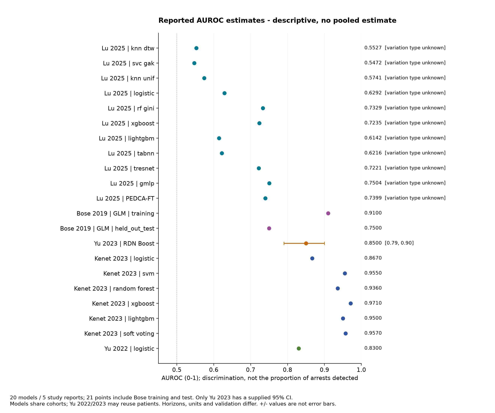

# Paediatric cardiac arrest prediction: reproducible evidence synthesis

**Completed analysis of the supplied systematic-review extraction.** Five study reports and 20 models remain after agreed exclusions. Neither inferential meta-analysis is statistically defensible from the available evidence. No pooled estimates have been invented.

| Result | Finding |
| --- | --- |
| Original extraction | 6 reports, 26 populated model entries, 1 cross-reference (not a blank row) |
| Working cohort | 5 reports, 20 models; 4 conservative potential cohort groups |
| AUROC | 21 numerical evaluations (Bose training/test separate); only 1 genuine 95% CI |
| Complete diagnostic tables | 7 dependent model tables from 2 sources; 0 confirmed eligible independent patient-level tables |
| Strict protocol | 0 reports demonstrate all criteria from supplied evidence; no external-validation waiver presumed |
| Inference | Both planned pooling workflows fail evidence eligibility; descriptive synthesis completed |

The team-agreed general-PICU scope is exploratory. The registered review specifies cardiac ICU and external validation. Kenet also includes 38 adults. Two Dallas publications may reuse patients. QUADAS-2 and adapted GRADE require independent reviewer completion. This repository does not claim a new comprehensive search, independently verified full-text extraction, or completed dual-reviewer review.

Read the [complete statistical report](reports/final_analysis_report.md), [plain-English summary](reports/plain_english_summary.md), and [protocol discrepancies](reports/protocol_deviations.md). Styled HTML versions are included beside Markdown; open `reports/final_analysis_report.html` locally for readable tables and embedded figure links.



## Reproduce from public curated aggregate data

Tested with Python 3.14.7 on macOS; code requires Python >=3.11, and dependency wheels must be available for the chosen interpreter. Exact versions used are pinned in `requirements.txt`; the full installed environment is recorded separately.

```bash
git clone https://github.com/Jyozaa/PAED.git
cd PAED
python3 -m venv .venv
.venv/bin/python -m pip install -r requirements.txt
make all
make verify
```

`make all` runs the complete pipeline, numerical/completeness checks and automated tests. End-to-end tests rebuild all outputs twice in isolated temporary directories and require identical result, figure and report hashes. Tests do not recursively invoke themselves. Timestamps, test durations and Git metadata in the run manifest are intentionally run-specific.

To run without Make:

```bash
.venv/bin/python scripts/run_pipeline.py --run-tests
.venv/bin/python -m pytest -q
.venv/bin/python scripts/verify_outputs.py
```

No R installation is needed to reproduce the current no-pooling findings. The Python workflows evaluate the evidence gates, and the output datasets and reports explain exactly why no inferential optimizer should run. `scripts/meta_analysis.R` provides conditional established-package fitting using `metafor` and `mada`; it exits without fitting on current data. Its fitting paths have not been executed/validated as current study results. Future eligibility changes require expert review, new verified uncertainty/unit/selection evidence, and validation of those paths; toggling flags is not a scientific remedy.

If R is available, the current early-exit can be checked with:

```bash
Rscript scripts/meta_analysis.R .
```

For future scientifically eligible data only, package installation is `Rscript -e 'install.packages(c("metafor", "mada"), repos="https://cloud.r-project.org")'`. The script uses a guarded logit-AUROC REML fit with a modified Hartung-Knapp interval and a guarded bivariate Reitsma REML fit for independent interior proportions. It refuses sparse zero-cell data requiring a validated binomial HSROC approach. These routes are not substitutes for obtaining missing study evidence.

## Reproduce the original-source ingestion audit

Three original files were supplied and read in full locally:

- `Data extraction paeds cardiac arrest SR progress 5.xlsx - Sheet1.csv`
- `List of Variables.pdf` (3 pages)
- `PROSPERO.pdf` (7 pages; CRD420251241478 version 3.0)

They are **not committed**. Place them anywhere beneath a local source directory, preserving their basenames, then run:

```bash
.venv/bin/python scripts/run_pipeline.py --input-dir /path/to/local/sources --run-tests
make verify
```

When originals are in the repository root, `make raw` runs the same ingestion. Discovery is recursive and rejects duplicate matching filenames. Both CSV headers are preserved as metadata; logical record numbers and physical multiline line spans are retained. Original metrics are preserved in allowed aggregate fields. Private correspondence-derived text and unpublished free-text notes are withheld; the public run does not recreate them.

Public curated mode reproduces the numerical tables, evidence gates, descriptive figures and reports. It **cannot independently verify fidelity to originals or recover private details**. `source_provenance.json` records original-file hashes and page counts; `raw_sources_verified_this_run` distinguishes an actual original-source run from public-only reproduction. The manifest source Git SHA refers to the source revision available during execution and cannot be the future hash of a commit containing that manifest.

## Repository contents

- `config/analysis.json`: selection hierarchy, exclusions, evidence gates and tolerances.
- `config/study_context.json`: analyst-curated aggregate context and evidence provenance.
- `config/source_schema.json`: exact two-row source headers and standardized mappings.
- `data/curated/`: minimum necessary aggregate inputs, cell-state audit and source hashes.
- `src/paed/`: ingestion, cleaning, feasibility, figures, reporting and orchestration.
- `scripts/`: one-command runner, independent output verifier and conditional R models.
- `tests/`: parsing, missingness, exclusions, 2x2 arithmetic, rounding, overlap, window-clustering and reproducibility tests.
- `results/`: cleaned models, all source inventories, AUROC/diagnostic datasets, tables, logs, comparability and review worksheets.
- `figures/`: six descriptive plots, each as PNG and SVG; [captions](reports/figure_captions.md) explain units and limitations.
- `reports/`: complete statistical report, feasibility assessments, formatted tables, protocol/bias/certainty documentation, audit and validation.
- `run_manifest.json`: counts, hashes, versions, methods, tests, warnings and source revision.

## Interpretation boundaries

AUROC is ranking discrimination, not arrest detection sensitivity. Six Kenet confusion matrices count repeated five-minute windows from 229 test patients with five CA patients; 211 positive windows are not 211 independent arrests. Yu 2023's representative matrix has unresolved model/threshold/horizon/unit linkage. Lu's +/- variation is not assumed to be SE/CI, and three operating points are graph-read. No naive binomial CIs, reconstructed confusion tables, dependent-model pooling, automatic best-AUROC selection, or formal software-assigned bias/certainty judgements are used.

Study characteristics and metrics derive from the supplied extraction, not independent full-text re-extraction. Review-team questions are listed in the final report. The data cannot establish calibration, alarm burden per patient-day, patient-level missed arrests or readiness for deployment.

## Public-data and publication policy

Only code, sanitized aggregate extraction facts, generated reports/figures and provenance hashes are published. Original PDFs/CSV, extracted local PDF text, correspondence, unpublished narrative notes and credentials are ignored. Dataset decision logs identify exclusions and withheld fields without copying private contents. The `scripts/check_publication.py --staged` check reviews staged files for accidental raw files, private material and credential patterns. Metrics remain attributable to original study DOIs in the inventory. Publication was explicitly authorized for this repository.
