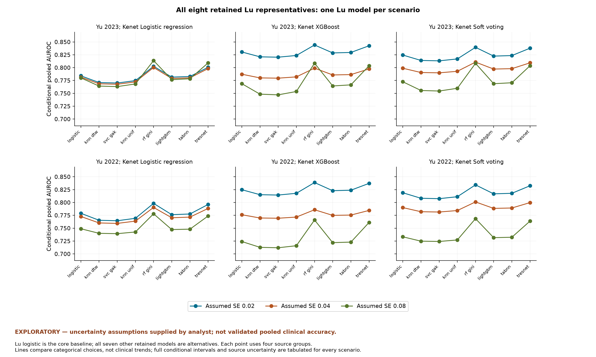

# Revised exploratory AUROC meta-analysis

This eligibility revision wholly excludes Lu 2025 XGBoost, gMLP and PEDCA-FT because their sensitivity/specificity was graphically extracted and considered insufficiently reliable. Their AUROCs are excluded with the entries; this does not assert that those AUROCs were graphical. The revised extraction retains five reports and 17 models, including eight Lu models. Other Lu models remain eligible despite missing operating points. Only the supplied sources and existing derivatives are used. Original source hashes are unchanged and no new papers, clinical data or correspondence were obtained. Confirmatory pooling remains unsupported; every pooled number here is explicitly conditional on analyst assumptions.

**18/18 core scenarios** and **126/126 additional Lu-choice scenarios** produced accepted conditional estimates. Core pooled range: **0.724073-0.830502**. Across all retained Lu choices: **0.711952-0.844093**. Ranges are scenario spread, not confidence intervals.

EXPLORATORY — uncertainty assumptions supplied by analyst; not validated pooled clinical accuracy.

Hypothetical missing SEs; four source groups assumed independent; heterogeneous tools, horizons, units and internal validation; not validated clinical accuracy. No excluded Lu model contributes an AUROC or uncertainty value. The following tables identify all four source reports/models and their individual points. The source/SE/weight ledger contains 576 rows with provenance, genuine versus assumed SEs and conditional limits.

## Core scenarios: Lu logistic regression

| scenario | family | Lu 2025 | Bose 2019 | Dallas | Kenet 2023 | assumed SE | conditional pooled AUROC [95%] | estimated logit tau2 | status |
| --- | --- | --- | --- | --- | --- | --- | --- | --- | --- |
| A_2023_logistic_SE02 | core_lu_logistic | logistic (0.6292) | glm (0.7500) held-out | rdn boost (0.8500) yu 2023 | logistic (0.8670) | 0.02 | 0.7841 [0.5740, 0.9073] | 0.364444 | checked fallback; success_conditional |
| A_2023_logistic_SE04 | core_lu_logistic | logistic (0.6292) | glm (0.7500) held-out | rdn boost (0.8500) yu 2023 | logistic (0.8670) | 0.04 | 0.7815 [0.5708, 0.9059] | 0.328384 | success_conditional |
| A_2023_logistic_SE08 | core_lu_logistic | logistic (0.6292) | glm (0.7500) held-out | rdn boost (0.8500) yu 2023 | logistic (0.8670) | 0.08 | 0.7802 [0.5707, 0.9045] | 0.222621 | success_conditional |
| A_2023_xgboost_SE02 | core_lu_logistic | logistic (0.6292) | glm (0.7500) held-out | rdn boost (0.8500) yu 2023 | xgboost (0.9710) | 0.02 | 0.8305 [0.4151, 0.9713] | 1.356592 | success_conditional |
| A_2023_xgboost_SE04 | core_lu_logistic | logistic (0.6292) | glm (0.7500) held-out | rdn boost (0.8500) yu 2023 | xgboost (0.9710) | 0.04 | 0.7872 [0.4570, 0.9421] | 0.664931 | checked fallback; success_conditional |
| A_2023_xgboost_SE08 | core_lu_logistic | logistic (0.6292) | glm (0.7500) held-out | rdn boost (0.8500) yu 2023 | xgboost (0.9710) | 0.08 | 0.7688 [0.5359, 0.9055] | 0.228276 | success_conditional |
| A_2023_soft_voting_SE02 | core_lu_logistic | logistic (0.6292) | glm (0.7500) held-out | rdn boost (0.8500) yu 2023 | soft voting (0.9570) | 0.02 | 0.8245 [0.4599, 0.9629] | 1.082998 | success_conditional |
| A_2023_soft_voting_SE04 | core_lu_logistic | logistic (0.6292) | glm (0.7500) held-out | rdn boost (0.8500) yu 2023 | soft voting (0.9570) | 0.04 | 0.7989 [0.4701, 0.9468] | 0.725970 | success_conditional |
| A_2023_soft_voting_SE08 | core_lu_logistic | logistic (0.6292) | glm (0.7500) held-out | rdn boost (0.8500) yu 2023 | soft voting (0.9570) | 0.08 | 0.7726 [0.5291, 0.9112] | 0.265004 | success_conditional |
| A_2022_logistic_SE02 | core_lu_logistic | logistic (0.6292) | glm (0.7500) held-out | logistic (0.8300) yu 2022 | logistic (0.8670) | 0.02 | 0.7790 [0.5794, 0.9002] | 0.331549 | success_conditional |
| A_2022_logistic_SE04 | core_lu_logistic | logistic (0.6292) | glm (0.7500) held-out | logistic (0.8300) yu 2022 | logistic (0.8670) | 0.04 | 0.7728 [0.5705, 0.8970] | 0.283537 | success_conditional |
| A_2022_logistic_SE08 | core_lu_logistic | logistic (0.6292) | glm (0.7500) held-out | logistic (0.8300) yu 2022 | logistic (0.8670) | 0.08 | 0.7490 [0.5420, 0.8826] | 0.109427 | success_conditional |
| A_2022_xgboost_SE02 | core_lu_logistic | logistic (0.6292) | glm (0.7500) held-out | logistic (0.8300) yu 2022 | xgboost (0.9710) | 0.02 | 0.8248 [0.4085, 0.9698] | 1.345908 | success_conditional |
| A_2022_xgboost_SE04 | core_lu_logistic | logistic (0.6292) | glm (0.7500) held-out | logistic (0.8300) yu 2022 | xgboost (0.9710) | 0.04 | 0.7762 [0.4570, 0.9346] | 0.591660 | success_conditional |
| A_2022_xgboost_SE08 | core_lu_logistic | logistic (0.6292) | glm (0.7500) held-out | logistic (0.8300) yu 2022 | xgboost (0.9710) | 0.08 | 0.7241 [0.5188, 0.8646] | 0.054869 | success_conditional |
| A_2022_soft_voting_SE02 | core_lu_logistic | logistic (0.6292) | glm (0.7500) held-out | logistic (0.8300) yu 2022 | soft voting (0.9570) | 0.02 | 0.8189 [0.4545, 0.9609] | 1.068863 | success_conditional |
| A_2022_soft_voting_SE04 | core_lu_logistic | logistic (0.6292) | glm (0.7500) held-out | logistic (0.8300) yu 2022 | soft voting (0.9570) | 0.04 | 0.7901 [0.4653, 0.9421] | 0.679387 | success_conditional |
| A_2022_soft_voting_SE08 | core_lu_logistic | logistic (0.6292) | glm (0.7500) held-out | logistic (0.8300) yu 2022 | soft voting (0.9570) | 0.08 | 0.7333 [0.5100, 0.8790] | 0.100997 | success_conditional |

## All other retained Lu representatives

| lu_model_id | individual_auroc | scenario_count | pooled_min | pooled_max | max_absolute_change_from_matched_lu_logistic |
| --- | --- | --- | --- | --- | --- |
| lu_2025_logistic | 0.6292 | 18 | 0.7240731071621067 | 0.8305023589110181 | 0.0 |
| lu_2025_knn_dtw | 0.5527000000000001 | 18 | 0.7127655421224767 | 0.8210303676945517 | 0.020428806993685877 |
| lu_2025_svc_gak | 0.5472 | 18 | 0.7119517745376744 | 0.820346029449468 | 0.021728795179537075 |
| lu_2025_knn_unif | 0.5740999999999999 | 18 | 0.7159313582816196 | 0.8236824921328535 | 0.015193310238810875 |
| lu_2025_rf_gini | 0.7329000000000001 | 18 | 0.7659480078673743 | 0.8440928251643599 | 0.04187490070526756 |
| lu_2025_lightgbm | 0.6142 | 18 | 0.7218597124098084 | 0.8286391697187089 | 0.0044322806190745245 |
| lu_2025_tabnn | 0.6215999999999999 | 18 | 0.7229521528741276 | 0.8295571084633281 | 0.002277697844302984 |
| lu_2025_tresnet | 0.7221 | 18 | 0.7611830589808515 | 0.8425747545892683 | 0.03710995181874477 |

The range for each Lu choice covers its 18 configurations, not the uncertainty interval of a single fit. Differences relative to matched logistic scenarios change only the Lu representative.

| scenario | family | Lu 2025 | Bose 2019 | Dallas | Kenet 2023 | assumed SE | conditional pooled AUROC [95%] | estimated logit tau2 | status |
| --- | --- | --- | --- | --- | --- | --- | --- | --- | --- |
| A_LU_knn_dtw_2023_logistic_SE02 | alternative_lu_model | knn dtw (0.5527) | glm (0.7500) held-out | rdn boost (0.8500) yu 2023 | logistic (0.8670) | 0.02 | 0.7711 [0.5005, 0.9188] | 0.556399 | success_conditional |
| A_LU_knn_dtw_2023_logistic_SE04 | alternative_lu_model | knn dtw (0.5527) | glm (0.7500) held-out | rdn boost (0.8500) yu 2023 | logistic (0.8670) | 0.04 | 0.7686 [0.4967, 0.9179] | 0.523726 | success_conditional |
| A_LU_knn_dtw_2023_logistic_SE08 | alternative_lu_model | knn dtw (0.5527) | glm (0.7500) held-out | rdn boost (0.8500) yu 2023 | logistic (0.8670) | 0.08 | 0.7642 [0.4895, 0.9163] | 0.417923 | success_conditional |
| A_LU_knn_dtw_2023_xgboost_SE02 | alternative_lu_model | knn dtw (0.5527) | glm (0.7500) held-out | rdn boost (0.8500) yu 2023 | xgboost (0.9710) | 0.02 | 0.8210 [0.3550, 0.9745] | 1.654759 | success_conditional |
| A_LU_knn_dtw_2023_xgboost_SE04 | alternative_lu_model | knn dtw (0.5527) | glm (0.7500) held-out | rdn boost (0.8500) yu 2023 | xgboost (0.9710) | 0.04 | 0.7801 [0.3765, 0.9542] | 0.994343 | success_conditional |
| A_LU_knn_dtw_2023_xgboost_SE08 | alternative_lu_model | knn dtw (0.5527) | glm (0.7500) held-out | rdn boost (0.8500) yu 2023 | xgboost (0.9710) | 0.08 | 0.7484 [0.4398, 0.9185] | 0.429812 | success_conditional |
| A_LU_knn_dtw_2023_soft_voting_SE02 | alternative_lu_model | knn dtw (0.5527) | glm (0.7500) held-out | rdn boost (0.8500) yu 2023 | soft voting (0.9570) | 0.02 | 0.8140 [0.3966, 0.9668] | 1.349491 | success_conditional |
| A_LU_knn_dtw_2023_soft_voting_SE04 | alternative_lu_model | knn dtw (0.5527) | glm (0.7500) held-out | rdn boost (0.8500) yu 2023 | soft voting (0.9570) | 0.04 | 0.7905 [0.3982, 0.9556] | 1.019120 | success_conditional |
| A_LU_knn_dtw_2023_soft_voting_SE08 | alternative_lu_model | knn dtw (0.5527) | glm (0.7500) held-out | rdn boost (0.8500) yu 2023 | soft voting (0.9570) | 0.08 | 0.7556 [0.4349, 0.9255] | 0.492266 | success_conditional |
| A_LU_knn_dtw_2022_logistic_SE02 | alternative_lu_model | knn dtw (0.5527) | glm (0.7500) held-out | logistic (0.8300) yu 2022 | logistic (0.8670) | 0.02 | 0.7655 [0.5054, 0.9125] | 0.515625 | success_conditional |
| A_LU_knn_dtw_2022_logistic_SE04 | alternative_lu_model | knn dtw (0.5527) | glm (0.7500) held-out | logistic (0.8300) yu 2022 | logistic (0.8670) | 0.04 | 0.7602 [0.4966, 0.9106] | 0.472503 | success_conditional |
| A_LU_knn_dtw_2022_logistic_SE08 | alternative_lu_model | knn dtw (0.5527) | glm (0.7500) held-out | logistic (0.8300) yu 2022 | logistic (0.8670) | 0.08 | 0.7400 [0.4663, 0.9027] | 0.312297 | success_conditional |
| A_LU_knn_dtw_2022_xgboost_SE02 | alternative_lu_model | knn dtw (0.5527) | glm (0.7500) held-out | logistic (0.8300) yu 2022 | xgboost (0.9710) | 0.02 | 0.8152 [0.3495, 0.9731] | 1.637091 | checked fallback; success_conditional |
| A_LU_knn_dtw_2022_xgboost_SE04 | alternative_lu_model | knn dtw (0.5527) | glm (0.7500) held-out | logistic (0.8300) yu 2022 | xgboost (0.9710) | 0.04 | 0.7698 [0.3741, 0.9493] | 0.925160 | success_conditional |
| A_LU_knn_dtw_2022_xgboost_SE08 | alternative_lu_model | knn dtw (0.5527) | glm (0.7500) held-out | logistic (0.8300) yu 2022 | xgboost (0.9710) | 0.08 | 0.7128 [0.4227, 0.8937] | 0.262850 | success_conditional |
| A_LU_knn_dtw_2022_soft_voting_SE02 | alternative_lu_model | knn dtw (0.5527) | glm (0.7500) held-out | logistic (0.8300) yu 2022 | soft voting (0.9570) | 0.02 | 0.8082 [0.3922, 0.9649] | 1.328316 | checked fallback; success_conditional |
| A_LU_knn_dtw_2022_soft_voting_SE04 | alternative_lu_model | knn dtw (0.5527) | glm (0.7500) held-out | logistic (0.8300) yu 2022 | soft voting (0.9570) | 0.04 | 0.7821 [0.3934, 0.9521] | 0.970924 | success_conditional |
| A_LU_knn_dtw_2022_soft_voting_SE08 | alternative_lu_model | knn dtw (0.5527) | glm (0.7500) held-out | logistic (0.8300) yu 2022 | soft voting (0.9570) | 0.08 | 0.7248 [0.4157, 0.9070] | 0.340510 | success_conditional |
| A_LU_svc_gak_2023_logistic_SE02 | alternative_lu_model | svc gak (0.5472) | glm (0.7500) held-out | rdn boost (0.8500) yu 2023 | logistic (0.8670) | 0.02 | 0.7701 [0.4952, 0.9196] | 0.571705 | success_conditional |
| A_LU_svc_gak_2023_logistic_SE04 | alternative_lu_model | svc gak (0.5472) | glm (0.7500) held-out | rdn boost (0.8500) yu 2023 | logistic (0.8670) | 0.04 | 0.7677 [0.4914, 0.9188] | 0.539204 | success_conditional |
| A_LU_svc_gak_2023_logistic_SE08 | alternative_lu_model | svc gak (0.5472) | glm (0.7500) held-out | rdn boost (0.8500) yu 2023 | logistic (0.8670) | 0.08 | 0.7631 [0.4839, 0.9171] | 0.433376 | checked fallback; success_conditional |
| A_LU_svc_gak_2023_xgboost_SE02 | alternative_lu_model | svc gak (0.5472) | glm (0.7500) held-out | rdn boost (0.8500) yu 2023 | xgboost (0.9710) | 0.02 | 0.8203 [0.3508, 0.9747] | 1.677515 | success_conditional |
| A_LU_svc_gak_2023_xgboost_SE04 | alternative_lu_model | svc gak (0.5472) | glm (0.7500) held-out | rdn boost (0.8500) yu 2023 | xgboost (0.9710) | 0.04 | 0.7795 [0.3712, 0.9549] | 1.019350 | success_conditional |
| A_LU_svc_gak_2023_xgboost_SE08 | alternative_lu_model | svc gak (0.5472) | glm (0.7500) held-out | rdn boost (0.8500) yu 2023 | xgboost (0.9710) | 0.08 | 0.7471 [0.4333, 0.9194] | 0.446159 | success_conditional |
| A_LU_svc_gak_2023_soft_voting_SE02 | alternative_lu_model | svc gak (0.5472) | glm (0.7500) held-out | rdn boost (0.8500) yu 2023 | soft voting (0.9570) | 0.02 | 0.8133 [0.3921, 0.9671] | 1.370015 | success_conditional |
| A_LU_svc_gak_2023_soft_voting_SE04 | alternative_lu_model | svc gak (0.5472) | glm (0.7500) held-out | rdn boost (0.8500) yu 2023 | soft voting (0.9570) | 0.04 | 0.7899 [0.3933, 0.9562] | 1.041394 | success_conditional |
| A_LU_svc_gak_2023_soft_voting_SE08 | alternative_lu_model | svc gak (0.5472) | glm (0.7500) held-out | rdn boost (0.8500) yu 2023 | soft voting (0.9570) | 0.08 | 0.7545 [0.4285, 0.9265] | 0.510564 | success_conditional |
| A_LU_svc_gak_2022_logistic_SE02 | alternative_lu_model | svc gak (0.5472) | glm (0.7500) held-out | logistic (0.8300) yu 2022 | logistic (0.8670) | 0.02 | 0.7645 [0.5001, 0.9133] | 0.530376 | success_conditional |
| A_LU_svc_gak_2022_logistic_SE04 | alternative_lu_model | svc gak (0.5472) | glm (0.7500) held-out | logistic (0.8300) yu 2022 | logistic (0.8670) | 0.04 | 0.7593 [0.4913, 0.9115] | 0.487509 | checked fallback; success_conditional |
| A_LU_svc_gak_2022_logistic_SE08 | alternative_lu_model | svc gak (0.5472) | glm (0.7500) held-out | logistic (0.8300) yu 2022 | logistic (0.8670) | 0.08 | 0.7394 [0.4611, 0.9039] | 0.327986 | success_conditional |
| A_LU_svc_gak_2022_xgboost_SE02 | alternative_lu_model | svc gak (0.5472) | glm (0.7500) held-out | logistic (0.8300) yu 2022 | xgboost (0.9710) | 0.02 | 0.8145 [0.3454, 0.9734] | 1.659370 | success_conditional |
| A_LU_svc_gak_2022_xgboost_SE04 | alternative_lu_model | svc gak (0.5472) | glm (0.7500) held-out | logistic (0.8300) yu 2022 | xgboost (0.9710) | 0.04 | 0.7694 [0.3687, 0.9501] | 0.950324 | success_conditional |
| A_LU_svc_gak_2022_xgboost_SE08 | alternative_lu_model | svc gak (0.5472) | glm (0.7500) held-out | logistic (0.8300) yu 2022 | xgboost (0.9710) | 0.08 | 0.7120 [0.4163, 0.8955] | 0.279478 | success_conditional |
| A_LU_svc_gak_2022_soft_voting_SE02 | alternative_lu_model | svc gak (0.5472) | glm (0.7500) held-out | logistic (0.8300) yu 2022 | soft voting (0.9570) | 0.02 | 0.8074 [0.3878, 0.9652] | 1.348352 | success_conditional |
| A_LU_svc_gak_2022_soft_voting_SE04 | alternative_lu_model | svc gak (0.5472) | glm (0.7500) held-out | logistic (0.8300) yu 2022 | soft voting (0.9570) | 0.04 | 0.7815 [0.3885, 0.9527] | 0.993021 | success_conditional |
| A_LU_svc_gak_2022_soft_voting_SE08 | alternative_lu_model | svc gak (0.5472) | glm (0.7500) held-out | logistic (0.8300) yu 2022 | soft voting (0.9570) | 0.08 | 0.7242 [0.4095, 0.9086] | 0.359472 | success_conditional |
| A_LU_knn_unif_2023_logistic_SE02 | alternative_lu_model | knn unif (0.5741) | glm (0.7500) held-out | rdn boost (0.8500) yu 2023 | logistic (0.8670) | 0.02 | 0.7747 [0.5212, 0.9157] | 0.498805 | success_conditional |
| A_LU_knn_unif_2023_logistic_SE04 | alternative_lu_model | knn unif (0.5741) | glm (0.7500) held-out | rdn boost (0.8500) yu 2023 | logistic (0.8670) | 0.04 | 0.7722 [0.5174, 0.9147] | 0.465380 | success_conditional |
| A_LU_knn_unif_2023_logistic_SE08 | alternative_lu_model | knn unif (0.5741) | glm (0.7500) held-out | rdn boost (0.8500) yu 2023 | logistic (0.8670) | 0.08 | 0.7683 [0.5115, 0.9130] | 0.359605 | success_conditional |
| A_LU_knn_unif_2023_xgboost_SE02 | alternative_lu_model | knn unif (0.5741) | glm (0.7500) held-out | rdn boost (0.8500) yu 2023 | xgboost (0.9710) | 0.02 | 0.8237 [0.3714, 0.9736] | 1.567988 | success_conditional |
| A_LU_knn_unif_2023_xgboost_SE04 | alternative_lu_model | knn unif (0.5741) | glm (0.7500) held-out | rdn boost (0.8500) yu 2023 | xgboost (0.9710) | 0.04 | 0.7821 [0.3978, 0.9512] | 0.898772 | success_conditional |
| A_LU_knn_unif_2023_xgboost_SE08 | alternative_lu_model | knn unif (0.5741) | glm (0.7500) held-out | rdn boost (0.8500) yu 2023 | xgboost (0.9710) | 0.08 | 0.7536 [0.4658, 0.9148] | 0.368614 | success_conditional |
| A_LU_knn_unif_2023_soft_voting_SE02 | alternative_lu_model | knn unif (0.5741) | glm (0.7500) held-out | rdn boost (0.8500) yu 2023 | soft voting (0.9570) | 0.02 | 0.8170 [0.4141, 0.9657] | 1.271450 | success_conditional |
| A_LU_knn_unif_2023_soft_voting_SE04 | alternative_lu_model | knn unif (0.5741) | glm (0.7500) held-out | rdn boost (0.8500) yu 2023 | soft voting (0.9570) | 0.04 | 0.7929 [0.4177, 0.9534] | 0.934065 | success_conditional |
| A_LU_knn_unif_2023_soft_voting_SE08 | alternative_lu_model | knn unif (0.5741) | glm (0.7500) held-out | rdn boost (0.8500) yu 2023 | soft voting (0.9570) | 0.08 | 0.7598 [0.4602, 0.9215] | 0.423566 | success_conditional |
| A_LU_knn_unif_2022_logistic_SE02 | alternative_lu_model | knn unif (0.5741) | glm (0.7500) held-out | logistic (0.8300) yu 2022 | logistic (0.8670) | 0.02 | 0.7692 [0.5262, 0.9091] | 0.460205 | success_conditional |
| A_LU_knn_unif_2022_logistic_SE04 | alternative_lu_model | knn unif (0.5741) | glm (0.7500) held-out | logistic (0.8300) yu 2022 | logistic (0.8670) | 0.04 | 0.7638 [0.5173, 0.9070] | 0.415979 | success_conditional |
| A_LU_knn_unif_2022_logistic_SE08 | alternative_lu_model | knn unif (0.5741) | glm (0.7500) held-out | logistic (0.8300) yu 2022 | logistic (0.8670) | 0.08 | 0.7426 [0.4868, 0.8977] | 0.252750 | success_conditional |
| A_LU_knn_unif_2022_xgboost_SE02 | alternative_lu_model | knn unif (0.5741) | glm (0.7500) held-out | logistic (0.8300) yu 2022 | xgboost (0.9710) | 0.02 | 0.8179 [0.3657, 0.9722] | 1.552201 | success_conditional |
| A_LU_knn_unif_2022_xgboost_SE04 | alternative_lu_model | knn unif (0.5741) | glm (0.7500) held-out | logistic (0.8300) yu 2022 | xgboost (0.9710) | 0.04 | 0.7717 [0.3959, 0.9457] | 0.828824 | success_conditional |
| A_LU_knn_unif_2022_xgboost_SE08 | alternative_lu_model | knn unif (0.5741) | glm (0.7500) held-out | logistic (0.8300) yu 2022 | xgboost (0.9710) | 0.08 | 0.7159 [0.4483, 0.8866] | 0.200370 | success_conditional |
| A_LU_knn_unif_2022_soft_voting_SE02 | alternative_lu_model | knn unif (0.5741) | glm (0.7500) held-out | logistic (0.8300) yu 2022 | soft voting (0.9570) | 0.02 | 0.8112 [0.4095, 0.9638] | 1.252191 | success_conditional |
| A_LU_knn_unif_2022_soft_voting_SE04 | alternative_lu_model | knn unif (0.5741) | glm (0.7500) held-out | logistic (0.8300) yu 2022 | soft voting (0.9570) | 0.04 | 0.7844 [0.4128, 0.9496] | 0.886486 | success_conditional |
| A_LU_knn_unif_2022_soft_voting_SE08 | alternative_lu_model | knn unif (0.5741) | glm (0.7500) held-out | logistic (0.8300) yu 2022 | soft voting (0.9570) | 0.08 | 0.7271 [0.4406, 0.9002] | 0.268994 | success_conditional |
| A_LU_rf_gini_2023_logistic_SE02 | alternative_lu_model | rf gini (0.7329) | glm (0.7500) held-out | rdn boost (0.8500) yu 2023 | logistic (0.8670) | 0.02 | 0.8027 [0.6691, 0.8911] | 0.168863 | success_conditional |
| A_LU_rf_gini_2023_logistic_SE04 | alternative_lu_model | rf gini (0.7329) | glm (0.7500) held-out | rdn boost (0.8500) yu 2023 | logistic (0.8670) | 0.04 | 0.8003 [0.6691, 0.8882] | 0.125293 | success_conditional |
| A_LU_rf_gini_2023_logistic_SE08 | alternative_lu_model | rf gini (0.7329) | glm (0.7500) held-out | rdn boost (0.8500) yu 2023 | logistic (0.8670) | 0.08 | 0.8138 [0.6983, 0.8919] | 0.026535 | success_conditional |
| A_LU_rf_gini_2023_xgboost_SE02 | alternative_lu_model | rf gini (0.7329) | glm (0.7500) held-out | rdn boost (0.8500) yu 2023 | xgboost (0.9710) | 0.02 | 0.8441 [0.5018, 0.9668] | 1.004597 | success_conditional |
| A_LU_rf_gini_2023_xgboost_SE04 | alternative_lu_model | rf gini (0.7329) | glm (0.7500) held-out | rdn boost (0.8500) yu 2023 | xgboost (0.9710) | 0.04 | 0.7991 [0.5855, 0.9180] | 0.286979 | success_conditional |
| A_LU_rf_gini_2023_xgboost_SE08 | alternative_lu_model | rf gini (0.7329) | glm (0.7500) held-out | rdn boost (0.8500) yu 2023 | xgboost (0.9710) | 0.08 | 0.8086 [0.6799, 0.8937] | 0.035566 | success_conditional |
| A_LU_rf_gini_2023_soft_voting_SE02 | alternative_lu_model | rf gini (0.7329) | glm (0.7500) held-out | rdn boost (0.8500) yu 2023 | soft voting (0.9570) | 0.02 | 0.8395 [0.5481, 0.9576] | 0.776347 | success_conditional |
| A_LU_rf_gini_2023_soft_voting_SE04 | alternative_lu_model | rf gini (0.7329) | glm (0.7500) held-out | rdn boost (0.8500) yu 2023 | soft voting (0.9570) | 0.04 | 0.8108 [0.5783, 0.9305] | 0.380086 | success_conditional |
| A_LU_rf_gini_2023_soft_voting_SE08 | alternative_lu_model | rf gini (0.7329) | glm (0.7500) held-out | rdn boost (0.8500) yu 2023 | soft voting (0.9570) | 0.08 | 0.8084 [0.6731, 0.8963] | 0.046803 | success_conditional |
| A_LU_rf_gini_2022_logistic_SE02 | alternative_lu_model | rf gini (0.7329) | glm (0.7500) held-out | logistic (0.8300) yu 2022 | logistic (0.8670) | 0.02 | 0.7983 [0.6746, 0.8831] | 0.147384 | success_conditional |
| A_LU_rf_gini_2022_logistic_SE04 | alternative_lu_model | rf gini (0.7329) | glm (0.7500) held-out | logistic (0.8300) yu 2022 | logistic (0.8670) | 0.04 | 0.7904 [0.6686, 0.8758] | 0.088291 | success_conditional |
| A_LU_rf_gini_2022_logistic_SE08 | alternative_lu_model | rf gini (0.7329) | glm (0.7500) held-out | logistic (0.8300) yu 2022 | logistic (0.8670) | 0.08 | 0.7780 [0.6165, 0.8843] | 0.000000 | boundary; success_conditional |
| A_LU_rf_gini_2022_xgboost_SE02 | alternative_lu_model | rf gini (0.7329) | glm (0.7500) held-out | logistic (0.8300) yu 2022 | xgboost (0.9710) | 0.02 | 0.8388 [0.4932, 0.9653] | 1.005815 | checked fallback; success_conditional |
| A_LU_rf_gini_2022_xgboost_SE04 | alternative_lu_model | rf gini (0.7329) | glm (0.7500) held-out | logistic (0.8300) yu 2022 | xgboost (0.9710) | 0.04 | 0.7859 [0.5953, 0.9015] | 0.202374 | success_conditional |
| A_LU_rf_gini_2022_xgboost_SE08 | alternative_lu_model | rf gini (0.7329) | glm (0.7500) held-out | logistic (0.8300) yu 2022 | xgboost (0.9710) | 0.08 | 0.7659 [0.5881, 0.8824] | 0.000000 | boundary; success_conditional |
| A_LU_rf_gini_2022_soft_voting_SE02 | alternative_lu_model | rf gini (0.7329) | glm (0.7500) held-out | logistic (0.8300) yu 2022 | soft voting (0.9570) | 0.02 | 0.8343 [0.5408, 0.9556] | 0.773612 | success_conditional |
| A_LU_rf_gini_2022_soft_voting_SE04 | alternative_lu_model | rf gini (0.7329) | glm (0.7500) held-out | logistic (0.8300) yu 2022 | soft voting (0.9570) | 0.04 | 0.8011 [0.5751, 0.9230] | 0.332634 | success_conditional |
| A_LU_rf_gini_2022_soft_voting_SE08 | alternative_lu_model | rf gini (0.7329) | glm (0.7500) held-out | logistic (0.8300) yu 2022 | soft voting (0.9570) | 0.08 | 0.7686 [0.5926, 0.8835] | 0.000000 | boundary; success_conditional |
| A_LU_lightgbm_2023_logistic_SE02 | alternative_lu_model | lightgbm (0.6142) | glm (0.7500) held-out | rdn boost (0.8500) yu 2023 | logistic (0.8670) | 0.02 | 0.7816 [0.5597, 0.9097] | 0.399058 | success_conditional |
| A_LU_lightgbm_2023_logistic_SE04 | alternative_lu_model | lightgbm (0.6142) | glm (0.7500) held-out | rdn boost (0.8500) yu 2023 | logistic (0.8670) | 0.04 | 0.7790 [0.5562, 0.9083] | 0.363820 | success_conditional |
| A_LU_lightgbm_2023_logistic_SE08 | alternative_lu_model | lightgbm (0.6142) | glm (0.7500) held-out | rdn boost (0.8500) yu 2023 | logistic (0.8670) | 0.08 | 0.7767 [0.5542, 0.9068] | 0.258005 | success_conditional |
| A_LU_lightgbm_2023_xgboost_SE02 | alternative_lu_model | lightgbm (0.6142) | glm (0.7500) held-out | rdn boost (0.8500) yu 2023 | xgboost (0.9710) | 0.02 | 0.8286 [0.4030, 0.9719] | 1.412501 | success_conditional |
| A_LU_lightgbm_2023_xgboost_SE04 | alternative_lu_model | lightgbm (0.6142) | glm (0.7500) held-out | rdn boost (0.8500) yu 2023 | xgboost (0.9710) | 0.04 | 0.7858 [0.4403, 0.9448] | 0.726842 | checked fallback; success_conditional |
| A_LU_lightgbm_2023_xgboost_SE08 | alternative_lu_model | lightgbm (0.6142) | glm (0.7500) held-out | rdn boost (0.8500) yu 2023 | xgboost (0.9710) | 0.08 | 0.7644 [0.5163, 0.9079] | 0.264033 | success_conditional |
| A_LU_lightgbm_2023_soft_voting_SE02 | alternative_lu_model | lightgbm (0.6142) | glm (0.7500) held-out | rdn boost (0.8500) yu 2023 | soft voting (0.9570) | 0.02 | 0.8225 [0.4474, 0.9637] | 1.132585 | success_conditional |
| A_LU_lightgbm_2023_soft_voting_SE04 | alternative_lu_model | lightgbm (0.6142) | glm (0.7500) held-out | rdn boost (0.8500) yu 2023 | soft voting (0.9570) | 0.04 | 0.7973 [0.4555, 0.9487] | 0.781129 | success_conditional |
| A_LU_lightgbm_2023_soft_voting_SE08 | alternative_lu_model | lightgbm (0.6142) | glm (0.7500) held-out | rdn boost (0.8500) yu 2023 | soft voting (0.9570) | 0.08 | 0.7688 [0.5098, 0.9140] | 0.305517 | success_conditional |
| A_LU_lightgbm_2022_logistic_SE02 | alternative_lu_model | lightgbm (0.6142) | glm (0.7500) held-out | logistic (0.8300) yu 2022 | logistic (0.8670) | 0.02 | 0.7763 [0.5650, 0.9027] | 0.364590 | success_conditional |
| A_LU_lightgbm_2022_logistic_SE04 | alternative_lu_model | lightgbm (0.6142) | glm (0.7500) held-out | logistic (0.8300) yu 2022 | logistic (0.8670) | 0.04 | 0.7703 [0.5560, 0.8998] | 0.317757 | checked fallback; success_conditional |
| A_LU_lightgbm_2022_logistic_SE08 | alternative_lu_model | lightgbm (0.6142) | glm (0.7500) held-out | logistic (0.8300) yu 2022 | logistic (0.8670) | 0.08 | 0.7473 [0.5266, 0.8872] | 0.147113 | success_conditional |
| A_LU_lightgbm_2022_xgboost_SE02 | alternative_lu_model | lightgbm (0.6142) | glm (0.7500) held-out | logistic (0.8300) yu 2022 | xgboost (0.9710) | 0.02 | 0.8229 [0.3967, 0.9705] | 1.400379 | success_conditional |
| A_LU_lightgbm_2022_xgboost_SE04 | alternative_lu_model | lightgbm (0.6142) | glm (0.7500) held-out | logistic (0.8300) yu 2022 | xgboost (0.9710) | 0.04 | 0.7749 [0.4395, 0.9380] | 0.654695 | success_conditional |
| A_LU_lightgbm_2022_xgboost_SE08 | alternative_lu_model | lightgbm (0.6142) | glm (0.7500) held-out | logistic (0.8300) yu 2022 | xgboost (0.9710) | 0.08 | 0.7219 [0.4989, 0.8712] | 0.092366 | success_conditional |
| A_LU_lightgbm_2022_soft_voting_SE02 | alternative_lu_model | lightgbm (0.6142) | glm (0.7500) held-out | logistic (0.8300) yu 2022 | soft voting (0.9570) | 0.02 | 0.8168 [0.4422, 0.9617] | 1.117019 | success_conditional |
| A_LU_lightgbm_2022_soft_voting_SE04 | alternative_lu_model | lightgbm (0.6142) | glm (0.7500) held-out | logistic (0.8300) yu 2022 | soft voting (0.9570) | 0.04 | 0.7885 [0.4506, 0.9443] | 0.734371 | success_conditional |
| A_LU_lightgbm_2022_soft_voting_SE08 | alternative_lu_model | lightgbm (0.6142) | glm (0.7500) held-out | logistic (0.8300) yu 2022 | soft voting (0.9570) | 0.08 | 0.7316 [0.4902, 0.8854] | 0.144459 | success_conditional |
| A_LU_tabnn_2023_logistic_SE02 | alternative_lu_model | tabnn (0.6216) | glm (0.7500) held-out | rdn boost (0.8500) yu 2023 | logistic (0.8670) | 0.02 | 0.7828 [0.5668, 0.9085] | 0.381798 | success_conditional |
| A_LU_tabnn_2023_logistic_SE04 | alternative_lu_model | tabnn (0.6216) | glm (0.7500) held-out | rdn boost (0.8500) yu 2023 | logistic (0.8670) | 0.04 | 0.7802 [0.5634, 0.9071] | 0.346165 | success_conditional |
| A_LU_tabnn_2023_logistic_SE08 | alternative_lu_model | tabnn (0.6216) | glm (0.7500) held-out | rdn boost (0.8500) yu 2023 | logistic (0.8670) | 0.08 | 0.7784 [0.5623, 0.9057] | 0.240365 | success_conditional |
| A_LU_tabnn_2023_xgboost_SE02 | alternative_lu_model | tabnn (0.6216) | glm (0.7500) held-out | rdn boost (0.8500) yu 2023 | xgboost (0.9710) | 0.02 | 0.8296 [0.4089, 0.9716] | 1.384769 | success_conditional |
| A_LU_tabnn_2023_xgboost_SE04 | alternative_lu_model | tabnn (0.6216) | glm (0.7500) held-out | rdn boost (0.8500) yu 2023 | xgboost (0.9710) | 0.04 | 0.7865 [0.4485, 0.9435] | 0.696131 | checked fallback; success_conditional |
| A_LU_tabnn_2023_xgboost_SE08 | alternative_lu_model | tabnn (0.6216) | glm (0.7500) held-out | rdn boost (0.8500) yu 2023 | xgboost (0.9710) | 0.08 | 0.7665 [0.5259, 0.9067] | 0.246163 | success_conditional |
| A_LU_tabnn_2023_soft_voting_SE02 | alternative_lu_model | tabnn (0.6216) | glm (0.7500) held-out | rdn boost (0.8500) yu 2023 | soft voting (0.9570) | 0.02 | 0.8235 [0.4536, 0.9633] | 1.107964 | success_conditional |
| A_LU_tabnn_2023_soft_voting_SE04 | alternative_lu_model | tabnn (0.6216) | glm (0.7500) held-out | rdn boost (0.8500) yu 2023 | soft voting (0.9570) | 0.04 | 0.7981 [0.4627, 0.9477] | 0.753780 | success_conditional |
| A_LU_tabnn_2023_soft_voting_SE08 | alternative_lu_model | tabnn (0.6216) | glm (0.7500) held-out | rdn boost (0.8500) yu 2023 | soft voting (0.9570) | 0.08 | 0.7706 [0.5193, 0.9127] | 0.285277 | success_conditional |
| A_LU_tabnn_2022_logistic_SE02 | alternative_lu_model | tabnn (0.6216) | glm (0.7500) held-out | logistic (0.8300) yu 2022 | logistic (0.8670) | 0.02 | 0.7776 [0.5721, 0.9014] | 0.348104 | success_conditional |
| A_LU_tabnn_2022_logistic_SE04 | alternative_lu_model | tabnn (0.6216) | glm (0.7500) held-out | logistic (0.8300) yu 2022 | logistic (0.8670) | 0.04 | 0.7716 [0.5632, 0.8984] | 0.300704 | success_conditional |
| A_LU_tabnn_2022_logistic_SE08 | alternative_lu_model | tabnn (0.6216) | glm (0.7500) held-out | logistic (0.8300) yu 2022 | logistic (0.8670) | 0.08 | 0.7481 [0.5342, 0.8850] | 0.128404 | success_conditional |
| A_LU_tabnn_2022_xgboost_SE02 | alternative_lu_model | tabnn (0.6216) | glm (0.7500) held-out | logistic (0.8300) yu 2022 | xgboost (0.9710) | 0.02 | 0.8239 [0.4025, 0.9701] | 1.373351 | success_conditional |
| A_LU_tabnn_2022_xgboost_SE04 | alternative_lu_model | tabnn (0.6216) | glm (0.7500) held-out | logistic (0.8300) yu 2022 | xgboost (0.9710) | 0.04 | 0.7756 [0.4480, 0.9363] | 0.623452 | success_conditional |
| A_LU_tabnn_2022_xgboost_SE08 | alternative_lu_model | tabnn (0.6216) | glm (0.7500) held-out | logistic (0.8300) yu 2022 | xgboost (0.9710) | 0.08 | 0.7230 [0.5086, 0.8681] | 0.073675 | success_conditional |
| A_LU_tabnn_2022_soft_voting_SE02 | alternative_lu_model | tabnn (0.6216) | glm (0.7500) held-out | logistic (0.8300) yu 2022 | soft voting (0.9570) | 0.02 | 0.8179 [0.4483, 0.9613] | 1.093100 | success_conditional |
| A_LU_tabnn_2022_soft_voting_SE04 | alternative_lu_model | tabnn (0.6216) | glm (0.7500) held-out | logistic (0.8300) yu 2022 | soft voting (0.9570) | 0.04 | 0.7893 [0.4578, 0.9432] | 0.707118 | success_conditional |
| A_LU_tabnn_2022_soft_voting_SE08 | alternative_lu_model | tabnn (0.6216) | glm (0.7500) held-out | logistic (0.8300) yu 2022 | soft voting (0.9570) | 0.08 | 0.7324 [0.4999, 0.8823] | 0.122807 | success_conditional |
| A_LU_tresnet_2023_logistic_SE02 | alternative_lu_model | tresnet (0.7221) | glm (0.7500) held-out | rdn boost (0.8500) yu 2023 | logistic (0.8670) | 0.02 | 0.8007 [0.6598, 0.8927] | 0.185147 | success_conditional |
| A_LU_tresnet_2023_logistic_SE04 | alternative_lu_model | tresnet (0.7221) | glm (0.7500) held-out | rdn boost (0.8500) yu 2023 | logistic (0.8670) | 0.04 | 0.7982 [0.6593, 0.8899] | 0.142376 | success_conditional |
| A_LU_tresnet_2023_logistic_SE08 | alternative_lu_model | tresnet (0.7221) | glm (0.7500) held-out | rdn boost (0.8500) yu 2023 | logistic (0.8670) | 0.08 | 0.8092 [0.6837, 0.8928] | 0.042009 | success_conditional |
| A_LU_tresnet_2023_xgboost_SE02 | alternative_lu_model | tresnet (0.7221) | glm (0.7500) held-out | rdn boost (0.8500) yu 2023 | xgboost (0.9710) | 0.02 | 0.8426 [0.4926, 0.9672] | 1.038061 | success_conditional |
| A_LU_tresnet_2023_xgboost_SE04 | alternative_lu_model | tresnet (0.7221) | glm (0.7500) held-out | rdn boost (0.8500) yu 2023 | xgboost (0.9710) | 0.04 | 0.7975 [0.5716, 0.9208] | 0.320277 | success_conditional |
| A_LU_tresnet_2023_xgboost_SE08 | alternative_lu_model | tresnet (0.7221) | glm (0.7500) held-out | rdn boost (0.8500) yu 2023 | xgboost (0.9710) | 0.08 | 0.8037 [0.6643, 0.8944] | 0.050667 | success_conditional |
| A_LU_tresnet_2023_soft_voting_SE02 | alternative_lu_model | tresnet (0.7221) | glm (0.7500) held-out | rdn boost (0.8500) yu 2023 | soft voting (0.9570) | 0.02 | 0.8379 [0.5389, 0.9581] | 0.804986 | success_conditional |
| A_LU_tresnet_2023_soft_voting_SE04 | alternative_lu_model | tresnet (0.7221) | glm (0.7500) held-out | rdn boost (0.8500) yu 2023 | soft voting (0.9570) | 0.04 | 0.8094 [0.5666, 0.9324] | 0.412199 | success_conditional |
| A_LU_tresnet_2023_soft_voting_SE08 | alternative_lu_model | tresnet (0.7221) | glm (0.7500) held-out | rdn boost (0.8500) yu 2023 | soft voting (0.9570) | 0.08 | 0.8037 [0.6575, 0.8973] | 0.063769 | success_conditional |
| A_LU_tresnet_2022_logistic_SE02 | alternative_lu_model | tresnet (0.7221) | glm (0.7500) held-out | logistic (0.8300) yu 2022 | logistic (0.8670) | 0.02 | 0.7962 [0.6654, 0.8847] | 0.162430 | success_conditional |
| A_LU_tresnet_2022_logistic_SE04 | alternative_lu_model | tresnet (0.7221) | glm (0.7500) held-out | logistic (0.8300) yu 2022 | logistic (0.8670) | 0.04 | 0.7885 [0.6589, 0.8779] | 0.104537 | success_conditional |
| A_LU_tresnet_2022_logistic_SE08 | alternative_lu_model | tresnet (0.7221) | glm (0.7500) held-out | logistic (0.8300) yu 2022 | logistic (0.8670) | 0.08 | 0.7737 [0.6123, 0.8810] | 0.000000 | boundary; success_conditional |
| A_LU_tresnet_2022_xgboost_SE02 | alternative_lu_model | tresnet (0.7221) | glm (0.7500) held-out | logistic (0.8300) yu 2022 | xgboost (0.9710) | 0.02 | 0.8372 [0.4842, 0.9657] | 1.037801 | checked fallback; success_conditional |
| A_LU_tresnet_2022_xgboost_SE04 | alternative_lu_model | tresnet (0.7221) | glm (0.7500) held-out | logistic (0.8300) yu 2022 | xgboost (0.9710) | 0.04 | 0.7846 [0.5799, 0.9057] | 0.236595 | success_conditional |
| A_LU_tresnet_2022_xgboost_SE08 | alternative_lu_model | tresnet (0.7221) | glm (0.7500) held-out | logistic (0.8300) yu 2022 | xgboost (0.9710) | 0.08 | 0.7612 [0.5837, 0.8787] | 0.000000 | boundary; success_conditional |
| A_LU_tresnet_2022_soft_voting_SE02 | alternative_lu_model | tresnet (0.7221) | glm (0.7500) held-out | logistic (0.8300) yu 2022 | soft voting (0.9570) | 0.02 | 0.8326 [0.5319, 0.9561] | 0.800878 | success_conditional |
| A_LU_tresnet_2022_soft_voting_SE04 | alternative_lu_model | tresnet (0.7221) | glm (0.7500) held-out | logistic (0.8300) yu 2022 | soft voting (0.9570) | 0.04 | 0.7998 [0.5632, 0.9253] | 0.364867 | success_conditional |
| A_LU_tresnet_2022_soft_voting_SE08 | alternative_lu_model | tresnet (0.7221) | glm (0.7500) held-out | logistic (0.8300) yu 2022 | soft voting (0.9570) | 0.08 | 0.7638 [0.5882, 0.8799] | 0.000000 | boundary; success_conditional |

## Numerical diagnostics

There are 6 accepted zero-tau² boundaries and 11 cases using the checked same-equation fallback. All initial rejected attempts remain in [fit_attempts.csv](../../results/exploratory/fit_attempts.csv). Every final accepted fit passes the PM root/boundary check. No favourable scenario is selected as the answer.

## Figures

EXPLORATORY — uncertainty assumptions supplied by analyst; not validated pooled clinical accuracy. This figure shows the 18 core scenarios only, with conditional interval shading, mixed horizons/units and four assumed independent groups.

EXPLORATORY — uncertainty assumptions supplied by analyst; not validated pooled clinical accuracy. One Lu representative per point, with all seven alternatives. Lines connect categorical scenario choices, not clinical trends. Full conditional intervals are tabulated above.

All core forests:

- [A_2023_logistic_SE02](../../figures/exploratory/forest_A_2023_logistic_SE02.png) ([SVG](../../figures/exploratory/forest_A_2023_logistic_SE02.svg)); EXPLORATORY — uncertainty assumptions supplied by analyst; not validated pooled clinical accuracy. Hypothetical missing SEs; four source groups assumed independent; heterogeneous tools, horizons, units and internal validation; not validated clinical accuracy.
- [A_2023_logistic_SE04](../../figures/exploratory/forest_A_2023_logistic_SE04.png) ([SVG](../../figures/exploratory/forest_A_2023_logistic_SE04.svg)); EXPLORATORY — uncertainty assumptions supplied by analyst; not validated pooled clinical accuracy. Hypothetical missing SEs; four source groups assumed independent; heterogeneous tools, horizons, units and internal validation; not validated clinical accuracy.
- [A_2023_logistic_SE08](../../figures/exploratory/forest_A_2023_logistic_SE08.png) ([SVG](../../figures/exploratory/forest_A_2023_logistic_SE08.svg)); EXPLORATORY — uncertainty assumptions supplied by analyst; not validated pooled clinical accuracy. Hypothetical missing SEs; four source groups assumed independent; heterogeneous tools, horizons, units and internal validation; not validated clinical accuracy.
- [A_2023_xgboost_SE02](../../figures/exploratory/forest_A_2023_xgboost_SE02.png) ([SVG](../../figures/exploratory/forest_A_2023_xgboost_SE02.svg)); EXPLORATORY — uncertainty assumptions supplied by analyst; not validated pooled clinical accuracy. Hypothetical missing SEs; four source groups assumed independent; heterogeneous tools, horizons, units and internal validation; not validated clinical accuracy.
- [A_2023_xgboost_SE04](../../figures/exploratory/forest_A_2023_xgboost_SE04.png) ([SVG](../../figures/exploratory/forest_A_2023_xgboost_SE04.svg)); EXPLORATORY — uncertainty assumptions supplied by analyst; not validated pooled clinical accuracy. Hypothetical missing SEs; four source groups assumed independent; heterogeneous tools, horizons, units and internal validation; not validated clinical accuracy.
- [A_2023_xgboost_SE08](../../figures/exploratory/forest_A_2023_xgboost_SE08.png) ([SVG](../../figures/exploratory/forest_A_2023_xgboost_SE08.svg)); EXPLORATORY — uncertainty assumptions supplied by analyst; not validated pooled clinical accuracy. Hypothetical missing SEs; four source groups assumed independent; heterogeneous tools, horizons, units and internal validation; not validated clinical accuracy.
- [A_2023_soft_voting_SE02](../../figures/exploratory/forest_A_2023_soft_voting_SE02.png) ([SVG](../../figures/exploratory/forest_A_2023_soft_voting_SE02.svg)); EXPLORATORY — uncertainty assumptions supplied by analyst; not validated pooled clinical accuracy. Hypothetical missing SEs; four source groups assumed independent; heterogeneous tools, horizons, units and internal validation; not validated clinical accuracy.
- [A_2023_soft_voting_SE04](../../figures/exploratory/forest_A_2023_soft_voting_SE04.png) ([SVG](../../figures/exploratory/forest_A_2023_soft_voting_SE04.svg)); EXPLORATORY — uncertainty assumptions supplied by analyst; not validated pooled clinical accuracy. Hypothetical missing SEs; four source groups assumed independent; heterogeneous tools, horizons, units and internal validation; not validated clinical accuracy.
- [A_2023_soft_voting_SE08](../../figures/exploratory/forest_A_2023_soft_voting_SE08.png) ([SVG](../../figures/exploratory/forest_A_2023_soft_voting_SE08.svg)); EXPLORATORY — uncertainty assumptions supplied by analyst; not validated pooled clinical accuracy. Hypothetical missing SEs; four source groups assumed independent; heterogeneous tools, horizons, units and internal validation; not validated clinical accuracy.
- [A_2022_logistic_SE02](../../figures/exploratory/forest_A_2022_logistic_SE02.png) ([SVG](../../figures/exploratory/forest_A_2022_logistic_SE02.svg)); EXPLORATORY — uncertainty assumptions supplied by analyst; not validated pooled clinical accuracy. Hypothetical missing SEs; four source groups assumed independent; heterogeneous tools, horizons, units and internal validation; not validated clinical accuracy.
- [A_2022_logistic_SE04](../../figures/exploratory/forest_A_2022_logistic_SE04.png) ([SVG](../../figures/exploratory/forest_A_2022_logistic_SE04.svg)); EXPLORATORY — uncertainty assumptions supplied by analyst; not validated pooled clinical accuracy. Hypothetical missing SEs; four source groups assumed independent; heterogeneous tools, horizons, units and internal validation; not validated clinical accuracy.
- [A_2022_logistic_SE08](../../figures/exploratory/forest_A_2022_logistic_SE08.png) ([SVG](../../figures/exploratory/forest_A_2022_logistic_SE08.svg)); EXPLORATORY — uncertainty assumptions supplied by analyst; not validated pooled clinical accuracy. Hypothetical missing SEs; four source groups assumed independent; heterogeneous tools, horizons, units and internal validation; not validated clinical accuracy.
- [A_2022_xgboost_SE02](../../figures/exploratory/forest_A_2022_xgboost_SE02.png) ([SVG](../../figures/exploratory/forest_A_2022_xgboost_SE02.svg)); EXPLORATORY — uncertainty assumptions supplied by analyst; not validated pooled clinical accuracy. Hypothetical missing SEs; four source groups assumed independent; heterogeneous tools, horizons, units and internal validation; not validated clinical accuracy.
- [A_2022_xgboost_SE04](../../figures/exploratory/forest_A_2022_xgboost_SE04.png) ([SVG](../../figures/exploratory/forest_A_2022_xgboost_SE04.svg)); EXPLORATORY — uncertainty assumptions supplied by analyst; not validated pooled clinical accuracy. Hypothetical missing SEs; four source groups assumed independent; heterogeneous tools, horizons, units and internal validation; not validated clinical accuracy.
- [A_2022_xgboost_SE08](../../figures/exploratory/forest_A_2022_xgboost_SE08.png) ([SVG](../../figures/exploratory/forest_A_2022_xgboost_SE08.svg)); EXPLORATORY — uncertainty assumptions supplied by analyst; not validated pooled clinical accuracy. Hypothetical missing SEs; four source groups assumed independent; heterogeneous tools, horizons, units and internal validation; not validated clinical accuracy.
- [A_2022_soft_voting_SE02](../../figures/exploratory/forest_A_2022_soft_voting_SE02.png) ([SVG](../../figures/exploratory/forest_A_2022_soft_voting_SE02.svg)); EXPLORATORY — uncertainty assumptions supplied by analyst; not validated pooled clinical accuracy. Hypothetical missing SEs; four source groups assumed independent; heterogeneous tools, horizons, units and internal validation; not validated clinical accuracy.
- [A_2022_soft_voting_SE04](../../figures/exploratory/forest_A_2022_soft_voting_SE04.png) ([SVG](../../figures/exploratory/forest_A_2022_soft_voting_SE04.svg)); EXPLORATORY — uncertainty assumptions supplied by analyst; not validated pooled clinical accuracy. Hypothetical missing SEs; four source groups assumed independent; heterogeneous tools, horizons, units and internal validation; not validated clinical accuracy.
- [A_2022_soft_voting_SE08](../../figures/exploratory/forest_A_2022_soft_voting_SE08.png) ([SVG](../../figures/exploratory/forest_A_2022_soft_voting_SE08.svg)); EXPLORATORY — uncertainty assumptions supplied by analyst; not validated pooled clinical accuracy. Hypothetical missing SEs; four source groups assumed independent; heterogeneous tools, horizons, units and internal validation; not validated clinical accuracy.
