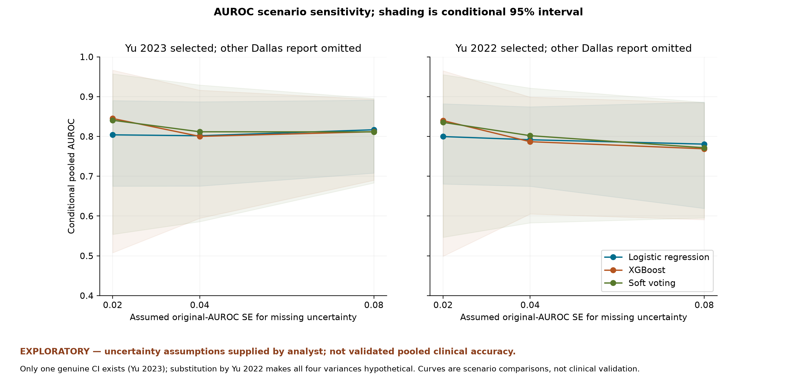

# EXPLORATORY: AUROC meta-analysis results

The supplied extraction is authoritative for this task and has not been independently verified against original papers. No new studies, external confidence intervals, author correspondence or patient-level records were consulted. Reported source values are unchanged. Original confirmatory feasibility conclusions and descriptive outputs are preserved. The numbers here are **conditional pooled calculations**, not the primary evidence-supported findings or established clinical accuracy.

**18/18 configured scenarios produced conditional pooled results.** Each has four potentially independent source groups, assumed independent for fitting; the existing source inventory remains five reports/20 models. Conditional summaries range **0.768949-0.845098** across configurations. This range is scenario spread, not a confidence interval.

EXPLORATORY — uncertainty assumptions supplied by analyst; not validated pooled clinical accuracy.

Hypothetical missing SEs; four source groups assumed independent; heterogeneous tools, horizons, units and internal validation; not validated clinical accuracy. Yu 2023's genuine CI is preserved; all other missing variances are hypothetical. Yu 2022 substitution means all four variances are assumed. No numerical result is a confirmatory estimate, and none resolves validation, horizon or protocol discrepancies.

## Selected extracted AUROCs

| estimate | source row | AUROC | uncertainty provenance |
| --- | --- | --- | --- |
| lu_2025_pedca_ft_a1 | 18 | 0.7399 | No genuine SE; hypothetical 0.02/0.04/0.08 |
| bose_2019_glm_a2 | 19 | 0.75 | No genuine SE; hypothetical 0.02/0.04/0.08 |
| yu_2023_rdn_boost_a1 | 20 | 0.85 | genuine 95% CI 0.79-0.9 |
| kenet_2023_logistic_a1 | 23 | 0.867 | No genuine SE; hypothetical 0.02/0.04/0.08 |
| kenet_2023_xgboost_a1 | 26 | 0.971 | No genuine SE; hypothetical 0.02/0.04/0.08 |
| kenet_2023_soft_voting_a1 | 28 | 0.957 | No genuine SE; hypothetical 0.02/0.04/0.08 |
| yu_2022_logistic_a1 | 29 | 0.83 | No genuine SE; hypothetical 0.02/0.04/0.08 |

Each scenario includes four rows from this seven-evaluation set, as configured; never both Dallas reports.

## Every configured scenario

| scenario | Kenet | Dallas | assumed SE | conditional pooled AUROC [95%] | estimated logit tau² | status / diagnostics |
| --- | --- | --- | --- | --- | --- | --- |
| A_2023_logistic_SE02 | logistic | 2023 | 0.02 | 0.8041 [0.6750, 0.8902] | 0.158941 | success_conditional |
| A_2023_logistic_SE04 | logistic | 2023 | 0.04 | 0.8017 [0.6752, 0.8872] | 0.114900 | success_conditional |
| A_2023_logistic_SE08 | logistic | 2023 | 0.08 | 0.8168 [0.7079, 0.8913] | 0.017281 | success_conditional |
| A_2023_xgboost_SE02 | xgboost | 2023 | 0.02 | 0.8451 [0.5078, 0.9665] | 0.983408 | success_conditional |
| A_2023_xgboost_SE04 | xgboost | 2023 | 0.04 | 0.8002 [0.5945, 0.9162] | 0.266631 | success_conditional |
| A_2023_xgboost_SE08 | xgboost | 2023 | 0.08 | 0.8119 [0.6900, 0.8933] | 0.026491 | success_conditional |
| A_2023_soft_voting_SE02 | soft_voting | 2023 | 0.02 | 0.8406 [0.5540, 0.9573] | 0.758288 | success_conditional |
| A_2023_soft_voting_SE04 | soft_voting | 2023 | 0.04 | 0.8117 [0.5858, 0.9293] | 0.360052 | success_conditional |
| A_2023_soft_voting_SE08 | soft_voting | 2023 | 0.08 | 0.8114 [0.6832, 0.8957] | 0.036638 | success_conditional |
| A_2022_logistic_SE02 | logistic | 2022 | 0.02 | 0.7997 [0.6805, 0.8821] | 0.138272 | success_conditional |
| A_2022_logistic_SE04 | logistic | 2022 | 0.04 | 0.7917 [0.6747, 0.8745] | 0.078488 | success_conditional |
| A_2022_logistic_SE08 | logistic | 2022 | 0.08 | 0.7807 [0.6191, 0.8864] | 0.000000 | boundary; success_conditional |
| A_2022_xgboost_SE02 | xgboost | 2022 | 0.02 | 0.8398 [0.4990, 0.9650] | 0.985628 | success_conditional |
| A_2022_xgboost_SE04 | xgboost | 2022 | 0.04 | 0.7868 [0.6052, 0.8989] | 0.181712 | success_conditional |
| A_2022_xgboost_SE08 | xgboost | 2022 | 0.08 | 0.7689 [0.5907, 0.8847] | 0.000000 | boundary; success_conditional |
| A_2022_soft_voting_SE02 | soft_voting | 2022 | 0.02 | 0.8354 [0.5466, 0.9553] | 0.756477 | validated fallback; success_conditional |
| A_2022_soft_voting_SE04 | soft_voting | 2022 | 0.04 | 0.8020 [0.5829, 0.9215] | 0.312596 | success_conditional |
| A_2022_soft_voting_SE08 | soft_voting | 2022 | 0.08 | 0.7716 [0.5953, 0.8858] | 0.000000 | boundary; success_conditional |

Each bracketed interval is the modified H-K conditional 95% interval, df=3. Estimated tau² refers to the assumed-variance logit model, not verified clinical heterogeneity. Full precision, source/model selections, assumptions, convergence and numerical diagnostics are in [auroc_scenario_results.csv](../../results/exploratory/auroc_scenario_results.csv); [AUROC input/weight ledger](../../results/exploratory/auroc_scenario_inputs.csv) gives all 72 selected rows, individual points, genuine versus hypothetical SEs, plot limits and weights.

## Preserved numerical attempts

| scenario_id | solver | status | message |
| --- | --- | --- | --- |
| A_2022_soft_voting_SE02 | statsmodels_iterated_PM | failed_equation_check | Library PM residual check failed: tau2=0.0, Q_tau=25.772469087599525 |

All final accepted fits pass the PM equation/boundary check. A numerical fallback is disclosed, not a suppressed or data-modified fit. Zero tau² at some high-SE scenarios is a conditional boundary estimate; it does not show the studies are clinically homogeneous.

## Forest plots and assumption sensitivity

Shading is conditional 95% uncertainty under each scenario; it excludes uncertainty about the assumptions. Genuine study intervals are used only for Yu 2023; other forest error bars arise from analyst-assumed SEs. Different algorithms/horizons/units are summarized under a hypothetical random-effects model. All successful scenarios have individual forest plots:

- [A_2023_logistic_SE02](../../figures/exploratory/forest_A_2023_logistic_SE02.png) ([SVG](../../figures/exploratory/forest_A_2023_logistic_SE02.svg)): 0.8041 [0.6750, 0.8902]; **EXPLORATORY — uncertainty assumptions supplied by analyst; not validated pooled clinical accuracy.** Hypothetical missing SEs; four source groups assumed independent; heterogeneous tools, horizons, units and internal validation; not validated clinical accuracy.
- [A_2023_logistic_SE04](../../figures/exploratory/forest_A_2023_logistic_SE04.png) ([SVG](../../figures/exploratory/forest_A_2023_logistic_SE04.svg)): 0.8017 [0.6752, 0.8872]; **EXPLORATORY — uncertainty assumptions supplied by analyst; not validated pooled clinical accuracy.** Hypothetical missing SEs; four source groups assumed independent; heterogeneous tools, horizons, units and internal validation; not validated clinical accuracy.
- [A_2023_logistic_SE08](../../figures/exploratory/forest_A_2023_logistic_SE08.png) ([SVG](../../figures/exploratory/forest_A_2023_logistic_SE08.svg)): 0.8168 [0.7079, 0.8913]; **EXPLORATORY — uncertainty assumptions supplied by analyst; not validated pooled clinical accuracy.** Hypothetical missing SEs; four source groups assumed independent; heterogeneous tools, horizons, units and internal validation; not validated clinical accuracy.
- [A_2023_xgboost_SE02](../../figures/exploratory/forest_A_2023_xgboost_SE02.png) ([SVG](../../figures/exploratory/forest_A_2023_xgboost_SE02.svg)): 0.8451 [0.5078, 0.9665]; **EXPLORATORY — uncertainty assumptions supplied by analyst; not validated pooled clinical accuracy.** Hypothetical missing SEs; four source groups assumed independent; heterogeneous tools, horizons, units and internal validation; not validated clinical accuracy.
- [A_2023_xgboost_SE04](../../figures/exploratory/forest_A_2023_xgboost_SE04.png) ([SVG](../../figures/exploratory/forest_A_2023_xgboost_SE04.svg)): 0.8002 [0.5945, 0.9162]; **EXPLORATORY — uncertainty assumptions supplied by analyst; not validated pooled clinical accuracy.** Hypothetical missing SEs; four source groups assumed independent; heterogeneous tools, horizons, units and internal validation; not validated clinical accuracy.
- [A_2023_xgboost_SE08](../../figures/exploratory/forest_A_2023_xgboost_SE08.png) ([SVG](../../figures/exploratory/forest_A_2023_xgboost_SE08.svg)): 0.8119 [0.6900, 0.8933]; **EXPLORATORY — uncertainty assumptions supplied by analyst; not validated pooled clinical accuracy.** Hypothetical missing SEs; four source groups assumed independent; heterogeneous tools, horizons, units and internal validation; not validated clinical accuracy.
- [A_2023_soft_voting_SE02](../../figures/exploratory/forest_A_2023_soft_voting_SE02.png) ([SVG](../../figures/exploratory/forest_A_2023_soft_voting_SE02.svg)): 0.8406 [0.5540, 0.9573]; **EXPLORATORY — uncertainty assumptions supplied by analyst; not validated pooled clinical accuracy.** Hypothetical missing SEs; four source groups assumed independent; heterogeneous tools, horizons, units and internal validation; not validated clinical accuracy.
- [A_2023_soft_voting_SE04](../../figures/exploratory/forest_A_2023_soft_voting_SE04.png) ([SVG](../../figures/exploratory/forest_A_2023_soft_voting_SE04.svg)): 0.8117 [0.5858, 0.9293]; **EXPLORATORY — uncertainty assumptions supplied by analyst; not validated pooled clinical accuracy.** Hypothetical missing SEs; four source groups assumed independent; heterogeneous tools, horizons, units and internal validation; not validated clinical accuracy.
- [A_2023_soft_voting_SE08](../../figures/exploratory/forest_A_2023_soft_voting_SE08.png) ([SVG](../../figures/exploratory/forest_A_2023_soft_voting_SE08.svg)): 0.8114 [0.6832, 0.8957]; **EXPLORATORY — uncertainty assumptions supplied by analyst; not validated pooled clinical accuracy.** Hypothetical missing SEs; four source groups assumed independent; heterogeneous tools, horizons, units and internal validation; not validated clinical accuracy.
- [A_2022_logistic_SE02](../../figures/exploratory/forest_A_2022_logistic_SE02.png) ([SVG](../../figures/exploratory/forest_A_2022_logistic_SE02.svg)): 0.7997 [0.6805, 0.8821]; **EXPLORATORY — uncertainty assumptions supplied by analyst; not validated pooled clinical accuracy.** Hypothetical missing SEs; four source groups assumed independent; heterogeneous tools, horizons, units and internal validation; not validated clinical accuracy.
- [A_2022_logistic_SE04](../../figures/exploratory/forest_A_2022_logistic_SE04.png) ([SVG](../../figures/exploratory/forest_A_2022_logistic_SE04.svg)): 0.7917 [0.6747, 0.8745]; **EXPLORATORY — uncertainty assumptions supplied by analyst; not validated pooled clinical accuracy.** Hypothetical missing SEs; four source groups assumed independent; heterogeneous tools, horizons, units and internal validation; not validated clinical accuracy.
- [A_2022_logistic_SE08](../../figures/exploratory/forest_A_2022_logistic_SE08.png) ([SVG](../../figures/exploratory/forest_A_2022_logistic_SE08.svg)): 0.7807 [0.6191, 0.8864]; **EXPLORATORY — uncertainty assumptions supplied by analyst; not validated pooled clinical accuracy.** Hypothetical missing SEs; four source groups assumed independent; heterogeneous tools, horizons, units and internal validation; not validated clinical accuracy.
- [A_2022_xgboost_SE02](../../figures/exploratory/forest_A_2022_xgboost_SE02.png) ([SVG](../../figures/exploratory/forest_A_2022_xgboost_SE02.svg)): 0.8398 [0.4990, 0.9650]; **EXPLORATORY — uncertainty assumptions supplied by analyst; not validated pooled clinical accuracy.** Hypothetical missing SEs; four source groups assumed independent; heterogeneous tools, horizons, units and internal validation; not validated clinical accuracy.
- [A_2022_xgboost_SE04](../../figures/exploratory/forest_A_2022_xgboost_SE04.png) ([SVG](../../figures/exploratory/forest_A_2022_xgboost_SE04.svg)): 0.7868 [0.6052, 0.8989]; **EXPLORATORY — uncertainty assumptions supplied by analyst; not validated pooled clinical accuracy.** Hypothetical missing SEs; four source groups assumed independent; heterogeneous tools, horizons, units and internal validation; not validated clinical accuracy.
- [A_2022_xgboost_SE08](../../figures/exploratory/forest_A_2022_xgboost_SE08.png) ([SVG](../../figures/exploratory/forest_A_2022_xgboost_SE08.svg)): 0.7689 [0.5907, 0.8847]; **EXPLORATORY — uncertainty assumptions supplied by analyst; not validated pooled clinical accuracy.** Hypothetical missing SEs; four source groups assumed independent; heterogeneous tools, horizons, units and internal validation; not validated clinical accuracy.
- [A_2022_soft_voting_SE02](../../figures/exploratory/forest_A_2022_soft_voting_SE02.png) ([SVG](../../figures/exploratory/forest_A_2022_soft_voting_SE02.svg)): 0.8354 [0.5466, 0.9553]; **EXPLORATORY — uncertainty assumptions supplied by analyst; not validated pooled clinical accuracy.** Hypothetical missing SEs; four source groups assumed independent; heterogeneous tools, horizons, units and internal validation; not validated clinical accuracy.
- [A_2022_soft_voting_SE04](../../figures/exploratory/forest_A_2022_soft_voting_SE04.png) ([SVG](../../figures/exploratory/forest_A_2022_soft_voting_SE04.svg)): 0.8020 [0.5829, 0.9215]; **EXPLORATORY — uncertainty assumptions supplied by analyst; not validated pooled clinical accuracy.** Hypothetical missing SEs; four source groups assumed independent; heterogeneous tools, horizons, units and internal validation; not validated clinical accuracy.
- [A_2022_soft_voting_SE08](../../figures/exploratory/forest_A_2022_soft_voting_SE08.png) ([SVG](../../figures/exploratory/forest_A_2022_soft_voting_SE08.svg)): 0.7716 [0.5953, 0.8858]; **EXPLORATORY — uncertainty assumptions supplied by analyst; not validated pooled clinical accuracy.** Hypothetical missing SEs; four source groups assumed independent; heterogeneous tools, horizons, units and internal validation; not validated clinical accuracy.
