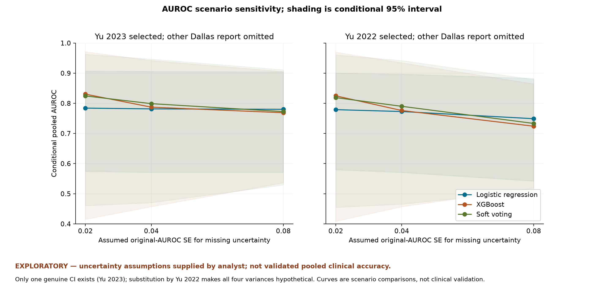
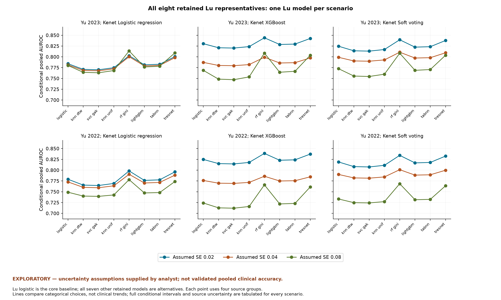
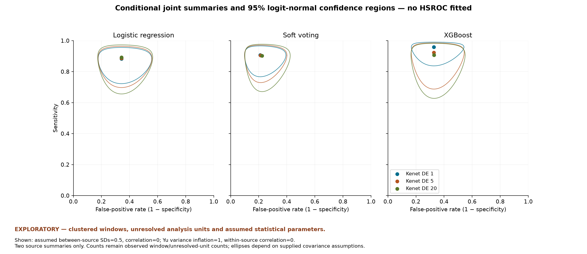
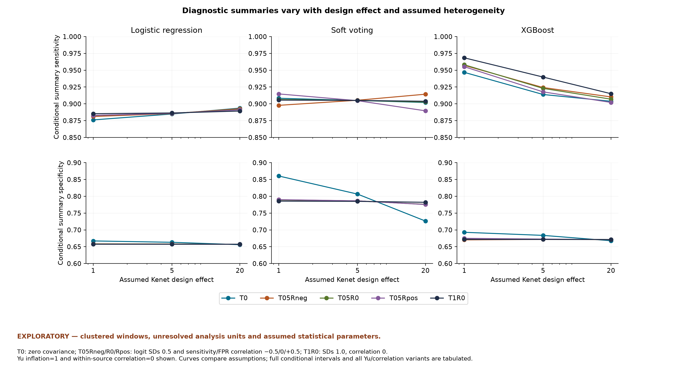

# Revised exploratory results summary

This eligibility revision wholly excludes Lu 2025 XGBoost, gMLP and PEDCA-FT because their sensitivity/specificity was graphically extracted and considered insufficiently reliable. Their AUROCs are excluded with the entries; this does not assert that those AUROCs were graphical. The revised extraction retains five reports and 17 models, including eight Lu models. Other Lu models remain eligible despite missing operating points. Only the supplied sources and existing derivatives are used. Original source hashes are unchanged and no new papers, clinical data or correspondence were obtained. Confirmatory pooling remains unsupported; every pooled number here is explicitly conditional on analyst assumptions.

## Before and after the exclusion decision

| measure | previous | revised |
| --- | --- | --- |
| Retained study reports | 5 | 5 |
| Retained models | 20 | 17 |
| Retained Lu models | 11 | 8 |
| Lu reported AUROC range | 0.5472-0.7504 | 0.5472-0.7329 |
| Core AUROC scenarios | 18 | 18 |
| Core conditional pooled AUROC range | 0.7689-0.8451 | 0.7241-0.8305 |
| Additional retained-Lu AUROC scenarios | 0 | 126 |
| All revised Lu-choice conditional pooled AUROC range | Not previously assessed | 0.7120-0.8441 |
| Diagnostic scenarios | 96 | 96 |
| Conditional diagnostic sensitivity (%) | 87.2956-98.2449 | 87.2956-98.2449 |
| Conditional diagnostic specificity (%) | 65.5968-87.4968 | 65.5968-87.4968 |

## How to read these calculations

An assumed SE describes hypothetical precision, not recovered study uncertainty. A design effect inflates variance without turning windows into measured independent children. T supplies between-source logit covariance rather than estimating it from two sources. A conditional 95% interval assumes the stated statistical model and parameters; it excludes uncertainty about those assumptions, bias, extraction errors and unresolved clinical units.

## Selected individual AUROCs

| estimate | source row | individual AUROC | uncertainty |
| --- | --- | --- | --- |
| lu_2025_logistic_a1 | 11 | 0.6292 | hypothetical original-scale SE 0.02/0.04/0.08 |
| bose_2019_glm_a2 | 19 | 0.75 | hypothetical original-scale SE 0.02/0.04/0.08 |
| yu_2023_rdn_boost_a1 | 20 | 0.85 | genuine 95% CI 0.79-0.9 |
| kenet_2023_logistic_a1 | 23 | 0.867 | hypothetical original-scale SE 0.02/0.04/0.08 |
| kenet_2023_xgboost_a1 | 26 | 0.971 | hypothetical original-scale SE 0.02/0.04/0.08 |
| kenet_2023_soft_voting_a1 | 28 | 0.957 | hypothetical original-scale SE 0.02/0.04/0.08 |
| yu_2022_logistic_a1 | 29 | 0.83 | hypothetical original-scale SE 0.02/0.04/0.08 |
| lu_2025_knn_dtw_a1 | 8 | 0.5527000000000001 | hypothetical original-scale SE 0.02/0.04/0.08 |
| lu_2025_svc_gak_a1 | 9 | 0.5472 | hypothetical original-scale SE 0.02/0.04/0.08 |
| lu_2025_knn_unif_a1 | 10 | 0.5740999999999999 | hypothetical original-scale SE 0.02/0.04/0.08 |
| lu_2025_rf_gini_a1 | 12 | 0.7329000000000001 | hypothetical original-scale SE 0.02/0.04/0.08 |
| lu_2025_lightgbm_a1 | 14 | 0.6142 | hypothetical original-scale SE 0.02/0.04/0.08 |
| lu_2025_tabnn_a1 | 15 | 0.6215999999999999 | hypothetical original-scale SE 0.02/0.04/0.08 |
| lu_2025_tresnet_a1 | 16 | 0.7221 | hypothetical original-scale SE 0.02/0.04/0.08 |

## The 18 revised core AUROC scenarios

EXPLORATORY — uncertainty assumptions supplied by analyst; not validated pooled clinical accuracy.

All four contributors and selected models are identified in the table below. Lu logistic is an analyst-selected baseline, not a verified original primary model. Genuine Yu 2023 CI-derived variance is retained; all missing SEs are hypothetical. Core range is **0.724073-0.830502**.

| scenario | family | Lu 2025 | Bose 2019 | Dallas | Kenet 2023 | assumed SE | conditional pooled AUROC [95%] | estimated logit tau2 | status |
| --- | --- | --- | --- | --- | --- | --- | --- | --- | --- |
| A_2023_logistic_SE02 | core_lu_logistic | logistic (0.6292) | glm (0.7500) held-out | rdn boost (0.8500) yu 2023 | logistic (0.8670) | 0.02 | 0.7841 [0.5740, 0.9073] | 0.364444 | checked fallback; success_conditional |
| A_2023_logistic_SE04 | core_lu_logistic | logistic (0.6292) | glm (0.7500) held-out | rdn boost (0.8500) yu 2023 | logistic (0.8670) | 0.04 | 0.7815 [0.5708, 0.9059] | 0.328384 | success_conditional |
| A_2023_logistic_SE08 | core_lu_logistic | logistic (0.6292) | glm (0.7500) held-out | rdn boost (0.8500) yu 2023 | logistic (0.8670) | 0.08 | 0.7802 [0.5707, 0.9045] | 0.222621 | success_conditional |
| A_2023_xgboost_SE02 | core_lu_logistic | logistic (0.6292) | glm (0.7500) held-out | rdn boost (0.8500) yu 2023 | xgboost (0.9710) | 0.02 | 0.8305 [0.4151, 0.9713] | 1.356592 | success_conditional |
| A_2023_xgboost_SE04 | core_lu_logistic | logistic (0.6292) | glm (0.7500) held-out | rdn boost (0.8500) yu 2023 | xgboost (0.9710) | 0.04 | 0.7872 [0.4570, 0.9421] | 0.664931 | checked fallback; success_conditional |
| A_2023_xgboost_SE08 | core_lu_logistic | logistic (0.6292) | glm (0.7500) held-out | rdn boost (0.8500) yu 2023 | xgboost (0.9710) | 0.08 | 0.7688 [0.5359, 0.9055] | 0.228276 | success_conditional |
| A_2023_soft_voting_SE02 | core_lu_logistic | logistic (0.6292) | glm (0.7500) held-out | rdn boost (0.8500) yu 2023 | soft voting (0.9570) | 0.02 | 0.8245 [0.4599, 0.9629] | 1.082998 | success_conditional |
| A_2023_soft_voting_SE04 | core_lu_logistic | logistic (0.6292) | glm (0.7500) held-out | rdn boost (0.8500) yu 2023 | soft voting (0.9570) | 0.04 | 0.7989 [0.4701, 0.9468] | 0.725970 | success_conditional |
| A_2023_soft_voting_SE08 | core_lu_logistic | logistic (0.6292) | glm (0.7500) held-out | rdn boost (0.8500) yu 2023 | soft voting (0.9570) | 0.08 | 0.7726 [0.5291, 0.9112] | 0.265004 | success_conditional |
| A_2022_logistic_SE02 | core_lu_logistic | logistic (0.6292) | glm (0.7500) held-out | logistic (0.8300) yu 2022 | logistic (0.8670) | 0.02 | 0.7790 [0.5794, 0.9002] | 0.331549 | success_conditional |
| A_2022_logistic_SE04 | core_lu_logistic | logistic (0.6292) | glm (0.7500) held-out | logistic (0.8300) yu 2022 | logistic (0.8670) | 0.04 | 0.7728 [0.5705, 0.8970] | 0.283537 | success_conditional |
| A_2022_logistic_SE08 | core_lu_logistic | logistic (0.6292) | glm (0.7500) held-out | logistic (0.8300) yu 2022 | logistic (0.8670) | 0.08 | 0.7490 [0.5420, 0.8826] | 0.109427 | success_conditional |
| A_2022_xgboost_SE02 | core_lu_logistic | logistic (0.6292) | glm (0.7500) held-out | logistic (0.8300) yu 2022 | xgboost (0.9710) | 0.02 | 0.8248 [0.4085, 0.9698] | 1.345908 | success_conditional |
| A_2022_xgboost_SE04 | core_lu_logistic | logistic (0.6292) | glm (0.7500) held-out | logistic (0.8300) yu 2022 | xgboost (0.9710) | 0.04 | 0.7762 [0.4570, 0.9346] | 0.591660 | success_conditional |
| A_2022_xgboost_SE08 | core_lu_logistic | logistic (0.6292) | glm (0.7500) held-out | logistic (0.8300) yu 2022 | xgboost (0.9710) | 0.08 | 0.7241 [0.5188, 0.8646] | 0.054869 | success_conditional |
| A_2022_soft_voting_SE02 | core_lu_logistic | logistic (0.6292) | glm (0.7500) held-out | logistic (0.8300) yu 2022 | soft voting (0.9570) | 0.02 | 0.8189 [0.4545, 0.9609] | 1.068863 | success_conditional |
| A_2022_soft_voting_SE04 | core_lu_logistic | logistic (0.6292) | glm (0.7500) held-out | logistic (0.8300) yu 2022 | soft voting (0.9570) | 0.04 | 0.7901 [0.4653, 0.9421] | 0.679387 | success_conditional |
| A_2022_soft_voting_SE08 | core_lu_logistic | logistic (0.6292) | glm (0.7500) held-out | logistic (0.8300) yu 2022 | soft voting (0.9570) | 0.08 | 0.7333 [0.5100, 0.8790] | 0.100997 | success_conditional |

## All seven other eligible Lu choices

One Lu model contributes per scenario. All **126** alternatives are reported. The combined 144-scenario range is **0.711952-0.844093**, not an uncertainty interval.

| lu_model_id | individual_auroc | scenario_count | pooled_min | pooled_max | max_absolute_change_from_matched_lu_logistic |
| --- | --- | --- | --- | --- | --- |
| lu_2025_logistic | 0.6292 | 18 | 0.7240731071621067 | 0.8305023589110181 | 0.0 |
| lu_2025_knn_dtw | 0.5527000000000001 | 18 | 0.7127655421224767 | 0.8210303676945517 | 0.020428806993685877 |
| lu_2025_svc_gak | 0.5472 | 18 | 0.7119517745376744 | 0.820346029449468 | 0.021728795179537075 |
| lu_2025_knn_unif | 0.5740999999999999 | 18 | 0.7159313582816196 | 0.8236824921328535 | 0.015193310238810875 |
| lu_2025_rf_gini | 0.7329000000000001 | 18 | 0.7659480078673743 | 0.8440928251643599 | 0.04187490070526756 |
| lu_2025_lightgbm | 0.6142 | 18 | 0.7218597124098084 | 0.8286391697187089 | 0.0044322806190745245 |
| lu_2025_tabnn | 0.6215999999999999 | 18 | 0.7229521528741276 | 0.8295571084633281 | 0.002277697844302984 |
| lu_2025_tresnet | 0.7221 | 18 | 0.7611830589808515 | 0.8425747545892683 | 0.03710995181874477 |

| scenario | family | Lu 2025 | Bose 2019 | Dallas | Kenet 2023 | assumed SE | conditional pooled AUROC [95%] | estimated logit tau2 | status |
| --- | --- | --- | --- | --- | --- | --- | --- | --- | --- |
| A_LU_knn_dtw_2023_logistic_SE02 | alternative_lu_model | knn dtw (0.5527) | glm (0.7500) held-out | rdn boost (0.8500) yu 2023 | logistic (0.8670) | 0.02 | 0.7711 [0.5005, 0.9188] | 0.556399 | success_conditional |
| A_LU_knn_dtw_2023_logistic_SE04 | alternative_lu_model | knn dtw (0.5527) | glm (0.7500) held-out | rdn boost (0.8500) yu 2023 | logistic (0.8670) | 0.04 | 0.7686 [0.4967, 0.9179] | 0.523726 | success_conditional |
| A_LU_knn_dtw_2023_logistic_SE08 | alternative_lu_model | knn dtw (0.5527) | glm (0.7500) held-out | rdn boost (0.8500) yu 2023 | logistic (0.8670) | 0.08 | 0.7642 [0.4895, 0.9163] | 0.417923 | success_conditional |
| A_LU_knn_dtw_2023_xgboost_SE02 | alternative_lu_model | knn dtw (0.5527) | glm (0.7500) held-out | rdn boost (0.8500) yu 2023 | xgboost (0.9710) | 0.02 | 0.8210 [0.3550, 0.9745] | 1.654759 | success_conditional |
| A_LU_knn_dtw_2023_xgboost_SE04 | alternative_lu_model | knn dtw (0.5527) | glm (0.7500) held-out | rdn boost (0.8500) yu 2023 | xgboost (0.9710) | 0.04 | 0.7801 [0.3765, 0.9542] | 0.994343 | success_conditional |
| A_LU_knn_dtw_2023_xgboost_SE08 | alternative_lu_model | knn dtw (0.5527) | glm (0.7500) held-out | rdn boost (0.8500) yu 2023 | xgboost (0.9710) | 0.08 | 0.7484 [0.4398, 0.9185] | 0.429812 | success_conditional |
| A_LU_knn_dtw_2023_soft_voting_SE02 | alternative_lu_model | knn dtw (0.5527) | glm (0.7500) held-out | rdn boost (0.8500) yu 2023 | soft voting (0.9570) | 0.02 | 0.8140 [0.3966, 0.9668] | 1.349491 | success_conditional |
| A_LU_knn_dtw_2023_soft_voting_SE04 | alternative_lu_model | knn dtw (0.5527) | glm (0.7500) held-out | rdn boost (0.8500) yu 2023 | soft voting (0.9570) | 0.04 | 0.7905 [0.3982, 0.9556] | 1.019120 | success_conditional |
| A_LU_knn_dtw_2023_soft_voting_SE08 | alternative_lu_model | knn dtw (0.5527) | glm (0.7500) held-out | rdn boost (0.8500) yu 2023 | soft voting (0.9570) | 0.08 | 0.7556 [0.4349, 0.9255] | 0.492266 | success_conditional |
| A_LU_knn_dtw_2022_logistic_SE02 | alternative_lu_model | knn dtw (0.5527) | glm (0.7500) held-out | logistic (0.8300) yu 2022 | logistic (0.8670) | 0.02 | 0.7655 [0.5054, 0.9125] | 0.515625 | success_conditional |
| A_LU_knn_dtw_2022_logistic_SE04 | alternative_lu_model | knn dtw (0.5527) | glm (0.7500) held-out | logistic (0.8300) yu 2022 | logistic (0.8670) | 0.04 | 0.7602 [0.4966, 0.9106] | 0.472503 | success_conditional |
| A_LU_knn_dtw_2022_logistic_SE08 | alternative_lu_model | knn dtw (0.5527) | glm (0.7500) held-out | logistic (0.8300) yu 2022 | logistic (0.8670) | 0.08 | 0.7400 [0.4663, 0.9027] | 0.312297 | success_conditional |
| A_LU_knn_dtw_2022_xgboost_SE02 | alternative_lu_model | knn dtw (0.5527) | glm (0.7500) held-out | logistic (0.8300) yu 2022 | xgboost (0.9710) | 0.02 | 0.8152 [0.3495, 0.9731] | 1.637091 | checked fallback; success_conditional |
| A_LU_knn_dtw_2022_xgboost_SE04 | alternative_lu_model | knn dtw (0.5527) | glm (0.7500) held-out | logistic (0.8300) yu 2022 | xgboost (0.9710) | 0.04 | 0.7698 [0.3741, 0.9493] | 0.925160 | success_conditional |
| A_LU_knn_dtw_2022_xgboost_SE08 | alternative_lu_model | knn dtw (0.5527) | glm (0.7500) held-out | logistic (0.8300) yu 2022 | xgboost (0.9710) | 0.08 | 0.7128 [0.4227, 0.8937] | 0.262850 | success_conditional |
| A_LU_knn_dtw_2022_soft_voting_SE02 | alternative_lu_model | knn dtw (0.5527) | glm (0.7500) held-out | logistic (0.8300) yu 2022 | soft voting (0.9570) | 0.02 | 0.8082 [0.3922, 0.9649] | 1.328316 | checked fallback; success_conditional |
| A_LU_knn_dtw_2022_soft_voting_SE04 | alternative_lu_model | knn dtw (0.5527) | glm (0.7500) held-out | logistic (0.8300) yu 2022 | soft voting (0.9570) | 0.04 | 0.7821 [0.3934, 0.9521] | 0.970924 | success_conditional |
| A_LU_knn_dtw_2022_soft_voting_SE08 | alternative_lu_model | knn dtw (0.5527) | glm (0.7500) held-out | logistic (0.8300) yu 2022 | soft voting (0.9570) | 0.08 | 0.7248 [0.4157, 0.9070] | 0.340510 | success_conditional |
| A_LU_svc_gak_2023_logistic_SE02 | alternative_lu_model | svc gak (0.5472) | glm (0.7500) held-out | rdn boost (0.8500) yu 2023 | logistic (0.8670) | 0.02 | 0.7701 [0.4952, 0.9196] | 0.571705 | success_conditional |
| A_LU_svc_gak_2023_logistic_SE04 | alternative_lu_model | svc gak (0.5472) | glm (0.7500) held-out | rdn boost (0.8500) yu 2023 | logistic (0.8670) | 0.04 | 0.7677 [0.4914, 0.9188] | 0.539204 | success_conditional |
| A_LU_svc_gak_2023_logistic_SE08 | alternative_lu_model | svc gak (0.5472) | glm (0.7500) held-out | rdn boost (0.8500) yu 2023 | logistic (0.8670) | 0.08 | 0.7631 [0.4839, 0.9171] | 0.433376 | checked fallback; success_conditional |
| A_LU_svc_gak_2023_xgboost_SE02 | alternative_lu_model | svc gak (0.5472) | glm (0.7500) held-out | rdn boost (0.8500) yu 2023 | xgboost (0.9710) | 0.02 | 0.8203 [0.3508, 0.9747] | 1.677515 | success_conditional |
| A_LU_svc_gak_2023_xgboost_SE04 | alternative_lu_model | svc gak (0.5472) | glm (0.7500) held-out | rdn boost (0.8500) yu 2023 | xgboost (0.9710) | 0.04 | 0.7795 [0.3712, 0.9549] | 1.019350 | success_conditional |
| A_LU_svc_gak_2023_xgboost_SE08 | alternative_lu_model | svc gak (0.5472) | glm (0.7500) held-out | rdn boost (0.8500) yu 2023 | xgboost (0.9710) | 0.08 | 0.7471 [0.4333, 0.9194] | 0.446159 | success_conditional |
| A_LU_svc_gak_2023_soft_voting_SE02 | alternative_lu_model | svc gak (0.5472) | glm (0.7500) held-out | rdn boost (0.8500) yu 2023 | soft voting (0.9570) | 0.02 | 0.8133 [0.3921, 0.9671] | 1.370015 | success_conditional |
| A_LU_svc_gak_2023_soft_voting_SE04 | alternative_lu_model | svc gak (0.5472) | glm (0.7500) held-out | rdn boost (0.8500) yu 2023 | soft voting (0.9570) | 0.04 | 0.7899 [0.3933, 0.9562] | 1.041394 | success_conditional |
| A_LU_svc_gak_2023_soft_voting_SE08 | alternative_lu_model | svc gak (0.5472) | glm (0.7500) held-out | rdn boost (0.8500) yu 2023 | soft voting (0.9570) | 0.08 | 0.7545 [0.4285, 0.9265] | 0.510564 | success_conditional |
| A_LU_svc_gak_2022_logistic_SE02 | alternative_lu_model | svc gak (0.5472) | glm (0.7500) held-out | logistic (0.8300) yu 2022 | logistic (0.8670) | 0.02 | 0.7645 [0.5001, 0.9133] | 0.530376 | success_conditional |
| A_LU_svc_gak_2022_logistic_SE04 | alternative_lu_model | svc gak (0.5472) | glm (0.7500) held-out | logistic (0.8300) yu 2022 | logistic (0.8670) | 0.04 | 0.7593 [0.4913, 0.9115] | 0.487509 | checked fallback; success_conditional |
| A_LU_svc_gak_2022_logistic_SE08 | alternative_lu_model | svc gak (0.5472) | glm (0.7500) held-out | logistic (0.8300) yu 2022 | logistic (0.8670) | 0.08 | 0.7394 [0.4611, 0.9039] | 0.327986 | success_conditional |
| A_LU_svc_gak_2022_xgboost_SE02 | alternative_lu_model | svc gak (0.5472) | glm (0.7500) held-out | logistic (0.8300) yu 2022 | xgboost (0.9710) | 0.02 | 0.8145 [0.3454, 0.9734] | 1.659370 | success_conditional |
| A_LU_svc_gak_2022_xgboost_SE04 | alternative_lu_model | svc gak (0.5472) | glm (0.7500) held-out | logistic (0.8300) yu 2022 | xgboost (0.9710) | 0.04 | 0.7694 [0.3687, 0.9501] | 0.950324 | success_conditional |
| A_LU_svc_gak_2022_xgboost_SE08 | alternative_lu_model | svc gak (0.5472) | glm (0.7500) held-out | logistic (0.8300) yu 2022 | xgboost (0.9710) | 0.08 | 0.7120 [0.4163, 0.8955] | 0.279478 | success_conditional |
| A_LU_svc_gak_2022_soft_voting_SE02 | alternative_lu_model | svc gak (0.5472) | glm (0.7500) held-out | logistic (0.8300) yu 2022 | soft voting (0.9570) | 0.02 | 0.8074 [0.3878, 0.9652] | 1.348352 | success_conditional |
| A_LU_svc_gak_2022_soft_voting_SE04 | alternative_lu_model | svc gak (0.5472) | glm (0.7500) held-out | logistic (0.8300) yu 2022 | soft voting (0.9570) | 0.04 | 0.7815 [0.3885, 0.9527] | 0.993021 | success_conditional |
| A_LU_svc_gak_2022_soft_voting_SE08 | alternative_lu_model | svc gak (0.5472) | glm (0.7500) held-out | logistic (0.8300) yu 2022 | soft voting (0.9570) | 0.08 | 0.7242 [0.4095, 0.9086] | 0.359472 | success_conditional |
| A_LU_knn_unif_2023_logistic_SE02 | alternative_lu_model | knn unif (0.5741) | glm (0.7500) held-out | rdn boost (0.8500) yu 2023 | logistic (0.8670) | 0.02 | 0.7747 [0.5212, 0.9157] | 0.498805 | success_conditional |
| A_LU_knn_unif_2023_logistic_SE04 | alternative_lu_model | knn unif (0.5741) | glm (0.7500) held-out | rdn boost (0.8500) yu 2023 | logistic (0.8670) | 0.04 | 0.7722 [0.5174, 0.9147] | 0.465380 | success_conditional |
| A_LU_knn_unif_2023_logistic_SE08 | alternative_lu_model | knn unif (0.5741) | glm (0.7500) held-out | rdn boost (0.8500) yu 2023 | logistic (0.8670) | 0.08 | 0.7683 [0.5115, 0.9130] | 0.359605 | success_conditional |
| A_LU_knn_unif_2023_xgboost_SE02 | alternative_lu_model | knn unif (0.5741) | glm (0.7500) held-out | rdn boost (0.8500) yu 2023 | xgboost (0.9710) | 0.02 | 0.8237 [0.3714, 0.9736] | 1.567988 | success_conditional |
| A_LU_knn_unif_2023_xgboost_SE04 | alternative_lu_model | knn unif (0.5741) | glm (0.7500) held-out | rdn boost (0.8500) yu 2023 | xgboost (0.9710) | 0.04 | 0.7821 [0.3978, 0.9512] | 0.898772 | success_conditional |
| A_LU_knn_unif_2023_xgboost_SE08 | alternative_lu_model | knn unif (0.5741) | glm (0.7500) held-out | rdn boost (0.8500) yu 2023 | xgboost (0.9710) | 0.08 | 0.7536 [0.4658, 0.9148] | 0.368614 | success_conditional |
| A_LU_knn_unif_2023_soft_voting_SE02 | alternative_lu_model | knn unif (0.5741) | glm (0.7500) held-out | rdn boost (0.8500) yu 2023 | soft voting (0.9570) | 0.02 | 0.8170 [0.4141, 0.9657] | 1.271450 | success_conditional |
| A_LU_knn_unif_2023_soft_voting_SE04 | alternative_lu_model | knn unif (0.5741) | glm (0.7500) held-out | rdn boost (0.8500) yu 2023 | soft voting (0.9570) | 0.04 | 0.7929 [0.4177, 0.9534] | 0.934065 | success_conditional |
| A_LU_knn_unif_2023_soft_voting_SE08 | alternative_lu_model | knn unif (0.5741) | glm (0.7500) held-out | rdn boost (0.8500) yu 2023 | soft voting (0.9570) | 0.08 | 0.7598 [0.4602, 0.9215] | 0.423566 | success_conditional |
| A_LU_knn_unif_2022_logistic_SE02 | alternative_lu_model | knn unif (0.5741) | glm (0.7500) held-out | logistic (0.8300) yu 2022 | logistic (0.8670) | 0.02 | 0.7692 [0.5262, 0.9091] | 0.460205 | success_conditional |
| A_LU_knn_unif_2022_logistic_SE04 | alternative_lu_model | knn unif (0.5741) | glm (0.7500) held-out | logistic (0.8300) yu 2022 | logistic (0.8670) | 0.04 | 0.7638 [0.5173, 0.9070] | 0.415979 | success_conditional |
| A_LU_knn_unif_2022_logistic_SE08 | alternative_lu_model | knn unif (0.5741) | glm (0.7500) held-out | logistic (0.8300) yu 2022 | logistic (0.8670) | 0.08 | 0.7426 [0.4868, 0.8977] | 0.252750 | success_conditional |
| A_LU_knn_unif_2022_xgboost_SE02 | alternative_lu_model | knn unif (0.5741) | glm (0.7500) held-out | logistic (0.8300) yu 2022 | xgboost (0.9710) | 0.02 | 0.8179 [0.3657, 0.9722] | 1.552201 | success_conditional |
| A_LU_knn_unif_2022_xgboost_SE04 | alternative_lu_model | knn unif (0.5741) | glm (0.7500) held-out | logistic (0.8300) yu 2022 | xgboost (0.9710) | 0.04 | 0.7717 [0.3959, 0.9457] | 0.828824 | success_conditional |
| A_LU_knn_unif_2022_xgboost_SE08 | alternative_lu_model | knn unif (0.5741) | glm (0.7500) held-out | logistic (0.8300) yu 2022 | xgboost (0.9710) | 0.08 | 0.7159 [0.4483, 0.8866] | 0.200370 | success_conditional |
| A_LU_knn_unif_2022_soft_voting_SE02 | alternative_lu_model | knn unif (0.5741) | glm (0.7500) held-out | logistic (0.8300) yu 2022 | soft voting (0.9570) | 0.02 | 0.8112 [0.4095, 0.9638] | 1.252191 | success_conditional |
| A_LU_knn_unif_2022_soft_voting_SE04 | alternative_lu_model | knn unif (0.5741) | glm (0.7500) held-out | logistic (0.8300) yu 2022 | soft voting (0.9570) | 0.04 | 0.7844 [0.4128, 0.9496] | 0.886486 | success_conditional |
| A_LU_knn_unif_2022_soft_voting_SE08 | alternative_lu_model | knn unif (0.5741) | glm (0.7500) held-out | logistic (0.8300) yu 2022 | soft voting (0.9570) | 0.08 | 0.7271 [0.4406, 0.9002] | 0.268994 | success_conditional |
| A_LU_rf_gini_2023_logistic_SE02 | alternative_lu_model | rf gini (0.7329) | glm (0.7500) held-out | rdn boost (0.8500) yu 2023 | logistic (0.8670) | 0.02 | 0.8027 [0.6691, 0.8911] | 0.168863 | success_conditional |
| A_LU_rf_gini_2023_logistic_SE04 | alternative_lu_model | rf gini (0.7329) | glm (0.7500) held-out | rdn boost (0.8500) yu 2023 | logistic (0.8670) | 0.04 | 0.8003 [0.6691, 0.8882] | 0.125293 | success_conditional |
| A_LU_rf_gini_2023_logistic_SE08 | alternative_lu_model | rf gini (0.7329) | glm (0.7500) held-out | rdn boost (0.8500) yu 2023 | logistic (0.8670) | 0.08 | 0.8138 [0.6983, 0.8919] | 0.026535 | success_conditional |
| A_LU_rf_gini_2023_xgboost_SE02 | alternative_lu_model | rf gini (0.7329) | glm (0.7500) held-out | rdn boost (0.8500) yu 2023 | xgboost (0.9710) | 0.02 | 0.8441 [0.5018, 0.9668] | 1.004597 | success_conditional |
| A_LU_rf_gini_2023_xgboost_SE04 | alternative_lu_model | rf gini (0.7329) | glm (0.7500) held-out | rdn boost (0.8500) yu 2023 | xgboost (0.9710) | 0.04 | 0.7991 [0.5855, 0.9180] | 0.286979 | success_conditional |
| A_LU_rf_gini_2023_xgboost_SE08 | alternative_lu_model | rf gini (0.7329) | glm (0.7500) held-out | rdn boost (0.8500) yu 2023 | xgboost (0.9710) | 0.08 | 0.8086 [0.6799, 0.8937] | 0.035566 | success_conditional |
| A_LU_rf_gini_2023_soft_voting_SE02 | alternative_lu_model | rf gini (0.7329) | glm (0.7500) held-out | rdn boost (0.8500) yu 2023 | soft voting (0.9570) | 0.02 | 0.8395 [0.5481, 0.9576] | 0.776347 | success_conditional |
| A_LU_rf_gini_2023_soft_voting_SE04 | alternative_lu_model | rf gini (0.7329) | glm (0.7500) held-out | rdn boost (0.8500) yu 2023 | soft voting (0.9570) | 0.04 | 0.8108 [0.5783, 0.9305] | 0.380086 | success_conditional |
| A_LU_rf_gini_2023_soft_voting_SE08 | alternative_lu_model | rf gini (0.7329) | glm (0.7500) held-out | rdn boost (0.8500) yu 2023 | soft voting (0.9570) | 0.08 | 0.8084 [0.6731, 0.8963] | 0.046803 | success_conditional |
| A_LU_rf_gini_2022_logistic_SE02 | alternative_lu_model | rf gini (0.7329) | glm (0.7500) held-out | logistic (0.8300) yu 2022 | logistic (0.8670) | 0.02 | 0.7983 [0.6746, 0.8831] | 0.147384 | success_conditional |
| A_LU_rf_gini_2022_logistic_SE04 | alternative_lu_model | rf gini (0.7329) | glm (0.7500) held-out | logistic (0.8300) yu 2022 | logistic (0.8670) | 0.04 | 0.7904 [0.6686, 0.8758] | 0.088291 | success_conditional |
| A_LU_rf_gini_2022_logistic_SE08 | alternative_lu_model | rf gini (0.7329) | glm (0.7500) held-out | logistic (0.8300) yu 2022 | logistic (0.8670) | 0.08 | 0.7780 [0.6165, 0.8843] | 0.000000 | boundary; success_conditional |
| A_LU_rf_gini_2022_xgboost_SE02 | alternative_lu_model | rf gini (0.7329) | glm (0.7500) held-out | logistic (0.8300) yu 2022 | xgboost (0.9710) | 0.02 | 0.8388 [0.4932, 0.9653] | 1.005815 | checked fallback; success_conditional |
| A_LU_rf_gini_2022_xgboost_SE04 | alternative_lu_model | rf gini (0.7329) | glm (0.7500) held-out | logistic (0.8300) yu 2022 | xgboost (0.9710) | 0.04 | 0.7859 [0.5953, 0.9015] | 0.202374 | success_conditional |
| A_LU_rf_gini_2022_xgboost_SE08 | alternative_lu_model | rf gini (0.7329) | glm (0.7500) held-out | logistic (0.8300) yu 2022 | xgboost (0.9710) | 0.08 | 0.7659 [0.5881, 0.8824] | 0.000000 | boundary; success_conditional |
| A_LU_rf_gini_2022_soft_voting_SE02 | alternative_lu_model | rf gini (0.7329) | glm (0.7500) held-out | logistic (0.8300) yu 2022 | soft voting (0.9570) | 0.02 | 0.8343 [0.5408, 0.9556] | 0.773612 | success_conditional |
| A_LU_rf_gini_2022_soft_voting_SE04 | alternative_lu_model | rf gini (0.7329) | glm (0.7500) held-out | logistic (0.8300) yu 2022 | soft voting (0.9570) | 0.04 | 0.8011 [0.5751, 0.9230] | 0.332634 | success_conditional |
| A_LU_rf_gini_2022_soft_voting_SE08 | alternative_lu_model | rf gini (0.7329) | glm (0.7500) held-out | logistic (0.8300) yu 2022 | soft voting (0.9570) | 0.08 | 0.7686 [0.5926, 0.8835] | 0.000000 | boundary; success_conditional |
| A_LU_lightgbm_2023_logistic_SE02 | alternative_lu_model | lightgbm (0.6142) | glm (0.7500) held-out | rdn boost (0.8500) yu 2023 | logistic (0.8670) | 0.02 | 0.7816 [0.5597, 0.9097] | 0.399058 | success_conditional |
| A_LU_lightgbm_2023_logistic_SE04 | alternative_lu_model | lightgbm (0.6142) | glm (0.7500) held-out | rdn boost (0.8500) yu 2023 | logistic (0.8670) | 0.04 | 0.7790 [0.5562, 0.9083] | 0.363820 | success_conditional |
| A_LU_lightgbm_2023_logistic_SE08 | alternative_lu_model | lightgbm (0.6142) | glm (0.7500) held-out | rdn boost (0.8500) yu 2023 | logistic (0.8670) | 0.08 | 0.7767 [0.5542, 0.9068] | 0.258005 | success_conditional |
| A_LU_lightgbm_2023_xgboost_SE02 | alternative_lu_model | lightgbm (0.6142) | glm (0.7500) held-out | rdn boost (0.8500) yu 2023 | xgboost (0.9710) | 0.02 | 0.8286 [0.4030, 0.9719] | 1.412501 | success_conditional |
| A_LU_lightgbm_2023_xgboost_SE04 | alternative_lu_model | lightgbm (0.6142) | glm (0.7500) held-out | rdn boost (0.8500) yu 2023 | xgboost (0.9710) | 0.04 | 0.7858 [0.4403, 0.9448] | 0.726842 | checked fallback; success_conditional |
| A_LU_lightgbm_2023_xgboost_SE08 | alternative_lu_model | lightgbm (0.6142) | glm (0.7500) held-out | rdn boost (0.8500) yu 2023 | xgboost (0.9710) | 0.08 | 0.7644 [0.5163, 0.9079] | 0.264033 | success_conditional |
| A_LU_lightgbm_2023_soft_voting_SE02 | alternative_lu_model | lightgbm (0.6142) | glm (0.7500) held-out | rdn boost (0.8500) yu 2023 | soft voting (0.9570) | 0.02 | 0.8225 [0.4474, 0.9637] | 1.132585 | success_conditional |
| A_LU_lightgbm_2023_soft_voting_SE04 | alternative_lu_model | lightgbm (0.6142) | glm (0.7500) held-out | rdn boost (0.8500) yu 2023 | soft voting (0.9570) | 0.04 | 0.7973 [0.4555, 0.9487] | 0.781129 | success_conditional |
| A_LU_lightgbm_2023_soft_voting_SE08 | alternative_lu_model | lightgbm (0.6142) | glm (0.7500) held-out | rdn boost (0.8500) yu 2023 | soft voting (0.9570) | 0.08 | 0.7688 [0.5098, 0.9140] | 0.305517 | success_conditional |
| A_LU_lightgbm_2022_logistic_SE02 | alternative_lu_model | lightgbm (0.6142) | glm (0.7500) held-out | logistic (0.8300) yu 2022 | logistic (0.8670) | 0.02 | 0.7763 [0.5650, 0.9027] | 0.364590 | success_conditional |
| A_LU_lightgbm_2022_logistic_SE04 | alternative_lu_model | lightgbm (0.6142) | glm (0.7500) held-out | logistic (0.8300) yu 2022 | logistic (0.8670) | 0.04 | 0.7703 [0.5560, 0.8998] | 0.317757 | checked fallback; success_conditional |
| A_LU_lightgbm_2022_logistic_SE08 | alternative_lu_model | lightgbm (0.6142) | glm (0.7500) held-out | logistic (0.8300) yu 2022 | logistic (0.8670) | 0.08 | 0.7473 [0.5266, 0.8872] | 0.147113 | success_conditional |
| A_LU_lightgbm_2022_xgboost_SE02 | alternative_lu_model | lightgbm (0.6142) | glm (0.7500) held-out | logistic (0.8300) yu 2022 | xgboost (0.9710) | 0.02 | 0.8229 [0.3967, 0.9705] | 1.400379 | success_conditional |
| A_LU_lightgbm_2022_xgboost_SE04 | alternative_lu_model | lightgbm (0.6142) | glm (0.7500) held-out | logistic (0.8300) yu 2022 | xgboost (0.9710) | 0.04 | 0.7749 [0.4395, 0.9380] | 0.654695 | success_conditional |
| A_LU_lightgbm_2022_xgboost_SE08 | alternative_lu_model | lightgbm (0.6142) | glm (0.7500) held-out | logistic (0.8300) yu 2022 | xgboost (0.9710) | 0.08 | 0.7219 [0.4989, 0.8712] | 0.092366 | success_conditional |
| A_LU_lightgbm_2022_soft_voting_SE02 | alternative_lu_model | lightgbm (0.6142) | glm (0.7500) held-out | logistic (0.8300) yu 2022 | soft voting (0.9570) | 0.02 | 0.8168 [0.4422, 0.9617] | 1.117019 | success_conditional |
| A_LU_lightgbm_2022_soft_voting_SE04 | alternative_lu_model | lightgbm (0.6142) | glm (0.7500) held-out | logistic (0.8300) yu 2022 | soft voting (0.9570) | 0.04 | 0.7885 [0.4506, 0.9443] | 0.734371 | success_conditional |
| A_LU_lightgbm_2022_soft_voting_SE08 | alternative_lu_model | lightgbm (0.6142) | glm (0.7500) held-out | logistic (0.8300) yu 2022 | soft voting (0.9570) | 0.08 | 0.7316 [0.4902, 0.8854] | 0.144459 | success_conditional |
| A_LU_tabnn_2023_logistic_SE02 | alternative_lu_model | tabnn (0.6216) | glm (0.7500) held-out | rdn boost (0.8500) yu 2023 | logistic (0.8670) | 0.02 | 0.7828 [0.5668, 0.9085] | 0.381798 | success_conditional |
| A_LU_tabnn_2023_logistic_SE04 | alternative_lu_model | tabnn (0.6216) | glm (0.7500) held-out | rdn boost (0.8500) yu 2023 | logistic (0.8670) | 0.04 | 0.7802 [0.5634, 0.9071] | 0.346165 | success_conditional |
| A_LU_tabnn_2023_logistic_SE08 | alternative_lu_model | tabnn (0.6216) | glm (0.7500) held-out | rdn boost (0.8500) yu 2023 | logistic (0.8670) | 0.08 | 0.7784 [0.5623, 0.9057] | 0.240365 | success_conditional |
| A_LU_tabnn_2023_xgboost_SE02 | alternative_lu_model | tabnn (0.6216) | glm (0.7500) held-out | rdn boost (0.8500) yu 2023 | xgboost (0.9710) | 0.02 | 0.8296 [0.4089, 0.9716] | 1.384769 | success_conditional |
| A_LU_tabnn_2023_xgboost_SE04 | alternative_lu_model | tabnn (0.6216) | glm (0.7500) held-out | rdn boost (0.8500) yu 2023 | xgboost (0.9710) | 0.04 | 0.7865 [0.4485, 0.9435] | 0.696131 | checked fallback; success_conditional |
| A_LU_tabnn_2023_xgboost_SE08 | alternative_lu_model | tabnn (0.6216) | glm (0.7500) held-out | rdn boost (0.8500) yu 2023 | xgboost (0.9710) | 0.08 | 0.7665 [0.5259, 0.9067] | 0.246163 | success_conditional |
| A_LU_tabnn_2023_soft_voting_SE02 | alternative_lu_model | tabnn (0.6216) | glm (0.7500) held-out | rdn boost (0.8500) yu 2023 | soft voting (0.9570) | 0.02 | 0.8235 [0.4536, 0.9633] | 1.107964 | success_conditional |
| A_LU_tabnn_2023_soft_voting_SE04 | alternative_lu_model | tabnn (0.6216) | glm (0.7500) held-out | rdn boost (0.8500) yu 2023 | soft voting (0.9570) | 0.04 | 0.7981 [0.4627, 0.9477] | 0.753780 | success_conditional |
| A_LU_tabnn_2023_soft_voting_SE08 | alternative_lu_model | tabnn (0.6216) | glm (0.7500) held-out | rdn boost (0.8500) yu 2023 | soft voting (0.9570) | 0.08 | 0.7706 [0.5193, 0.9127] | 0.285277 | success_conditional |
| A_LU_tabnn_2022_logistic_SE02 | alternative_lu_model | tabnn (0.6216) | glm (0.7500) held-out | logistic (0.8300) yu 2022 | logistic (0.8670) | 0.02 | 0.7776 [0.5721, 0.9014] | 0.348104 | success_conditional |
| A_LU_tabnn_2022_logistic_SE04 | alternative_lu_model | tabnn (0.6216) | glm (0.7500) held-out | logistic (0.8300) yu 2022 | logistic (0.8670) | 0.04 | 0.7716 [0.5632, 0.8984] | 0.300704 | success_conditional |
| A_LU_tabnn_2022_logistic_SE08 | alternative_lu_model | tabnn (0.6216) | glm (0.7500) held-out | logistic (0.8300) yu 2022 | logistic (0.8670) | 0.08 | 0.7481 [0.5342, 0.8850] | 0.128404 | success_conditional |
| A_LU_tabnn_2022_xgboost_SE02 | alternative_lu_model | tabnn (0.6216) | glm (0.7500) held-out | logistic (0.8300) yu 2022 | xgboost (0.9710) | 0.02 | 0.8239 [0.4025, 0.9701] | 1.373351 | success_conditional |
| A_LU_tabnn_2022_xgboost_SE04 | alternative_lu_model | tabnn (0.6216) | glm (0.7500) held-out | logistic (0.8300) yu 2022 | xgboost (0.9710) | 0.04 | 0.7756 [0.4480, 0.9363] | 0.623452 | success_conditional |
| A_LU_tabnn_2022_xgboost_SE08 | alternative_lu_model | tabnn (0.6216) | glm (0.7500) held-out | logistic (0.8300) yu 2022 | xgboost (0.9710) | 0.08 | 0.7230 [0.5086, 0.8681] | 0.073675 | success_conditional |
| A_LU_tabnn_2022_soft_voting_SE02 | alternative_lu_model | tabnn (0.6216) | glm (0.7500) held-out | logistic (0.8300) yu 2022 | soft voting (0.9570) | 0.02 | 0.8179 [0.4483, 0.9613] | 1.093100 | success_conditional |
| A_LU_tabnn_2022_soft_voting_SE04 | alternative_lu_model | tabnn (0.6216) | glm (0.7500) held-out | logistic (0.8300) yu 2022 | soft voting (0.9570) | 0.04 | 0.7893 [0.4578, 0.9432] | 0.707118 | success_conditional |
| A_LU_tabnn_2022_soft_voting_SE08 | alternative_lu_model | tabnn (0.6216) | glm (0.7500) held-out | logistic (0.8300) yu 2022 | soft voting (0.9570) | 0.08 | 0.7324 [0.4999, 0.8823] | 0.122807 | success_conditional |
| A_LU_tresnet_2023_logistic_SE02 | alternative_lu_model | tresnet (0.7221) | glm (0.7500) held-out | rdn boost (0.8500) yu 2023 | logistic (0.8670) | 0.02 | 0.8007 [0.6598, 0.8927] | 0.185147 | success_conditional |
| A_LU_tresnet_2023_logistic_SE04 | alternative_lu_model | tresnet (0.7221) | glm (0.7500) held-out | rdn boost (0.8500) yu 2023 | logistic (0.8670) | 0.04 | 0.7982 [0.6593, 0.8899] | 0.142376 | success_conditional |
| A_LU_tresnet_2023_logistic_SE08 | alternative_lu_model | tresnet (0.7221) | glm (0.7500) held-out | rdn boost (0.8500) yu 2023 | logistic (0.8670) | 0.08 | 0.8092 [0.6837, 0.8928] | 0.042009 | success_conditional |
| A_LU_tresnet_2023_xgboost_SE02 | alternative_lu_model | tresnet (0.7221) | glm (0.7500) held-out | rdn boost (0.8500) yu 2023 | xgboost (0.9710) | 0.02 | 0.8426 [0.4926, 0.9672] | 1.038061 | success_conditional |
| A_LU_tresnet_2023_xgboost_SE04 | alternative_lu_model | tresnet (0.7221) | glm (0.7500) held-out | rdn boost (0.8500) yu 2023 | xgboost (0.9710) | 0.04 | 0.7975 [0.5716, 0.9208] | 0.320277 | success_conditional |
| A_LU_tresnet_2023_xgboost_SE08 | alternative_lu_model | tresnet (0.7221) | glm (0.7500) held-out | rdn boost (0.8500) yu 2023 | xgboost (0.9710) | 0.08 | 0.8037 [0.6643, 0.8944] | 0.050667 | success_conditional |
| A_LU_tresnet_2023_soft_voting_SE02 | alternative_lu_model | tresnet (0.7221) | glm (0.7500) held-out | rdn boost (0.8500) yu 2023 | soft voting (0.9570) | 0.02 | 0.8379 [0.5389, 0.9581] | 0.804986 | success_conditional |
| A_LU_tresnet_2023_soft_voting_SE04 | alternative_lu_model | tresnet (0.7221) | glm (0.7500) held-out | rdn boost (0.8500) yu 2023 | soft voting (0.9570) | 0.04 | 0.8094 [0.5666, 0.9324] | 0.412199 | success_conditional |
| A_LU_tresnet_2023_soft_voting_SE08 | alternative_lu_model | tresnet (0.7221) | glm (0.7500) held-out | rdn boost (0.8500) yu 2023 | soft voting (0.9570) | 0.08 | 0.8037 [0.6575, 0.8973] | 0.063769 | success_conditional |
| A_LU_tresnet_2022_logistic_SE02 | alternative_lu_model | tresnet (0.7221) | glm (0.7500) held-out | logistic (0.8300) yu 2022 | logistic (0.8670) | 0.02 | 0.7962 [0.6654, 0.8847] | 0.162430 | success_conditional |
| A_LU_tresnet_2022_logistic_SE04 | alternative_lu_model | tresnet (0.7221) | glm (0.7500) held-out | logistic (0.8300) yu 2022 | logistic (0.8670) | 0.04 | 0.7885 [0.6589, 0.8779] | 0.104537 | success_conditional |
| A_LU_tresnet_2022_logistic_SE08 | alternative_lu_model | tresnet (0.7221) | glm (0.7500) held-out | logistic (0.8300) yu 2022 | logistic (0.8670) | 0.08 | 0.7737 [0.6123, 0.8810] | 0.000000 | boundary; success_conditional |
| A_LU_tresnet_2022_xgboost_SE02 | alternative_lu_model | tresnet (0.7221) | glm (0.7500) held-out | logistic (0.8300) yu 2022 | xgboost (0.9710) | 0.02 | 0.8372 [0.4842, 0.9657] | 1.037801 | checked fallback; success_conditional |
| A_LU_tresnet_2022_xgboost_SE04 | alternative_lu_model | tresnet (0.7221) | glm (0.7500) held-out | logistic (0.8300) yu 2022 | xgboost (0.9710) | 0.04 | 0.7846 [0.5799, 0.9057] | 0.236595 | success_conditional |
| A_LU_tresnet_2022_xgboost_SE08 | alternative_lu_model | tresnet (0.7221) | glm (0.7500) held-out | logistic (0.8300) yu 2022 | xgboost (0.9710) | 0.08 | 0.7612 [0.5837, 0.8787] | 0.000000 | boundary; success_conditional |
| A_LU_tresnet_2022_soft_voting_SE02 | alternative_lu_model | tresnet (0.7221) | glm (0.7500) held-out | logistic (0.8300) yu 2022 | soft voting (0.9570) | 0.02 | 0.8326 [0.5319, 0.9561] | 0.800878 | success_conditional |
| A_LU_tresnet_2022_soft_voting_SE04 | alternative_lu_model | tresnet (0.7221) | glm (0.7500) held-out | logistic (0.8300) yu 2022 | soft voting (0.9570) | 0.04 | 0.7998 [0.5632, 0.9253] | 0.364867 | success_conditional |
| A_LU_tresnet_2022_soft_voting_SE08 | alternative_lu_model | tresnet (0.7221) | glm (0.7500) held-out | logistic (0.8300) yu 2022 | soft voting (0.9570) | 0.08 | 0.7638 [0.5882, 0.8799] | 0.000000 | boundary; success_conditional |

## Rerun diagnostic scenarios

EXPLORATORY — clustered windows, unresolved analysis units and assumed statistical parameters.

Exactly one Kenet model and the Yu table contribute. All 96 numeric result rows are unchanged: **True**. Fixed covariance matrices are assumptions, not empirically estimated heterogeneity. Counts and units remain unchanged.

| model_id | source_row | tp | fp | fn | tn | analysis_unit |
| --- | --- | --- | --- | --- | --- | --- |
| yu_2023_rdn_boost | 20 | 36 | 63 | 4 | 115 | representative_fold_table_unit_unverified |
| kenet_2023_logistic | 23 | 184 | 944 | 27 | 1904 | repeated_5_minute_window |
| kenet_2023_soft_voting | 28 | 192 | 345 | 19 | 2503 | repeated_5_minute_window |
| kenet_2023_xgboost | 26 | 210 | 866 | 1 | 1982 | repeated_5_minute_window |

| T | SD sensitivity | SD FPR | rho sensitivity/FPR | fixed covariance matrix |
| --- | --- | --- | --- | --- |
| T0 | 0.0 | 0.0 | 0.0 | [[0.0, 0.0], [0.0, 0.0]] |
| T05Rneg | 0.5 | 0.5 | -0.5 | [[0.25, -0.125], [-0.125, 0.25]] |
| T05R0 | 0.5 | 0.5 | 0.0 | [[0.25, 0.0], [0.0, 0.25]] |
| T05Rpos | 0.5 | 0.5 | 0.5 | [[0.25, 0.125], [0.125, 0.25]] |
| T1R0 | 1.0 | 1.0 | 0.0 | [[1.0, 0.0], [0.0, 1.0]] |

| scenario | Kenet | Kenet D | Yu D | T | within rho | conditional sensitivity [95%] | conditional specificity [95%] | status |
| --- | --- | --- | --- | --- | --- | --- | --- | --- |
| D_logistic_K1_Y1_T0_W0 | logistic | 1 | 1 | T0 | 0.0 | 0.8761 [0.8292, 0.9115] | 0.6672 [0.6502, 0.6838] | success_conditional |
| D_logistic_K1_Y1_T05Rneg_W0 | logistic | 1 | 1 | T05Rneg | 0.0 | 0.8812 [0.7613, 0.9452] | 0.6585 [0.4866, 0.7968] | success_conditional |
| D_logistic_K1_Y1_T05R0_W0 | logistic | 1 | 1 | T05R0 | 0.0 | 0.8827 [0.7628, 0.9463] | 0.6579 [0.4859, 0.7964] | success_conditional |
| D_logistic_K1_Y1_T05Rpos_W0 | logistic | 1 | 1 | T05Rpos | 0.0 | 0.8828 [0.7642, 0.9460] | 0.6575 [0.4855, 0.7961] | success_conditional |
| D_logistic_K1_Y1_T1R0_W0 | logistic | 1 | 1 | T1R0 | 0.0 | 0.8853 [0.6362, 0.9715] | 0.6575 [0.3224, 0.8857] | success_conditional |
| D_logistic_K1_Y5_T0_W0 | logistic | 1 | 5 | T0 | 0.0 | 0.8730 [0.8219, 0.9109] | 0.6683 [0.6509, 0.6852] | success_conditional |
| D_logistic_K1_Y5_T05Rneg_W0 | logistic | 1 | 5 | T05Rneg | 0.0 | 0.8745 [0.7292, 0.9475] | 0.6605 [0.4767, 0.8060] | success_conditional |
| D_logistic_K1_Y5_T05R0_W0 | logistic | 1 | 5 | T05R0 | 0.0 | 0.8767 [0.7281, 0.9497] | 0.6596 [0.4755, 0.8055] | success_conditional |
| D_logistic_K1_Y5_T05Rpos_W0 | logistic | 1 | 5 | T05Rpos | 0.0 | 0.8777 [0.7349, 0.9489] | 0.6589 [0.4749, 0.8049] | success_conditional |
| D_logistic_K1_Y5_T1R0_W0 | logistic | 1 | 5 | T1R0 | 0.0 | 0.8812 [0.5827, 0.9752] | 0.6580 [0.3162, 0.8890] | success_conditional |
| D_logistic_K5_Y1_T0_W0 | logistic | 5 | 1 | T0 | 0.0 | 0.8849 [0.7957, 0.9382] | 0.6631 [0.6284, 0.6961] | success_conditional |
| D_logistic_K5_Y1_T05Rneg_W0 | logistic | 5 | 1 | T05Rneg | 0.0 | 0.8855 [0.7452, 0.9534] | 0.6581 [0.4850, 0.7973] | success_conditional |
| D_logistic_K5_Y1_T05R0_W0 | logistic | 5 | 1 | T05R0 | 0.0 | 0.8858 [0.7457, 0.9536] | 0.6577 [0.4846, 0.7971] | success_conditional |
| D_logistic_K5_Y1_T05Rpos_W0 | logistic | 5 | 1 | T05Rpos | 0.0 | 0.8859 [0.7459, 0.9536] | 0.6575 [0.4844, 0.7969] | success_conditional |
| D_logistic_K5_Y1_T1R0_W0 | logistic | 5 | 1 | T1R0 | 0.0 | 0.8864 [0.6245, 0.9734] | 0.6575 [0.3219, 0.8859] | success_conditional |
| D_logistic_K5_Y5_T0_W0 | logistic | 5 | 5 | T0 | 0.0 | 0.8761 [0.7530, 0.9425] | 0.6672 [0.6287, 0.7036] | success_conditional |
| D_logistic_K5_Y5_T05Rneg_W0 | logistic | 5 | 5 | T05Rneg | 0.0 | 0.8771 [0.6902, 0.9581] | 0.6602 [0.4750, 0.8067] | success_conditional |
| D_logistic_K5_Y5_T05R0_W0 | logistic | 5 | 5 | T05R0 | 0.0 | 0.8787 [0.6907, 0.9592] | 0.6594 [0.4739, 0.8063] | success_conditional |
| D_logistic_K5_Y5_T05Rpos_W0 | logistic | 5 | 5 | T05Rpos | 0.0 | 0.8795 [0.6952, 0.9590] | 0.6588 [0.4734, 0.8058] | success_conditional |
| D_logistic_K5_Y5_T1R0_W0 | logistic | 5 | 5 | T1R0 | 0.0 | 0.8821 [0.5634, 0.9775] | 0.6580 [0.3156, 0.8892] | success_conditional |
| D_logistic_K20_Y1_T0_W0 | logistic | 20 | 1 | T0 | 0.0 | 0.8937 [0.7742, 0.9537] | 0.6560 [0.6022, 0.7060] | success_conditional |
| D_logistic_K20_Y1_T05Rneg_W0 | logistic | 20 | 1 | T05Rneg | 0.0 | 0.8927 [0.7221, 0.9639] | 0.6572 [0.4800, 0.7992] | success_conditional |
| D_logistic_K20_Y1_T05R0_W0 | logistic | 20 | 1 | T05R0 | 0.0 | 0.8916 [0.7184, 0.9636] | 0.6572 [0.4801, 0.7993] | success_conditional |
| D_logistic_K20_Y1_T05Rpos_W0 | logistic | 20 | 1 | T05Rpos | 0.0 | 0.8911 [0.7187, 0.9633] | 0.6573 [0.4801, 0.7993] | success_conditional |
| D_logistic_K20_Y1_T1R0_W0 | logistic | 20 | 1 | T1R0 | 0.0 | 0.8893 [0.5938, 0.9778] | 0.6574 [0.3200, 0.8866] | success_conditional |
| D_logistic_K20_Y5_T0_W0 | logistic | 20 | 5 | T0 | 0.0 | 0.8834 [0.6460, 0.9692] | 0.6640 [0.5915, 0.7295] | success_conditional |
| D_logistic_K20_Y5_T05Rneg_W0 | logistic | 20 | 5 | T05Rneg | 0.0 | 0.8835 [0.6076, 0.9738] | 0.6594 [0.4690, 0.8093] | success_conditional |
| D_logistic_K20_Y5_T05R0_W0 | logistic | 20 | 5 | T05R0 | 0.0 | 0.8840 [0.6085, 0.9739] | 0.6590 [0.4684, 0.8090] | success_conditional |
| D_logistic_K20_Y5_T05Rpos_W0 | logistic | 20 | 5 | T05Rpos | 0.0 | 0.8843 [0.6094, 0.9740] | 0.6586 [0.4681, 0.8087] | success_conditional |
| D_logistic_K20_Y5_T1R0_W0 | logistic | 20 | 5 | T1R0 | 0.0 | 0.8850 [0.5098, 0.9827] | 0.6579 [0.3136, 0.8900] | success_conditional |
| D_soft_voting_K1_Y1_T0_W0 | soft_voting | 1 | 1 | T0 | 0.0 | 0.9083 [0.8658, 0.9383] | 0.8604 [0.8472, 0.8726] | success_conditional |
| D_soft_voting_K1_Y1_T05Rneg_W0 | soft_voting | 1 | 1 | T05Rneg | 0.0 | 0.8978 [0.7881, 0.9540] | 0.7897 [0.6484, 0.8844] | success_conditional |
| D_soft_voting_K1_Y1_T05R0_W0 | soft_voting | 1 | 1 | T05R0 | 0.0 | 0.9064 [0.8032, 0.9583] | 0.7891 [0.6475, 0.8840] | success_conditional |
| D_soft_voting_K1_Y1_T05Rpos_W0 | soft_voting | 1 | 1 | T05Rpos | 0.0 | 0.9148 [0.8197, 0.9620] | 0.7900 [0.6488, 0.8846] | success_conditional |
| D_soft_voting_K1_Y1_T1R0_W0 | soft_voting | 1 | 1 | T1R0 | 0.0 | 0.9056 [0.6834, 0.9771] | 0.7857 [0.4759, 0.9367] | success_conditional |
| D_soft_voting_K1_Y5_T0_W0 | soft_voting | 1 | 5 | T0 | 0.0 | 0.9096 [0.8637, 0.9410] | 0.8750 [0.8623, 0.8866] | success_conditional |
| D_soft_voting_K1_Y5_T05Rneg_W0 | soft_voting | 1 | 5 | T05Rneg | 0.0 | 0.8907 [0.7548, 0.9557] | 0.8068 [0.6612, 0.8993] | success_conditional |
| D_soft_voting_K1_Y5_T05R0_W0 | soft_voting | 1 | 5 | T05R0 | 0.0 | 0.9084 [0.7853, 0.9642] | 0.8059 [0.6598, 0.8989] | success_conditional |
| D_soft_voting_K1_Y5_T05Rpos_W0 | soft_voting | 1 | 5 | T05Rpos | 0.0 | 0.9238 [0.8208, 0.9698] | 0.8072 [0.6619, 0.8996] | success_conditional |
| D_soft_voting_K1_Y5_T1R0_W0 | soft_voting | 1 | 5 | T1R0 | 0.0 | 0.9070 [0.6455, 0.9812] | 0.7909 [0.4760, 0.9403] | success_conditional |
| D_soft_voting_K5_Y1_T0_W0 | soft_voting | 5 | 1 | T0 | 0.0 | 0.9050 [0.8200, 0.9522] | 0.8065 [0.7743, 0.8351] | success_conditional |
| D_soft_voting_K5_Y1_T05Rneg_W0 | soft_voting | 5 | 1 | T05Rneg | 0.0 | 0.9054 [0.7766, 0.9634] | 0.7864 [0.6416, 0.8833] | success_conditional |
| D_soft_voting_K5_Y1_T05R0_W0 | soft_voting | 5 | 1 | T05R0 | 0.0 | 0.9050 [0.7760, 0.9633] | 0.7862 [0.6414, 0.8832] | success_conditional |
| D_soft_voting_K5_Y1_T05Rpos_W0 | soft_voting | 5 | 1 | T05Rpos | 0.0 | 0.9047 [0.7753, 0.9631] | 0.7864 [0.6417, 0.8833] | success_conditional |
| D_soft_voting_K5_Y1_T1R0_W0 | soft_voting | 5 | 1 | T1R0 | 0.0 | 0.9051 [0.6648, 0.9786] | 0.7849 [0.4736, 0.9367] | success_conditional |
| D_soft_voting_K5_Y5_T0_W0 | soft_voting | 5 | 5 | T0 | 0.0 | 0.9083 [0.7915, 0.9627] | 0.8604 [0.8295, 0.8864] | success_conditional |
| D_soft_voting_K5_Y5_T05Rneg_W0 | soft_voting | 5 | 5 | T05Rneg | 0.0 | 0.8950 [0.7119, 0.9671] | 0.8039 [0.6544, 0.8987] | success_conditional |
| D_soft_voting_K5_Y5_T05R0_W0 | soft_voting | 5 | 5 | T05R0 | 0.0 | 0.9076 [0.7381, 0.9716] | 0.8032 [0.6534, 0.8984] | success_conditional |
| D_soft_voting_K5_Y5_T05Rpos_W0 | soft_voting | 5 | 5 | T05Rpos | 0.0 | 0.9190 [0.7667, 0.9751] | 0.8043 [0.6550, 0.8989] | success_conditional |
| D_soft_voting_K5_Y5_T1R0_W0 | soft_voting | 5 | 5 | T1R0 | 0.0 | 0.9066 [0.6175, 0.9831] | 0.7902 [0.4736, 0.9403] | success_conditional |
| D_soft_voting_K20_Y1_T0_W0 | soft_voting | 20 | 1 | T0 | 0.0 | 0.9020 [0.7845, 0.9588] | 0.7264 [0.6713, 0.7753] | success_conditional |
| D_soft_voting_K20_Y1_T05Rneg_W0 | soft_voting | 20 | 1 | T05Rneg | 0.0 | 0.9143 [0.7618, 0.9727] | 0.7758 [0.6201, 0.8800] | success_conditional |
| D_soft_voting_K20_Y1_T05R0_W0 | soft_voting | 20 | 1 | T05R0 | 0.0 | 0.9028 [0.7339, 0.9690] | 0.7762 [0.6206, 0.8802] | success_conditional |
| D_soft_voting_K20_Y1_T05Rpos_W0 | soft_voting | 20 | 1 | T05Rpos | 0.0 | 0.8896 [0.7072, 0.9642] | 0.7756 [0.6199, 0.8799] | success_conditional |
| D_soft_voting_K20_Y1_T1R0_W0 | soft_voting | 20 | 1 | T1R0 | 0.0 | 0.9038 [0.6188, 0.9819] | 0.7821 [0.4654, 0.9367] | success_conditional |
| D_soft_voting_K20_Y5_T0_W0 | soft_voting | 20 | 5 | T0 | 0.0 | 0.9055 [0.6689, 0.9785] | 0.8175 [0.7491, 0.8705] | success_conditional |
| D_soft_voting_K20_Y5_T05Rneg_W0 | soft_voting | 20 | 5 | T05Rneg | 0.0 | 0.9038 [0.6306, 0.9810] | 0.7941 [0.6317, 0.8966] | success_conditional |
| D_soft_voting_K20_Y5_T05R0_W0 | soft_voting | 20 | 5 | T05R0 | 0.0 | 0.9055 [0.6351, 0.9814] | 0.7939 [0.6314, 0.8965] | success_conditional |
| D_soft_voting_K20_Y5_T05Rpos_W0 | soft_voting | 20 | 5 | T05Rpos | 0.0 | 0.9072 [0.6397, 0.9817] | 0.7943 [0.6319, 0.8967] | success_conditional |
| D_soft_voting_K20_Y5_T1R0_W0 | soft_voting | 20 | 5 | T1R0 | 0.0 | 0.9053 [0.5428, 0.9872] | 0.7875 [0.4651, 0.9404] | success_conditional |
| D_xgboost_K1_Y1_T0_W0 | xgboost | 1 | 1 | T0 | 0.0 | 0.9468 [0.8771, 0.9780] | 0.6929 [0.6762, 0.7091] | success_conditional |
| D_xgboost_K1_Y1_T05Rneg_W0 | xgboost | 1 | 1 | T05Rneg | 0.0 | 0.9572 [0.8723, 0.9865] | 0.6704 [0.4999, 0.8053] | success_conditional |
| D_xgboost_K1_Y1_T05R0_W0 | xgboost | 1 | 1 | T05R0 | 0.0 | 0.9581 [0.8738, 0.9869] | 0.6726 [0.5024, 0.8069] | success_conditional |
| D_xgboost_K1_Y1_T05Rpos_W0 | xgboost | 1 | 1 | T05Rpos | 0.0 | 0.9552 [0.8670, 0.9859] | 0.6749 [0.5051, 0.8086] | success_conditional |
| D_xgboost_K1_Y1_T1R0_W0 | xgboost | 1 | 1 | T1R0 | 0.0 | 0.9684 [0.8445, 0.9943] | 0.6718 [0.3366, 0.8920] | success_conditional |
| D_xgboost_K1_Y5_T0_W0 | xgboost | 1 | 5 | T0 | 0.0 | 0.9824 [0.9261, 0.9960] | 0.6953 [0.6782, 0.7118] | success_conditional |
| D_xgboost_K1_Y5_T05Rneg_W0 | xgboost | 1 | 5 | T05Rneg | 0.0 | 0.9817 [0.9114, 0.9964] | 0.6705 [0.4878, 0.8130] | success_conditional |
| D_xgboost_K1_Y5_T05R0_W0 | xgboost | 1 | 5 | T05R0 | 0.0 | 0.9817 [0.9112, 0.9964] | 0.6763 [0.4943, 0.8171] | success_conditional |
| D_xgboost_K1_Y5_T05Rpos_W0 | xgboost | 1 | 5 | T05Rpos | 0.0 | 0.9819 [0.9124, 0.9965] | 0.6824 [0.5014, 0.8211] | success_conditional |
| D_xgboost_K1_Y5_T1R0_W0 | xgboost | 1 | 5 | T1R0 | 0.0 | 0.9804 [0.8657, 0.9974] | 0.6729 [0.3308, 0.8954] | success_conditional |
| D_xgboost_K5_Y1_T0_W0 | xgboost | 5 | 1 | T0 | 0.0 | 0.9139 [0.7952, 0.9667] | 0.6837 [0.6494, 0.7161] | success_conditional |
| D_xgboost_K5_Y1_T05Rneg_W0 | xgboost | 5 | 1 | T05Rneg | 0.0 | 0.9242 [0.7636, 0.9788] | 0.6718 [0.5003, 0.8071] | success_conditional |
| D_xgboost_K5_Y1_T05R0_W0 | xgboost | 5 | 1 | T05R0 | 0.0 | 0.9230 [0.7551, 0.9790] | 0.6722 [0.5008, 0.8074] | success_conditional |
| D_xgboost_K5_Y1_T05Rpos_W0 | xgboost | 5 | 1 | T05Rpos | 0.0 | 0.9178 [0.7472, 0.9768] | 0.6727 [0.5014, 0.8078] | success_conditional |
| D_xgboost_K5_Y1_T1R0_W0 | xgboost | 5 | 1 | T1R0 | 0.0 | 0.9398 [0.6761, 0.9915] | 0.6717 [0.3359, 0.8922] | success_conditional |
| D_xgboost_K5_Y5_T0_W0 | xgboost | 5 | 5 | T0 | 0.0 | 0.9468 [0.6974, 0.9928] | 0.6929 [0.6550, 0.7284] | success_conditional |
| D_xgboost_K5_Y5_T05Rneg_W0 | xgboost | 5 | 5 | T05Rneg | 0.0 | 0.9505 [0.6836, 0.9942] | 0.6738 [0.4900, 0.8162] | success_conditional |
| D_xgboost_K5_Y5_T05R0_W0 | xgboost | 5 | 5 | T05R0 | 0.0 | 0.9500 [0.6797, 0.9942] | 0.6760 [0.4925, 0.8177] | success_conditional |
| D_xgboost_K5_Y5_T05Rpos_W0 | xgboost | 5 | 5 | T05Rpos | 0.0 | 0.9482 [0.6732, 0.9939] | 0.6783 [0.4952, 0.8193] | success_conditional |
| D_xgboost_K5_Y5_T1R0_W0 | xgboost | 5 | 5 | T1R0 | 0.0 | 0.9565 [0.6291, 0.9965] | 0.6728 [0.3301, 0.8956] | success_conditional |
| D_xgboost_K20_Y1_T0_W0 | xgboost | 20 | 1 | T0 | 0.0 | 0.9038 [0.7710, 0.9632] | 0.6677 [0.6142, 0.7173] | success_conditional |
| D_xgboost_K20_Y1_T05Rneg_W0 | xgboost | 20 | 1 | T05Rneg | 0.0 | 0.9103 [0.7204, 0.9756] | 0.6712 [0.4954, 0.8093] | success_conditional |
| D_xgboost_K20_Y1_T05R0_W0 | xgboost | 20 | 1 | T05R0 | 0.0 | 0.9069 [0.7050, 0.9755] | 0.6711 [0.4953, 0.8092] | success_conditional |
| D_xgboost_K20_Y1_T05Rpos_W0 | xgboost | 20 | 1 | T05Rpos | 0.0 | 0.9021 [0.7005, 0.9732] | 0.6710 [0.4953, 0.8092] | success_conditional |
| D_xgboost_K20_Y1_T1R0_W0 | xgboost | 20 | 1 | T1R0 | 0.0 | 0.9151 [0.5562, 0.9893] | 0.6714 [0.3337, 0.8928] | success_conditional |
| D_xgboost_K20_Y5_T0_W0 | xgboost | 20 | 5 | T0 | 0.0 | 0.9169 [0.5416, 0.9904] | 0.6857 [0.6137, 0.7496] | success_conditional |
| D_xgboost_K20_Y5_T05Rneg_W0 | xgboost | 20 | 5 | T05Rneg | 0.0 | 0.9215 [0.5158, 0.9923] | 0.6744 [0.4854, 0.8197] | success_conditional |
| D_xgboost_K20_Y5_T05R0_W0 | xgboost | 20 | 5 | T05R0 | 0.0 | 0.9192 [0.5046, 0.9922] | 0.6749 [0.4860, 0.8200] | success_conditional |
| D_xgboost_K20_Y5_T05Rpos_W0 | xgboost | 20 | 5 | T05Rpos | 0.0 | 0.9160 [0.4974, 0.9918] | 0.6754 [0.4867, 0.8204] | success_conditional |
| D_xgboost_K20_Y5_T1R0_W0 | xgboost | 20 | 5 | T1R0 | 0.0 | 0.9254 [0.4125, 0.9955] | 0.6725 [0.3278, 0.8963] | success_conditional |
| D_logistic_K5_Y1_T05R0_W-0.5 | logistic | 5 | 1 | T05R0 | -0.5 | 0.8860 [0.7461, 0.9536] | 0.6571 [0.4840, 0.7966] | success_conditional |
| D_logistic_K5_Y1_T05R0_W+0.5 | logistic | 5 | 1 | T05R0 | 0.5 | 0.8857 [0.7455, 0.9535] | 0.6583 [0.4853, 0.7974] | success_conditional |
| D_soft_voting_K5_Y1_T05R0_W-0.5 | soft_voting | 5 | 1 | T05R0 | -0.5 | 0.9059 [0.7777, 0.9636] | 0.7861 [0.6413, 0.8831] | success_conditional |
| D_soft_voting_K5_Y1_T05R0_W+0.5 | soft_voting | 5 | 1 | T05R0 | 0.5 | 0.9042 [0.7743, 0.9629] | 0.7860 [0.6412, 0.8831] | success_conditional |
| D_xgboost_K5_Y1_T05R0_W-0.5 | xgboost | 5 | 1 | T05R0 | -0.5 | 0.9236 [0.7570, 0.9791] | 0.6684 [0.4966, 0.8046] | success_conditional |
| D_xgboost_K5_Y1_T05R0_W+0.5 | xgboost | 5 | 1 | T05R0 | 0.5 | 0.9218 [0.7525, 0.9786] | 0.6762 [0.5055, 0.8102] | success_conditional |

## Sensitivity to assumptions

| analysis | factor | matched pairs | max absolute delta AUROC | max absolute sensitivity change (pp) | max absolute specificity change (pp) |
| --- | --- | --- | --- | --- | --- |
| auroc | Assumed AUROC SE | 144 | 0.102521 |  |  |
| auroc | Kenet model | 144 | 0.050236 |  |  |
| auroc | Dallas substitution | 72 | 0.044747 |  |  |
| auroc | Lu representative | 504 | 0.061532 |  |  |
| diagnostic | Between-source covariance | 180 |  | 3.308 | 8.404 |
| diagnostic | Yu variance inflation | 45 |  | 3.563 | 9.115 |
| diagnostic | Kenet design effect | 90 |  | 6.591 | 13.400 |
| diagnostic | Kenet model | 96 |  | 10.949 | 20.671 |
| diagnostic | Within-source correlation | 9 |  | 0.172 | 0.784 |

## Figures

EXPLORATORY — uncertainty assumptions supplied by analyst; not validated pooled clinical accuracy. Revised core uses Lu logistic, four assumed independent source groups, heterogeneous horizons/units and conditional interval shading.

EXPLORATORY — uncertainty assumptions supplied by analyst; not validated pooled clinical accuracy. Categorical model choices, one Lu per four-source fit; no clinical ranking is implied.

EXPLORATORY — clustered windows, unresolved analysis units and assumed statistical parameters. T05R0, Yu inflation=1, within rho=0; Kenet D=1/5/20; confidence ellipses are conditional, not HSROC or prediction curves.

EXPLORATORY — clustered windows, unresolved analysis units and assumed statistical parameters. Diagnostic graph data are compared with the saved prior run. These figures are not included in the short LaTeX report.

## Limitations and conclusion

Hypothetical missing SEs; four source groups assumed independent; heterogeneous tools, horizons, units and internal validation; not validated clinical accuracy. Two source summaries; Kenet clustered windows and mixed-age sample; Yu attribution/unit/threshold/horizon unresolved; all covariance assumptions conditional; not validated patient-level accuracy. Possible Dallas overlap, Kenet adults, missing external validation and protocol discrepancies remain. No new sources or independently reviewed evidence were added. Replacing the excluded Lu index with logistic regression changes the core AUROC calculations; the diagnostic results remain unchanged because Lu did not contribute count tables. The additional Lu grid measures selection sensitivity without multiplying independent cohorts. Numerical stability, conditional precision or a high AUROC does not establish clinical accuracy, missed-patient rates, alarm burden or deployment safety.

## Methods and reproducibility

See [methods](meta_analysis_methods.md), [all AUROC results](auroc_meta_analysis.md), [all diagnostic results](diagnostic_meta_analysis.md), [Lu model sensitivity](lu_model_sensitivity.md), [limitations](assumptions_and_limitations.md), and [before/after comparison](../revisions/exclusion_comparison.md). The configuration, input ledgers and manifests retain every assumption and source record. Run `make revised` for the full validated workflow. Statistical checks completed: 6; actual full test results and versions are in execution manifests. Historical and current integrity records are both enforced.
