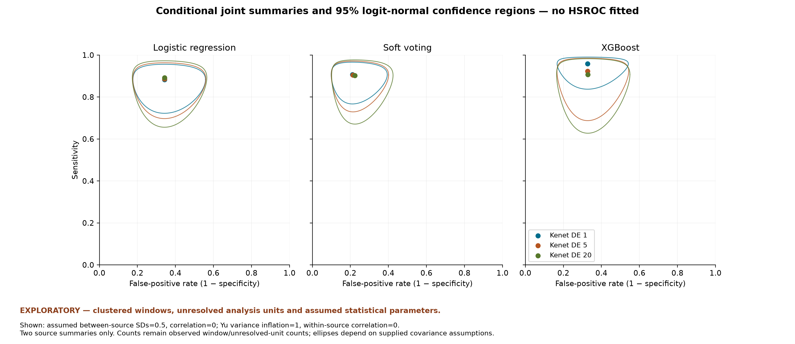
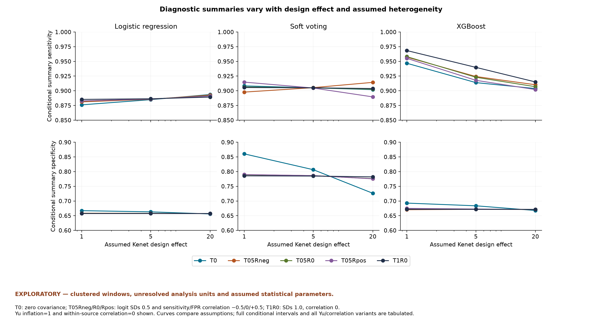

# EXPLORATORY: diagnostic joint pooling results

The supplied extraction is authoritative for this task and has not been independently verified against original papers. No new studies, external confidence intervals, author correspondence or patient-level records were consulted. Reported source values are unchanged. Original confirmatory feasibility conclusions and descriptive outputs are preserved. The numbers here are **conditional pooled calculations**, not the primary evidence-supported findings or established clinical accuracy.

**96/96 configured conditional GLS scenarios solved successfully.** Each contains one Kenet model and the Yu 2023 representative-fold table: two assumed independent source summaries, not seven independent studies or two verified patient datasets. Across all configurations, summary sensitivity ranges **0.872956-0.982449** and specificity **0.655968-0.874968**. These separate scenario extrema need not occur in the same scenario and are not confidence intervals.

EXPLORATORY — clustered windows, unresolved analysis units and assumed statistical parameters.

Two source summaries; Kenet clustered windows and mixed-age sample; Yu attribution/unit/threshold/horizon unresolved; all covariance assumptions conditional; not validated patient-level accuracy. All heterogeneity parameters are fixed assumptions, not empirical estimates. The original counts remain unchanged; all 192 source-scenario rows, analysis units, linkage caveats, sampling/total covariances and GLS weight matrices are in the [diagnostic input/covariance/weight ledger](../../results/exploratory/diagnostic_scenario_inputs.csv).

## Assumed between-source covariance matrices

| T ID | SD sensitivity | SD FPR | rho sensitivity/FPR | matrix [[T11,T12],[T12,T22]] |
| --- | --- | --- | --- | --- |
| T0 | 0.0 | 0.0 | 0.0 | [[0.0, 0.0], [0.0, 0.0]] |
| T05Rneg | 0.5 | 0.5 | -0.5 | [[0.25, -0.125], [-0.125, 0.25]] |
| T05R0 | 0.5 | 0.5 | 0.0 | [[0.25, 0.0], [0.0, 0.25]] |
| T05Rpos | 0.5 | 0.5 | 0.5 | [[0.25, 0.125], [0.125, 0.25]] |
| T1R0 | 1.0 | 1.0 | 0.0 | [[1.0, 0.0], [0.0, 1.0]] |

D means variance inflation: Kenet 1/5/20; Yu 1/5. Primary within-source rho=0. The six focused within-rho variants use Kenet D=5, Yu D=1, T05R0 and rho=-0.5/+0.5. Intervals condition on these choices, assume approximate normal logits, and do not include uncertainty in covariance parameters or extraction validity. All tables include a small-cell approximation warning because Yu has FN=4; XGBoost additionally has FN=1.

## Unchanged observed count tables used

| model_id | source_row | tp | fp | fn | tn | analysis_unit |
| --- | --- | --- | --- | --- | --- | --- |
| yu_2023_rdn_boost | 20 | 36 | 63 | 4 | 115 | representative_fold_table_unit_unverified |
| kenet_2023_logistic | 23 | 184 | 944 | 27 | 1904 | repeated_5_minute_window |
| kenet_2023_soft_voting | 28 | 192 | 345 | 19 | 2503 | repeated_5_minute_window |
| kenet_2023_xgboost | 26 | 210 | 866 | 1 | 1982 | repeated_5_minute_window |

Only one Kenet row accompanies Yu in each scenario.

## Every configured scenario

| scenario | Kenet | Kenet D | Yu D | T | within rho | conditional sensitivity [95%] | conditional specificity [95%] | status |
| --- | --- | --- | --- | --- | --- | --- | --- | --- |
| D_logistic_K1_Y1_T0_W0 | logistic | 1 | 1 | T0 | 0.0 | 0.8761 [0.8292, 0.9115] | 0.6672 [0.6502, 0.6838] | success_conditional |
| D_logistic_K1_Y1_T05Rneg_W0 | logistic | 1 | 1 | T05Rneg | 0.0 | 0.8812 [0.7613, 0.9452] | 0.6585 [0.4866, 0.7968] | success_conditional |
| D_logistic_K1_Y1_T05R0_W0 | logistic | 1 | 1 | T05R0 | 0.0 | 0.8827 [0.7628, 0.9463] | 0.6579 [0.4859, 0.7964] | success_conditional |
| D_logistic_K1_Y1_T05Rpos_W0 | logistic | 1 | 1 | T05Rpos | 0.0 | 0.8828 [0.7642, 0.9460] | 0.6575 [0.4855, 0.7961] | success_conditional |
| D_logistic_K1_Y1_T1R0_W0 | logistic | 1 | 1 | T1R0 | 0.0 | 0.8853 [0.6362, 0.9715] | 0.6575 [0.3224, 0.8857] | success_conditional |
| D_logistic_K1_Y5_T0_W0 | logistic | 1 | 5 | T0 | 0.0 | 0.8730 [0.8219, 0.9109] | 0.6683 [0.6509, 0.6852] | success_conditional |
| D_logistic_K1_Y5_T05Rneg_W0 | logistic | 1 | 5 | T05Rneg | 0.0 | 0.8745 [0.7292, 0.9475] | 0.6605 [0.4767, 0.8060] | success_conditional |
| D_logistic_K1_Y5_T05R0_W0 | logistic | 1 | 5 | T05R0 | 0.0 | 0.8767 [0.7281, 0.9497] | 0.6596 [0.4755, 0.8055] | success_conditional |
| D_logistic_K1_Y5_T05Rpos_W0 | logistic | 1 | 5 | T05Rpos | 0.0 | 0.8777 [0.7349, 0.9489] | 0.6589 [0.4749, 0.8049] | success_conditional |
| D_logistic_K1_Y5_T1R0_W0 | logistic | 1 | 5 | T1R0 | 0.0 | 0.8812 [0.5827, 0.9752] | 0.6580 [0.3162, 0.8890] | success_conditional |
| D_logistic_K5_Y1_T0_W0 | logistic | 5 | 1 | T0 | 0.0 | 0.8849 [0.7957, 0.9382] | 0.6631 [0.6284, 0.6961] | success_conditional |
| D_logistic_K5_Y1_T05Rneg_W0 | logistic | 5 | 1 | T05Rneg | 0.0 | 0.8855 [0.7452, 0.9534] | 0.6581 [0.4850, 0.7973] | success_conditional |
| D_logistic_K5_Y1_T05R0_W0 | logistic | 5 | 1 | T05R0 | 0.0 | 0.8858 [0.7457, 0.9536] | 0.6577 [0.4846, 0.7971] | success_conditional |
| D_logistic_K5_Y1_T05Rpos_W0 | logistic | 5 | 1 | T05Rpos | 0.0 | 0.8859 [0.7459, 0.9536] | 0.6575 [0.4844, 0.7969] | success_conditional |
| D_logistic_K5_Y1_T1R0_W0 | logistic | 5 | 1 | T1R0 | 0.0 | 0.8864 [0.6245, 0.9734] | 0.6575 [0.3219, 0.8859] | success_conditional |
| D_logistic_K5_Y5_T0_W0 | logistic | 5 | 5 | T0 | 0.0 | 0.8761 [0.7530, 0.9425] | 0.6672 [0.6287, 0.7036] | success_conditional |
| D_logistic_K5_Y5_T05Rneg_W0 | logistic | 5 | 5 | T05Rneg | 0.0 | 0.8771 [0.6902, 0.9581] | 0.6602 [0.4750, 0.8067] | success_conditional |
| D_logistic_K5_Y5_T05R0_W0 | logistic | 5 | 5 | T05R0 | 0.0 | 0.8787 [0.6907, 0.9592] | 0.6594 [0.4739, 0.8063] | success_conditional |
| D_logistic_K5_Y5_T05Rpos_W0 | logistic | 5 | 5 | T05Rpos | 0.0 | 0.8795 [0.6952, 0.9590] | 0.6588 [0.4734, 0.8058] | success_conditional |
| D_logistic_K5_Y5_T1R0_W0 | logistic | 5 | 5 | T1R0 | 0.0 | 0.8821 [0.5634, 0.9775] | 0.6580 [0.3156, 0.8892] | success_conditional |
| D_logistic_K20_Y1_T0_W0 | logistic | 20 | 1 | T0 | 0.0 | 0.8937 [0.7742, 0.9537] | 0.6560 [0.6022, 0.7060] | success_conditional |
| D_logistic_K20_Y1_T05Rneg_W0 | logistic | 20 | 1 | T05Rneg | 0.0 | 0.8927 [0.7221, 0.9639] | 0.6572 [0.4800, 0.7992] | success_conditional |
| D_logistic_K20_Y1_T05R0_W0 | logistic | 20 | 1 | T05R0 | 0.0 | 0.8916 [0.7184, 0.9636] | 0.6572 [0.4801, 0.7993] | success_conditional |
| D_logistic_K20_Y1_T05Rpos_W0 | logistic | 20 | 1 | T05Rpos | 0.0 | 0.8911 [0.7187, 0.9633] | 0.6573 [0.4801, 0.7993] | success_conditional |
| D_logistic_K20_Y1_T1R0_W0 | logistic | 20 | 1 | T1R0 | 0.0 | 0.8893 [0.5938, 0.9778] | 0.6574 [0.3200, 0.8866] | success_conditional |
| D_logistic_K20_Y5_T0_W0 | logistic | 20 | 5 | T0 | 0.0 | 0.8834 [0.6460, 0.9692] | 0.6640 [0.5915, 0.7295] | success_conditional |
| D_logistic_K20_Y5_T05Rneg_W0 | logistic | 20 | 5 | T05Rneg | 0.0 | 0.8835 [0.6076, 0.9738] | 0.6594 [0.4690, 0.8093] | success_conditional |
| D_logistic_K20_Y5_T05R0_W0 | logistic | 20 | 5 | T05R0 | 0.0 | 0.8840 [0.6085, 0.9739] | 0.6590 [0.4684, 0.8090] | success_conditional |
| D_logistic_K20_Y5_T05Rpos_W0 | logistic | 20 | 5 | T05Rpos | 0.0 | 0.8843 [0.6094, 0.9740] | 0.6586 [0.4681, 0.8087] | success_conditional |
| D_logistic_K20_Y5_T1R0_W0 | logistic | 20 | 5 | T1R0 | 0.0 | 0.8850 [0.5098, 0.9827] | 0.6579 [0.3136, 0.8900] | success_conditional |
| D_soft_voting_K1_Y1_T0_W0 | soft_voting | 1 | 1 | T0 | 0.0 | 0.9083 [0.8658, 0.9383] | 0.8604 [0.8472, 0.8726] | success_conditional |
| D_soft_voting_K1_Y1_T05Rneg_W0 | soft_voting | 1 | 1 | T05Rneg | 0.0 | 0.8978 [0.7881, 0.9540] | 0.7897 [0.6484, 0.8844] | success_conditional |
| D_soft_voting_K1_Y1_T05R0_W0 | soft_voting | 1 | 1 | T05R0 | 0.0 | 0.9064 [0.8032, 0.9583] | 0.7891 [0.6475, 0.8840] | success_conditional |
| D_soft_voting_K1_Y1_T05Rpos_W0 | soft_voting | 1 | 1 | T05Rpos | 0.0 | 0.9148 [0.8197, 0.9620] | 0.7900 [0.6488, 0.8846] | success_conditional |
| D_soft_voting_K1_Y1_T1R0_W0 | soft_voting | 1 | 1 | T1R0 | 0.0 | 0.9056 [0.6834, 0.9771] | 0.7857 [0.4759, 0.9367] | success_conditional |
| D_soft_voting_K1_Y5_T0_W0 | soft_voting | 1 | 5 | T0 | 0.0 | 0.9096 [0.8637, 0.9410] | 0.8750 [0.8623, 0.8866] | success_conditional |
| D_soft_voting_K1_Y5_T05Rneg_W0 | soft_voting | 1 | 5 | T05Rneg | 0.0 | 0.8907 [0.7548, 0.9557] | 0.8068 [0.6612, 0.8993] | success_conditional |
| D_soft_voting_K1_Y5_T05R0_W0 | soft_voting | 1 | 5 | T05R0 | 0.0 | 0.9084 [0.7853, 0.9642] | 0.8059 [0.6598, 0.8989] | success_conditional |
| D_soft_voting_K1_Y5_T05Rpos_W0 | soft_voting | 1 | 5 | T05Rpos | 0.0 | 0.9238 [0.8208, 0.9698] | 0.8072 [0.6619, 0.8996] | success_conditional |
| D_soft_voting_K1_Y5_T1R0_W0 | soft_voting | 1 | 5 | T1R0 | 0.0 | 0.9070 [0.6455, 0.9812] | 0.7909 [0.4760, 0.9403] | success_conditional |
| D_soft_voting_K5_Y1_T0_W0 | soft_voting | 5 | 1 | T0 | 0.0 | 0.9050 [0.8200, 0.9522] | 0.8065 [0.7743, 0.8351] | success_conditional |
| D_soft_voting_K5_Y1_T05Rneg_W0 | soft_voting | 5 | 1 | T05Rneg | 0.0 | 0.9054 [0.7766, 0.9634] | 0.7864 [0.6416, 0.8833] | success_conditional |
| D_soft_voting_K5_Y1_T05R0_W0 | soft_voting | 5 | 1 | T05R0 | 0.0 | 0.9050 [0.7760, 0.9633] | 0.7862 [0.6414, 0.8832] | success_conditional |
| D_soft_voting_K5_Y1_T05Rpos_W0 | soft_voting | 5 | 1 | T05Rpos | 0.0 | 0.9047 [0.7753, 0.9631] | 0.7864 [0.6417, 0.8833] | success_conditional |
| D_soft_voting_K5_Y1_T1R0_W0 | soft_voting | 5 | 1 | T1R0 | 0.0 | 0.9051 [0.6648, 0.9786] | 0.7849 [0.4736, 0.9367] | success_conditional |
| D_soft_voting_K5_Y5_T0_W0 | soft_voting | 5 | 5 | T0 | 0.0 | 0.9083 [0.7915, 0.9627] | 0.8604 [0.8295, 0.8864] | success_conditional |
| D_soft_voting_K5_Y5_T05Rneg_W0 | soft_voting | 5 | 5 | T05Rneg | 0.0 | 0.8950 [0.7119, 0.9671] | 0.8039 [0.6544, 0.8987] | success_conditional |
| D_soft_voting_K5_Y5_T05R0_W0 | soft_voting | 5 | 5 | T05R0 | 0.0 | 0.9076 [0.7381, 0.9716] | 0.8032 [0.6534, 0.8984] | success_conditional |
| D_soft_voting_K5_Y5_T05Rpos_W0 | soft_voting | 5 | 5 | T05Rpos | 0.0 | 0.9190 [0.7667, 0.9751] | 0.8043 [0.6550, 0.8989] | success_conditional |
| D_soft_voting_K5_Y5_T1R0_W0 | soft_voting | 5 | 5 | T1R0 | 0.0 | 0.9066 [0.6175, 0.9831] | 0.7902 [0.4736, 0.9403] | success_conditional |
| D_soft_voting_K20_Y1_T0_W0 | soft_voting | 20 | 1 | T0 | 0.0 | 0.9020 [0.7845, 0.9588] | 0.7264 [0.6713, 0.7753] | success_conditional |
| D_soft_voting_K20_Y1_T05Rneg_W0 | soft_voting | 20 | 1 | T05Rneg | 0.0 | 0.9143 [0.7618, 0.9727] | 0.7758 [0.6201, 0.8800] | success_conditional |
| D_soft_voting_K20_Y1_T05R0_W0 | soft_voting | 20 | 1 | T05R0 | 0.0 | 0.9028 [0.7339, 0.9690] | 0.7762 [0.6206, 0.8802] | success_conditional |
| D_soft_voting_K20_Y1_T05Rpos_W0 | soft_voting | 20 | 1 | T05Rpos | 0.0 | 0.8896 [0.7072, 0.9642] | 0.7756 [0.6199, 0.8799] | success_conditional |
| D_soft_voting_K20_Y1_T1R0_W0 | soft_voting | 20 | 1 | T1R0 | 0.0 | 0.9038 [0.6188, 0.9819] | 0.7821 [0.4654, 0.9367] | success_conditional |
| D_soft_voting_K20_Y5_T0_W0 | soft_voting | 20 | 5 | T0 | 0.0 | 0.9055 [0.6689, 0.9785] | 0.8175 [0.7491, 0.8705] | success_conditional |
| D_soft_voting_K20_Y5_T05Rneg_W0 | soft_voting | 20 | 5 | T05Rneg | 0.0 | 0.9038 [0.6306, 0.9810] | 0.7941 [0.6317, 0.8966] | success_conditional |
| D_soft_voting_K20_Y5_T05R0_W0 | soft_voting | 20 | 5 | T05R0 | 0.0 | 0.9055 [0.6351, 0.9814] | 0.7939 [0.6314, 0.8965] | success_conditional |
| D_soft_voting_K20_Y5_T05Rpos_W0 | soft_voting | 20 | 5 | T05Rpos | 0.0 | 0.9072 [0.6397, 0.9817] | 0.7943 [0.6319, 0.8967] | success_conditional |
| D_soft_voting_K20_Y5_T1R0_W0 | soft_voting | 20 | 5 | T1R0 | 0.0 | 0.9053 [0.5428, 0.9872] | 0.7875 [0.4651, 0.9404] | success_conditional |
| D_xgboost_K1_Y1_T0_W0 | xgboost | 1 | 1 | T0 | 0.0 | 0.9468 [0.8771, 0.9780] | 0.6929 [0.6762, 0.7091] | success_conditional |
| D_xgboost_K1_Y1_T05Rneg_W0 | xgboost | 1 | 1 | T05Rneg | 0.0 | 0.9572 [0.8723, 0.9865] | 0.6704 [0.4999, 0.8053] | success_conditional |
| D_xgboost_K1_Y1_T05R0_W0 | xgboost | 1 | 1 | T05R0 | 0.0 | 0.9581 [0.8738, 0.9869] | 0.6726 [0.5024, 0.8069] | success_conditional |
| D_xgboost_K1_Y1_T05Rpos_W0 | xgboost | 1 | 1 | T05Rpos | 0.0 | 0.9552 [0.8670, 0.9859] | 0.6749 [0.5051, 0.8086] | success_conditional |
| D_xgboost_K1_Y1_T1R0_W0 | xgboost | 1 | 1 | T1R0 | 0.0 | 0.9684 [0.8445, 0.9943] | 0.6718 [0.3366, 0.8920] | success_conditional |
| D_xgboost_K1_Y5_T0_W0 | xgboost | 1 | 5 | T0 | 0.0 | 0.9824 [0.9261, 0.9960] | 0.6953 [0.6782, 0.7118] | success_conditional |
| D_xgboost_K1_Y5_T05Rneg_W0 | xgboost | 1 | 5 | T05Rneg | 0.0 | 0.9817 [0.9114, 0.9964] | 0.6705 [0.4878, 0.8130] | success_conditional |
| D_xgboost_K1_Y5_T05R0_W0 | xgboost | 1 | 5 | T05R0 | 0.0 | 0.9817 [0.9112, 0.9964] | 0.6763 [0.4943, 0.8171] | success_conditional |
| D_xgboost_K1_Y5_T05Rpos_W0 | xgboost | 1 | 5 | T05Rpos | 0.0 | 0.9819 [0.9124, 0.9965] | 0.6824 [0.5014, 0.8211] | success_conditional |
| D_xgboost_K1_Y5_T1R0_W0 | xgboost | 1 | 5 | T1R0 | 0.0 | 0.9804 [0.8657, 0.9974] | 0.6729 [0.3308, 0.8954] | success_conditional |
| D_xgboost_K5_Y1_T0_W0 | xgboost | 5 | 1 | T0 | 0.0 | 0.9139 [0.7952, 0.9667] | 0.6837 [0.6494, 0.7161] | success_conditional |
| D_xgboost_K5_Y1_T05Rneg_W0 | xgboost | 5 | 1 | T05Rneg | 0.0 | 0.9242 [0.7636, 0.9788] | 0.6718 [0.5003, 0.8071] | success_conditional |
| D_xgboost_K5_Y1_T05R0_W0 | xgboost | 5 | 1 | T05R0 | 0.0 | 0.9230 [0.7551, 0.9790] | 0.6722 [0.5008, 0.8074] | success_conditional |
| D_xgboost_K5_Y1_T05Rpos_W0 | xgboost | 5 | 1 | T05Rpos | 0.0 | 0.9178 [0.7472, 0.9768] | 0.6727 [0.5014, 0.8078] | success_conditional |
| D_xgboost_K5_Y1_T1R0_W0 | xgboost | 5 | 1 | T1R0 | 0.0 | 0.9398 [0.6761, 0.9915] | 0.6717 [0.3359, 0.8922] | success_conditional |
| D_xgboost_K5_Y5_T0_W0 | xgboost | 5 | 5 | T0 | 0.0 | 0.9468 [0.6974, 0.9928] | 0.6929 [0.6550, 0.7284] | success_conditional |
| D_xgboost_K5_Y5_T05Rneg_W0 | xgboost | 5 | 5 | T05Rneg | 0.0 | 0.9505 [0.6836, 0.9942] | 0.6738 [0.4900, 0.8162] | success_conditional |
| D_xgboost_K5_Y5_T05R0_W0 | xgboost | 5 | 5 | T05R0 | 0.0 | 0.9500 [0.6797, 0.9942] | 0.6760 [0.4925, 0.8177] | success_conditional |
| D_xgboost_K5_Y5_T05Rpos_W0 | xgboost | 5 | 5 | T05Rpos | 0.0 | 0.9482 [0.6732, 0.9939] | 0.6783 [0.4952, 0.8193] | success_conditional |
| D_xgboost_K5_Y5_T1R0_W0 | xgboost | 5 | 5 | T1R0 | 0.0 | 0.9565 [0.6291, 0.9965] | 0.6728 [0.3301, 0.8956] | success_conditional |
| D_xgboost_K20_Y1_T0_W0 | xgboost | 20 | 1 | T0 | 0.0 | 0.9038 [0.7710, 0.9632] | 0.6677 [0.6142, 0.7173] | success_conditional |
| D_xgboost_K20_Y1_T05Rneg_W0 | xgboost | 20 | 1 | T05Rneg | 0.0 | 0.9103 [0.7204, 0.9756] | 0.6712 [0.4954, 0.8093] | success_conditional |
| D_xgboost_K20_Y1_T05R0_W0 | xgboost | 20 | 1 | T05R0 | 0.0 | 0.9069 [0.7050, 0.9755] | 0.6711 [0.4953, 0.8092] | success_conditional |
| D_xgboost_K20_Y1_T05Rpos_W0 | xgboost | 20 | 1 | T05Rpos | 0.0 | 0.9021 [0.7005, 0.9732] | 0.6710 [0.4953, 0.8092] | success_conditional |
| D_xgboost_K20_Y1_T1R0_W0 | xgboost | 20 | 1 | T1R0 | 0.0 | 0.9151 [0.5562, 0.9893] | 0.6714 [0.3337, 0.8928] | success_conditional |
| D_xgboost_K20_Y5_T0_W0 | xgboost | 20 | 5 | T0 | 0.0 | 0.9169 [0.5416, 0.9904] | 0.6857 [0.6137, 0.7496] | success_conditional |
| D_xgboost_K20_Y5_T05Rneg_W0 | xgboost | 20 | 5 | T05Rneg | 0.0 | 0.9215 [0.5158, 0.9923] | 0.6744 [0.4854, 0.8197] | success_conditional |
| D_xgboost_K20_Y5_T05R0_W0 | xgboost | 20 | 5 | T05R0 | 0.0 | 0.9192 [0.5046, 0.9922] | 0.6749 [0.4860, 0.8200] | success_conditional |
| D_xgboost_K20_Y5_T05Rpos_W0 | xgboost | 20 | 5 | T05Rpos | 0.0 | 0.9160 [0.4974, 0.9918] | 0.6754 [0.4867, 0.8204] | success_conditional |
| D_xgboost_K20_Y5_T1R0_W0 | xgboost | 20 | 5 | T1R0 | 0.0 | 0.9254 [0.4125, 0.9955] | 0.6725 [0.3278, 0.8963] | success_conditional |
| D_logistic_K5_Y1_T05R0_W-0.5 | logistic | 5 | 1 | T05R0 | -0.5 | 0.8860 [0.7461, 0.9536] | 0.6571 [0.4840, 0.7966] | success_conditional |
| D_logistic_K5_Y1_T05R0_W+0.5 | logistic | 5 | 1 | T05R0 | 0.5 | 0.8857 [0.7455, 0.9535] | 0.6583 [0.4853, 0.7974] | success_conditional |
| D_soft_voting_K5_Y1_T05R0_W-0.5 | soft_voting | 5 | 1 | T05R0 | -0.5 | 0.9059 [0.7777, 0.9636] | 0.7861 [0.6413, 0.8831] | success_conditional |
| D_soft_voting_K5_Y1_T05R0_W+0.5 | soft_voting | 5 | 1 | T05R0 | 0.5 | 0.9042 [0.7743, 0.9629] | 0.7860 [0.6412, 0.8831] | success_conditional |
| D_xgboost_K5_Y1_T05R0_W-0.5 | xgboost | 5 | 1 | T05R0 | -0.5 | 0.9236 [0.7570, 0.9791] | 0.6684 [0.4966, 0.8046] | success_conditional |
| D_xgboost_K5_Y1_T05R0_W+0.5 | xgboost | 5 | 1 | T05R0 | 0.5 | 0.9218 [0.7525, 0.9786] | 0.6762 [0.5055, 0.8102] | success_conditional |

Every bracket is a **conditional marginal** 95% interval, not a reported study CI or validated patient-level interval. Full precision and diagnostics are in [diagnostic_scenario_results.csv](../../results/exploratory/diagnostic_scenario_results.csv). No unrestricted covariance/HSROC fit was claimed. Closed-form solutions are checked by positive-definite covariance, normal equations and condition numbers; large conditional residual diagnostics remain visible.

## Numerical diagnostics

Maximum normal-equation residual: 5.73e-14; maximum covariance/precision condition number: 605.543. There are 8 scenarios with large conditional residual discrepancy warnings, retained in the table/ledger. This signals tension under the specified covariance model, not an estimated heterogeneity parameter. All 96 scenarios have sparse-cell approximation warnings. No warnings are used to select favourable scenarios.

## Conditional joint regions

Caption: one panel per Kenet model; fixed T05R0 (SDs=0.5, rho=0), Yu D=1, within rho=0; Kenet D=1/5/20 varies. Lines are transformed **joint confidence ellipses** under supplied covariance, not fitted SROC curves or prediction regions. EXPLORATORY — clustered windows, unresolved analysis units and assumed statistical parameters. Two source summaries; Kenet clustered windows and mixed-age sample; Yu attribution/unit/threshold/horizon unresolved; all covariance assumptions conditional; not validated patient-level accuracy.

Caption: all five T choices across Kenet D=1/5/20, per model, holding Yu D=1 and within rho=0. Lines connect assumption scenarios and omit error bars for legibility; all conditional intervals and additional variants are tabulated. EXPLORATORY — clustered windows, unresolved analysis units and assumed statistical parameters. Two source summaries; Kenet clustered windows and mixed-age sample; Yu attribution/unit/threshold/horizon unresolved; all covariance assumptions conditional; not validated patient-level accuracy.
