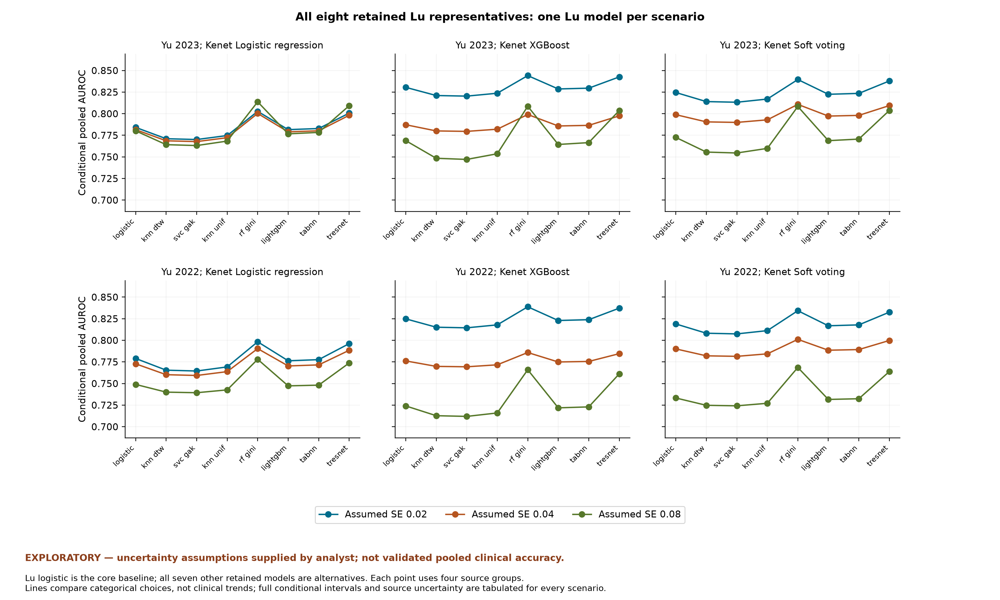

# All retained Lu representatives

This eligibility revision wholly excludes Lu 2025 XGBoost, gMLP and PEDCA-FT because their sensitivity/specificity was graphically extracted and considered insufficiently reliable. Their AUROCs are excluded with the entries; this does not assert that those AUROCs were graphical. The revised extraction retains five reports and 17 models, including eight Lu models. Other Lu models remain eligible despite missing operating points. Only the supplied sources and existing derivatives are used. Original source hashes are unchanged and no new papers, clinical data or correspondence were obtained. Confirmatory pooling remains unsupported; every pooled number here is explicitly conditional on analyst assumptions.

EXPLORATORY — uncertainty assumptions supplied by analyst; not validated pooled clinical accuracy.

Core logistic regression and all seven remaining retained alternatives are crossed with the same other source selections and SE assumptions. No model is selected because its observed AUROC is highest. All 144 four-source scenarios use exactly one Lu model.

| lu_model_id | individual_auroc | scenario_count | pooled_min | pooled_max | max_absolute_change_from_matched_lu_logistic |
| --- | --- | --- | --- | --- | --- |
| lu_2025_logistic | 0.6292 | 18 | 0.7240731071621067 | 0.8305023589110181 | 0.0 |
| lu_2025_knn_dtw | 0.5527000000000001 | 18 | 0.7127655421224767 | 0.8210303676945517 | 0.020428806993685877 |
| lu_2025_svc_gak | 0.5472 | 18 | 0.7119517745376744 | 0.820346029449468 | 0.021728795179537075 |
| lu_2025_knn_unif | 0.5740999999999999 | 18 | 0.7159313582816196 | 0.8236824921328535 | 0.015193310238810875 |
| lu_2025_rf_gini | 0.7329000000000001 | 18 | 0.7659480078673743 | 0.8440928251643599 | 0.04187490070526756 |
| lu_2025_lightgbm | 0.6142 | 18 | 0.7218597124098084 | 0.8286391697187089 | 0.0044322806190745245 |
| lu_2025_tabnn | 0.6215999999999999 | 18 | 0.7229521528741276 | 0.8295571084633281 | 0.002277697844302984 |
| lu_2025_tresnet | 0.7221 | 18 | 0.7611830589808515 | 0.8425747545892683 | 0.03710995181874477 |

Ranges are conditional point-estimate spreads across 18 configurations, not study/model confidence intervals. Full per-scenario inputs, weights, intervals and diagnostics are in `auroc_scenario_results.csv` and `auroc_scenario_inputs.csv`.
