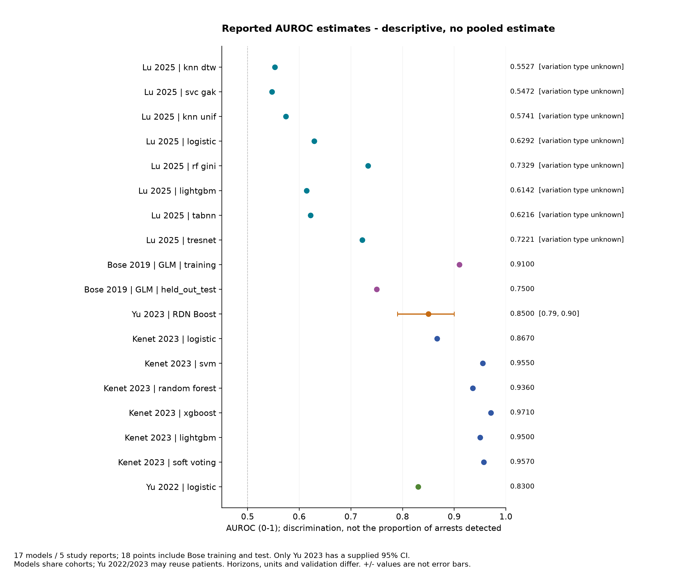
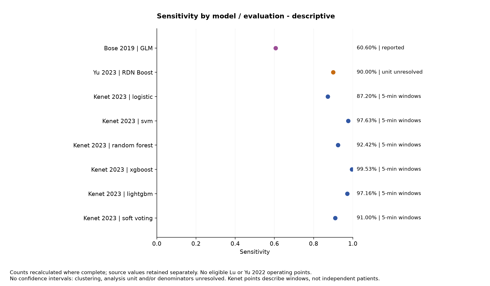
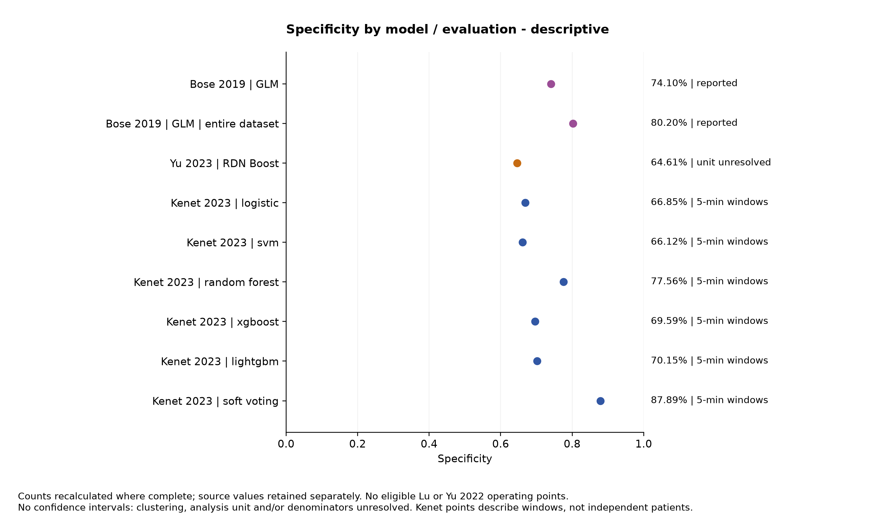
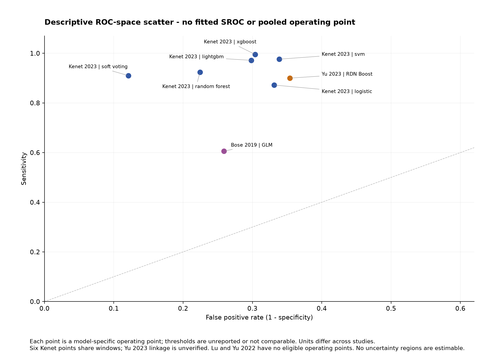
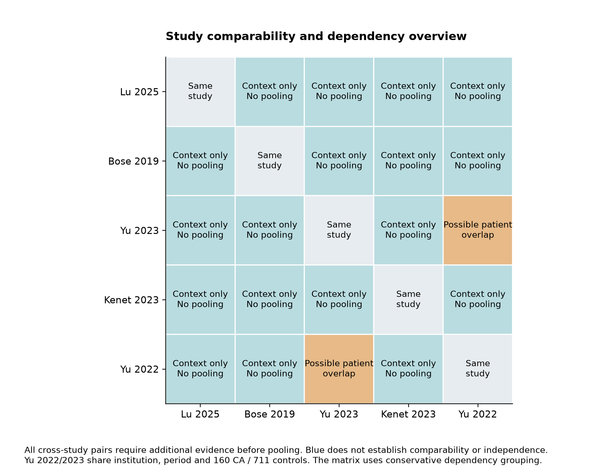
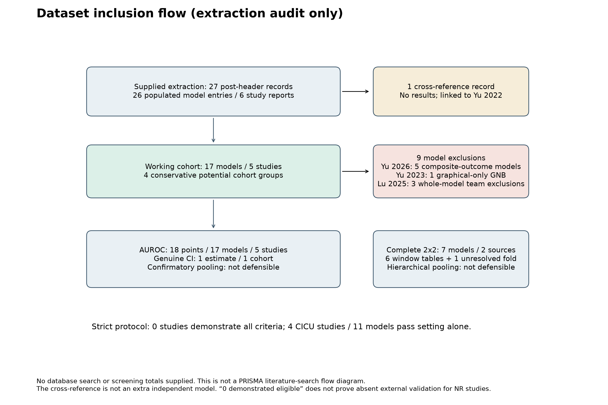

# Revised paediatric cardiac arrest analysis

Eligibility revision: 12 November 2026. Exploratory working scope, not fully protocol-concordant. This report analyses the supplied extraction rather than claiming new systematic searching or independent full-text verification.

## 1. Research question and objectives

How accurately can predictive algorithms identify impending paediatric cardiac arrest? Both confirmatory feasibility and separately labelled exploratory calculations are retained. AUROC, threshold-specific sensitivity/specificity and PPV concern different estimands and units.

## 2. Data sources and study eligibility

Only the original extraction CSV, List of Variables (3 pages), PROSPERO snapshot (7 pages) and their existing derivatives are used. No new papers, external data or correspondence were obtained. Original-file hashes are unchanged. Source row means 1-based logical CSV record including both header records; physical multiline spans are separate. Original/curated sources remain immutable, with raw PDFs/CSV and private narratives excluded from Git.

There are 27 post-header records, 26 populated original model entries and 6 original reports. One record is a cross-reference, with no extracted results, rather than a blank row. After 9 whole-model exclusions, **5 reports and 17 models remain**, including **8 Lu models**. There are **18 numerical AUROC evaluations**, because Bose contributes separate training and test results, and 8 unspecified Lu +/- quantities. Only one labelled AUROC CI is supplied. Seven complete candidate diagnostic tables still come from two sources.

## 3. Agreed exclusions and protocol discrepancies

Previous exclusions remain: five Yu 2026 models for composite adverse events and Yu 2023 Gaussian Naive Bayes for inadequate graphical numerical results. The new team decision excludes entire Lu 2025 XGBoost, gMLP and PEDCA-FT entries, including their AUROCs: **Research-team decision: model excluded because sensitivity and specificity were extracted graphically and considered insufficiently reliable.** This is a model-level eligibility decision based on the sensitivity/specificity extraction, not a claim that those AUROCs were necessarily graph-read. Missing sensitivity/specificity alone does not exclude the other Lu models.

General PICU remains team-agreed; Kenet includes 38 adults. No external-validation waiver or PROSPERO amendment is presumed. Strict demonstrated eligibility remains empty.

## 4. Data cleaning and validation

Two headers and multiline source provenance are preserved. Percentages are normalized without replacing missing values by zero. All exclusions occur before numerical metric parsing for retained analysis. Original uncertainty text remains distinct from CI/SE. Complete diagnostic tables are recalculated, and the random-forest specificity discrepancy is retained. Original source hashes are unchanged.

## 5. Characteristics of included studies

All five reports are retrospective single-centre US studies. Counts by report are {'lu_2025': 8, 'bose_2019': 1, 'yu_2023': 1, 'kenet_2023': 6, 'yu_2022': 1}.

| study_id | retained_models | sample_size_and_ca | icu_setting | model_architectures | training_validation | prediction_horizon | reporting_limitations |
| --- | --- | --- | --- | --- | --- | --- | --- |
| lu_2025 | 8 | 3,566 patients; 4,672 admissions; 4.0% patient and 3.1% admission CA proportions (rounded; exact counts not supplied) | CICU | knn dtw; svc gak; knn unif; logistic; rf gini; lightgbm; tabnn; tresnet | Five-fold CV grouped by patient; no separate external validation | First-24h input; target outcome interval requires public verification | Eight retained AUROC +/- quantities have unspecified meaning; no eligible retained sensitivity/specificity; three whole model entries excluded by team because their operating points were graphical. Exact outcome interval/definition remains unverified; duplicated baseline quality text. |
| bose_2019 | 1 | Initial 228 patients (22 CA); analysed 64 (16 CA, 48 matched controls); training 44 (11 CA), test 20 (5 CA) | CICU | glm | Patient train/test split 44/20, with 60 bootstrap iterations; no external validation | At least 2h warning; mean 17h (SD 7.5) among 16 cases; not a fixed 17h forecast | Only 5 test arrest patients; bootstrap procedure described but no numerical AUROC CI/SE supplied; percentage sensitivity does not identify an integer patient table; recruitment start date inconsistent |
| yu_2023 | 1 | 160 index CA cases/events and 711 unique controls; selected case-control fraction 18.37%, not population incidence | CICU | rdn boost | Five-fold CV (80/20 per fold), control subsampling; no demonstrated external validation | 1h extracted peak AUROC; other 5/9/13h results not numerically supplied | Representative confusion-matrix model attribution assumed in extraction; fold, threshold, horizon and unit unresolved; probable cohort reuse with Yu 2022; rounded PPV/NPV require comparison with exact table-derived values |
| kenet_2023 | 6 | 1,145 patients, 15 CA; 14,714 windows, 516 positive overall; test 229 patients (5 CA); six test matrices each contain 3,059 windows (211 positive) | general_PICU | logistic; svm; random forest; xgboost; lightgbm; soft voting | Patient split: train 732 (6 CA), validation 184 (4 CA), test 229 (5 CA) | 5min windows labelled positive within 3h before CA; 3h preferred over 1h | Repeated windows and six dependent models; no intrapatient correlation or clustering adjustment supplied; 1,019/2,164 patients removed including 57 CA; 38 adults included; recruitment ends July vs August 2021 |
| yu_2022 | 1 | 871 selected patients: 160 CA and 711 controls; 18.37% sample fraction, not population prevalence | CICU | logistic | No independent validation reported | 1h extracted peak; 1-15h evaluated, distal ranges approximate only | No AUROC CI/SE or model-level 2x2; independent validation unreported; cases referenced to arrest vs controls first 48h; probable cohort reuse with Yu 2023 |

## 6. Descriptive predictive performance

Nontraining/other reported AUROC span: **0.5472-0.9710**. Lu retained span: **0.5472-0.7329**. Bose held-out test 0.75 versus training 0.91; Yu 2023 0.85 (95% CI 0.79-0.90); Yu 2022 peak 0.83; Kenet 0.867-0.971. These are dependent descriptive results, not study averages or an architecture ranking. Lu and Yu 2022 have no eligible operating points. The model table preserves every retained result.

| study | model | source row | AUROC (source text) | sensitivity (source) | specificity (source) | TP/FP/FN/TN | AUPRC |
| --- | --- | --- | --- | --- | --- | --- | --- |
| lu_2025 | knn dtw | 8 | 55.27 ± 4.21 | NR | NR | NR/NR/NR/NR | NR |
| lu_2025 | svc gak | 9 | 54.72 ± 3.80 | NR | NR | NR/NR/NR/NR | NR |
| lu_2025 | knn unif | 10 | 57.41 ± 2.99 | NR | NR | NR/NR/NR/NR | NR |
| lu_2025 | logistic | 11 | 62.92 ± 1.92 | NR | NR | NR/NR/NR/NR | NR |
| lu_2025 | rf gini | 12 | 73.29 ± 2.47 | NR | NR | NR/NR/NR/NR | NR |
| lu_2025 | lightgbm | 14 | 61.42 ± 11.06 | NR | NR | NR/NR/NR/NR | NR |
| lu_2025 | tabnn | 15 | 62.16 ± 3.64 | NR | NR | NR/NR/NR/NR | NR |
| lu_2025 | tresnet | 16 | 72.21 ± 7.22 | NR | NR | NR/NR/NR/NR | NR |
| bose_2019 | glm | 19 | 0.91 (training set); 0.75 (test set) | 60.6% (test set; unchanged when evaluated on entire dataset excluding patients with <2h data) | 74.1% (test set); 80.2% (entire dataset) | NR/NR/NR/NR | NR |
| yu_2023 | rdn boost | 20 | 0.85 [95% CI 0.79, 0.90] at 1 hour prior to CA (peak performance); values also reported at 13, 9, and 5 hours prior (see Table 1 subgroup analyses; overall model AUROC lower at more distal time points, improving as time to arrest decreased) | 90% | 65% | 36/63/4/115 | NR |
| kenet_2023 | logistic | 23 | 0.867 (auPRC 0.529; accuracy 68.3%; PPV 16.3%; NPV 98.6%) | 87.20% | 66.90% | 184/944/27/1904 | 0.529 |
| kenet_2023 | svm | 24 | 0.955 (auPRC 0.614; accuracy 68.3%; PPV 17.6%; NPV 99.7%) | 97.60% | 66.10% | 206/965/5/1883 | 0.614 |
| kenet_2023 | random forest | 25 | 0.936 (auPRC 0.597; accuracy 78.6%; PPV 23.4%; NPV 99.3%) | 92.40% | 77.80% | 195/639/16/2209 | 0.597 |
| kenet_2023 | xgboost | 26 | 0.971 (auPRC 0.797 — best of all six models on both metrics; accuracy 71.7%; PPV 19.5%; NPV 99.9%) | 99.50% | 69.60% | 210/866/1/1982 | 0.797 |
| kenet_2023 | lightgbm | 27 | 0.950 (auPRC 0.727; accuracy 72.0%; PPV 19.4%; NPV 99.7%) | 97.20% | 70.20% | 205/850/6/1998 | 0.727 |
| kenet_2023 | soft voting | 28 | 0.957 (auPRC 0.733; accuracy 88.1% — highest of all six models; PPV 35.8% — highest of all six models; NPV 99.2%) | 91.00% | 87.90% | 192/345/19/2503 | 0.733 |
| yu_2022 | logistic | 29 | 0.83 at 1 hour before CA (best/peak performance); AUROC increased over time as it approached the arrest, ranging from approximately 0.72–0.74 at 15–10 hours prior, rising to 0.83 at 1 hour prior (see Figure 1 for full hourly trend) | NR | NR | NR/NR/NR/NR | NR |

## 7. AUROC meta-analysis: methods, feasibility, results

**Confirmatory status: not statistically defensible from the supplied evidence.** 5 reports/17 models supply 18 AUROC evaluations, but just one cohort has genuine numerical uncertainty. The 8 retained Lu +/- values are unspecified, not SEs. No confirmatory pooled AUROC, CI, p-value, tau-squared, I-squared or prediction interval is produced.

The separate exploratory report recomputes 18 core scenarios with Lu logistic regression and all seven retained alternative representatives. No original PEDCA-FT pooled value is reused as a revised result. The statistical estimator remains Paule-Mandel with modified Hartung-Knapp intervals; only its representative inputs change.

## 8. Sensitivity/specificity meta-analysis: methods, feasibility, results

**Confirmatory status: not statistically defensible from the supplied evidence.** Seven tables represent six Kenet algorithms on shared windows and one Yu 2023 representative fold. Zero confirmed independent patient-level tables contribute to a confirmatory pooled fit. No unrestricted bivariate covariance or HSROC curve is estimated.

The 96 constrained joint GLS scenarios are rerun with unchanged count tables and covariance assumptions and numerically compared with the saved prior run. These conditional summaries are not an unrestricted bivariate/HSROC fit.

## 9. Heterogeneity and sensitivity analyses

Different forecast times, definitions, units, sampling and internal validation persist. Yu 2022/2023 are grouped conservatively for possible overlap. Eight Lu representatives are analysed separately, never as independent cohorts in a single pooled scenario. Conditional scenario spread does not establish clinical validity.

## 10. Risk of bias and certainty

QUADAS-2 evidence and adapted GRADE preparation remain incomplete reviewer worksheets; no definitive software-assigned ratings or dual-reviewer completion are claimed.

## 11. Clinical interpretation

High AUROC does not establish sensitivity at a chosen threshold. Window-level missed predictions and false positives are not missed children or distinct clinical alarms. Calibration, prospective benefits, alert burden and deployment safety cannot be inferred.

## 12. Limitations

One genuine AUROC CI, eight unspecified Lu variability quantities, repeated Kenet windows, sparse arrest patients, mixed age, selected controls, missing external validation, possible Dallas reuse and unresolved Yu linkage remain. Sources cannot be independently checked against full papers in this task. Hypothetical uncertainty/covariance does not resolve these gaps.

## 13. Evidence-based conclusion

The revised evidence-supported synthesis contains 5 reports/17 models. Confirmatory pooling remains not statistically defensible. Separate conditional scenarios quantify the implications of explicit assumptions and revised model selection; they do not establish clinical accuracy.

## 14. Outstanding questions for the review team

Resolve scope/adult inclusion, external-validation eligibility, Dallas overlap, prediction horizons, true source uncertainty, table linkage and bias/certainty judgements before manuscript publication. No additional data request or external evidence retrieval was made during this revision.

## 15. Reproducibility information

Run `make revised` for the full descriptive, exploratory, comparison and LaTeX/PDF workflow with tests. Versioned historical/current baseline records preserve provenance; previous outputs remain on the parent Git branch. See the root, exploratory and revision manifests for commands, source hashes, versions, fit attempts and tests. The PDF requires Tectonic; no sensitivity/specificity graph is included in that short report.

## Descriptive figures

See [captions](figure_captions.md), [exploratory results](exploratory/consolidated_exploratory_report.md), and [before/after comparison](revisions/exclusion_comparison.md).
